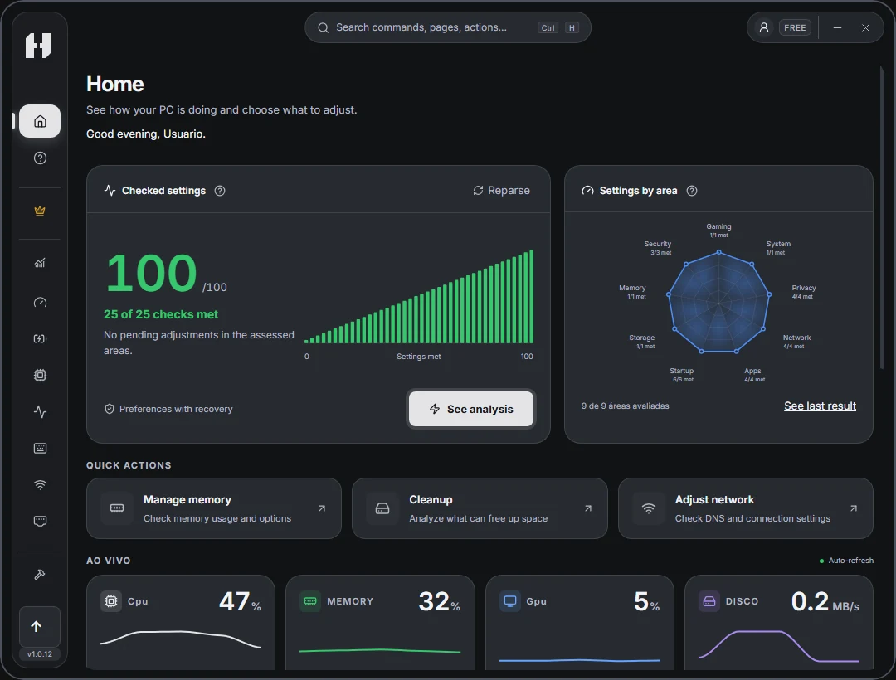
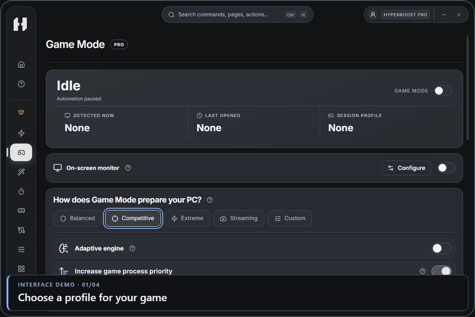

#  HyperBoost

[Português (Brasil)](README.md) · **English** · [Español](README.es.md)

Get your PC ready for gaming, clean up Windows, and monitor performance in one place. Review each change before applying it and use Recovery to undo supported changes.

## Download for Windows

**[Download the official installer (.exe)](https://www.hyperboostapps.com/api/download?redirect=1)**

[](https://github.com/brundevs/HyperBoost/releases/latest)  

[Release notes](https://github.com/brundevs/HyperBoost/releases/latest) · [Official website](https://www.hyperboostapps.com/?lang=en) · [Support](#support)

1. Run the installer. Windows will ask for administrator permission.
2. Open HyperBoost, follow the setup prompts, and wait for confirmation that the restore point was created. If an error appears, follow the app’s guidance before continuing.

HyperBoost checks for updates and keeps your settings and history. Downloads and restarts respect your preferences and any operations in progress. [Update guide in Portuguese](RELEASES.md).

<details>
<summary>Verify the installer with SHA-256 (optional)</summary>

Open PowerShell in your downloads folder and run the command below. Replace `X.Y.Z` with the version in the installer filename.

```powershell
Get-FileHash -Algorithm SHA256 -LiteralPath '.\HyperBoost-Setup-X.Y.Z.exe'
```

Compare the result with the installer’s entry in the `SHA256SUMS.txt` file attached to the [matching release](https://github.com/brundevs/HyperBoost/releases).

</details>

## Home screen



<sub>HyperBoost 1.0.12 · Home screen.</sub>

## Game Mode

**Included with Pro and Founder.** Choose a profile and turn on automatic detection. When a supported game launches, HyperBoost applies your chosen actions. When you exit the game, it restores temporary changes that support recovery.



<sub>HyperBoost 1.0.12 interface demo · 12 seconds · Illustrative session.</sub>

The optional overlay is off by default. When capture is supported for your game, you can use it to track FPS and resource usage. [Learn how to set up Game Mode](https://www.hyperboostapps.com/ferramentas/game-mode?lang=en).

## Free, Pro, and Founder

- **Free** · Cleanup, monitoring, diagnostics, and recovery for supported changes. You can start without an account.
- **Pro** · Everything in Free, plus PC Boost, Game Mode, and advanced tweaks. Monthly, quarterly, or annual subscription.
- **Founder** · Lifetime access to Free and Pro tools with a one-time payment.

Available tweaks depend on Windows, your hardware, and drivers. Cleanup and some removals are irreversible. [Compare plans and check pricing for your region](https://www.hyperboostapps.com/precos?lang=en).

## Tool guides

Browse screenshots and learn when to use each tool. [Português](docs/ferramentas.md) · [English](docs/tools.en.md) · [Español](docs/herramientas.es.md)

## Support

**[Contact official HyperBoost support](https://www.hyperboostapps.com/suporte?lang=en)**

If an error notification appears in the app, select **Report error**. When signed in, you can review the report before sending it. You can also [open a public issue on GitHub](https://github.com/brundevs/HyperBoost/issues/new?template=bug.yml). Include your HyperBoost and Windows versions and remove personal information before posting.

[Getting started](https://www.hyperboostapps.com/como-usar?lang=en) · [Frequently asked questions](https://www.hyperboostapps.com/faq?lang=en)

## Community

[Discord](https://discord.gg/wZn9XebX5B) · [User reviews](https://www.hyperboostapps.com/avaliacoes?lang=en) · [Suggest an improvement](https://github.com/brundevs/HyperBoost/issues/new?template=improvement.yml)

## About this repository

This repository hosts public HyperBoost downloads and documentation. Installers and checksums are available under [Releases](https://github.com/brundevs/HyperBoost/releases). The app’s source code is private.

HyperBoost is proprietary software. Component licenses and attributions are included with the installation.
