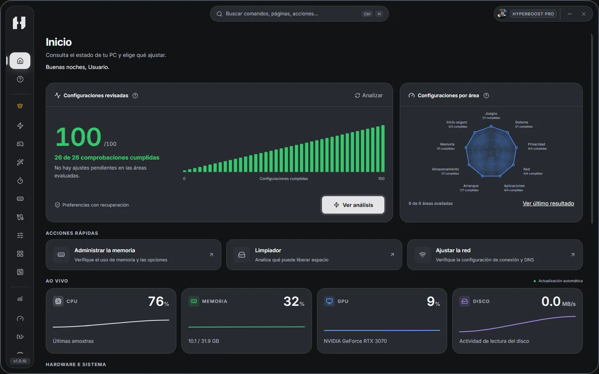
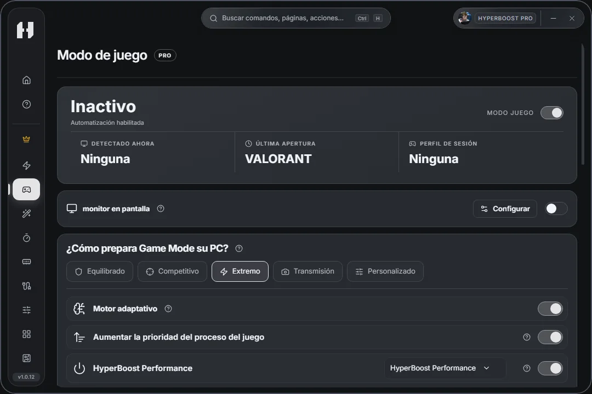

#  HyperBoost

[Português (Brasil)](README.md) · [English](README.en.md) · **Español**

Prepara tu PC para jugar, limpia Windows y supervisa el rendimiento desde un solo lugar. Revisa cada ajuste antes de aplicarlo y usa Recuperación para deshacer los cambios compatibles.

## Descargar para Windows

**[Descargar el instalador oficial (.exe)](https://www.hyperboostapps.com/api/download?redirect=1)**

[](https://github.com/brundevs/HyperBoost/releases/latest)  

[Notas de la versión](https://github.com/brundevs/HyperBoost/releases/latest) · [Sitio oficial](https://www.hyperboostapps.com/?lang=es) · [Soporte](#soporte)

1. Ejecuta el instalador. Windows solicitará permisos de administrador.
2. Abre HyperBoost, sigue la configuración inicial y espera la confirmación de que se creó el punto de restauración. Si aparece un error, sigue las indicaciones de la aplicación antes de continuar.

HyperBoost busca actualizaciones y conserva tu configuración y tu historial. La descarga y el reinicio respetan tus preferencias y las operaciones en curso. [Guía de actualización en portugués](RELEASES.md).

<details>
<summary>Verificar el instalador con SHA-256 (opcional)</summary>

Abre PowerShell en la carpeta de descargas y ejecuta el comando de abajo. Sustituye `X.Y.Z` por la versión que aparece en el nombre del instalador.

```powershell
Get-FileHash -Algorithm SHA256 -LiteralPath '.\HyperBoost-Setup-X.Y.Z.exe'
```

Compara el resultado con la línea del instalador en el archivo `SHA256SUMS.txt` de la [versión correspondiente](https://github.com/brundevs/HyperBoost/releases).

</details>

## Pantalla de inicio



<sub>HyperBoost 1.0.10 · Pantalla de inicio.</sub>

## Modo Juego

**Incluido en Pro y Founder.** Elige un perfil y activa la detección automática. Al abrir un juego compatible, HyperBoost aplica las acciones que elegiste. Al cerrar el juego, restaura los cambios temporales compatibles con la recuperación.



<sub>HyperBoost 1.0.12 · Modo Juego durante una partida de VALORANT.</sub>

El monitor en pantalla es opcional y viene desactivado. Cuando la captura es compatible con el juego, puedes usarlo para ver los FPS y el uso de recursos. [Cómo configurar el Modo Juego](https://www.hyperboostapps.com/ferramentas/modo-juego?lang=es).

## Gratis, Pro y Founder

- **Gratis** · Limpieza, monitorización, diagnóstico y recuperación de cambios compatibles. Puedes empezar sin cuenta.
- **Pro** · Todo lo incluido en Gratis, más PC Boost, Modo Juego y ajustes avanzados. Suscripción mensual, trimestral o anual.
- **Founder** · Acceso de por vida a las herramientas de Gratis y Pro con un pago único.

Los ajustes disponibles dependen de Windows, el hardware y los controladores. La limpieza y algunas eliminaciones son irreversibles. [Compara los planes y consulta los precios de tu región](https://www.hyperboostapps.com/precos?lang=es).

## Guías de herramientas

Consulta las capturas y aprende cuándo usar cada herramienta. [Português](docs/ferramentas.md) · [English](docs/tools.en.md) · [Español](docs/herramientas.es.md)

## Soporte

**[Contactar con el soporte oficial de HyperBoost](https://www.hyperboostapps.com/suporte?lang=es)**

Si aparece una notificación de error en la aplicación, selecciona **Reportar error**. Si has iniciado sesión, puedes revisar el informe antes de enviarlo. También puedes [abrir una incidencia pública en GitHub](https://github.com/brundevs/HyperBoost/issues/new?template=bug.yml). Indica las versiones de HyperBoost y Windows y elimina los datos personales antes de publicar.

[Guía de inicio](https://www.hyperboostapps.com/como-usar?lang=es) · [Preguntas frecuentes](https://www.hyperboostapps.com/faq?lang=es)

## Comunidad

[Discord](https://discord.gg/wZn9XebX5B) · [Opiniones de usuarios](https://www.hyperboostapps.com/avaliacoes?lang=es) · [Sugerir una mejora](https://github.com/brundevs/HyperBoost/issues/new?template=improvement.yml)

## Acerca de este repositorio

Este repositorio reúne las descargas públicas y la documentación de HyperBoost. Los instaladores y las sumas de verificación están disponibles en [Releases](https://github.com/brundevs/HyperBoost/releases). El código fuente de la aplicación es privado.

HyperBoost es software propietario. Las licencias y atribuciones de los componentes se incluyen con la instalación.
