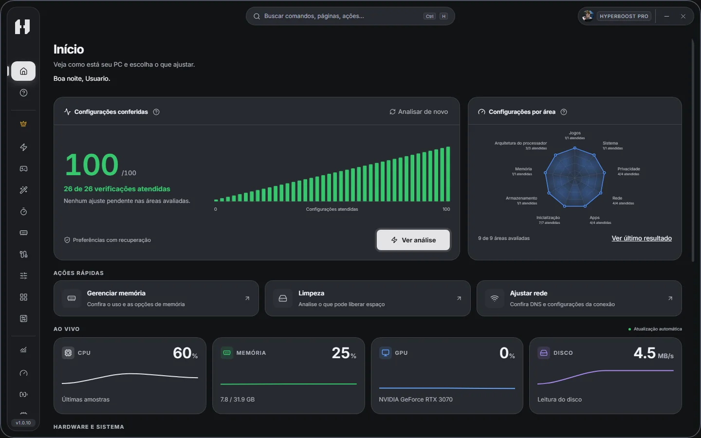
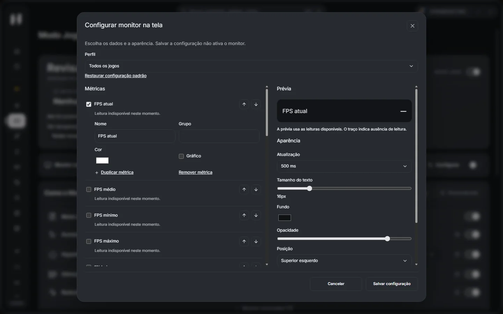

  
  

    
    
  

  
<strong>Prepare seu PC para jogar. Acompanhe o sistema e escolha o que ajustar.</strong>

  

    <a href="https://github.com/brundevs/HyperBoost/releases/latest"><strong>Baixar para Windows</strong></a> &nbsp;·&nbsp;
    <a href="https://www.hyperboostapps.com">Site oficial</a> &nbsp;·&nbsp;
    <a href="https://www.hyperboostapps.com/precos?lang=pt">Planos</a> &nbsp;·&nbsp;
    <a href="https://discord.gg/wZn9XebX5B">Discord</a>
  

## Seu PC em um só lugar

O HyperBoost reúne ferramentas para otimizar, limpar e acompanhar o Windows 10 e 11. Comece pelas ferramentas gratuitas ou use os perfis e ajustes do **HyperBoost Pro** para preparar suas partidas.

HyperBoost 1.0.10 · Captura real do aplicativo.

[Conheça todas as ferramentas, com imagens e explicações](docs/ferramentas.md).

[Português](docs/ferramentas.md) · [English](docs/tools.en.md) · [Español](docs/herramientas.es.md)

## O que você encontra no aplicativo

| Área | O que você pode fazer |
| --- | --- |
| **PC Boost** | Escolher um perfil, analisar o computador e revisar os ajustes antes de aplicar. |
| **Modo Jogo** | Detectar partidas, organizar a biblioteca e aplicar as ações escolhidas durante a sessão. |
| **Apps e Latência** | Revisar ajustes de aplicativos e configurações de mouse, CPU, GPU e rede, conforme a compatibilidade do PC. |
| **Memória e Rede** | Acompanhar o uso de memória, configurar a limpeza automática e conferir sua conexão e seus servidores DNS. |
| **Hardware e BIOS** | Consultar os componentes, sensores e informações que o computador disponibiliza. |
| **Limpeza e programas** | Liberar espaço, gerenciar a inicialização e instalar, atualizar ou remover aplicativos. |
| **Atividade e Recuperação** | Conferir os resultados das operações e restaurar ajustes que oferecem recuperação. |

A disponibilidade de cada ajuste depende do Windows, do hardware e dos drivers. O aplicativo apresenta as opções compatíveis e confirma o resultado das alterações. Limpezas e algumas remoções não podem ser desfeitas.

<strong>Veja o Modo Jogo</strong>

HyperBoost 1.0.10 · Captura real do aplicativo.

## Baixar e começar

1. Abra a [última versão estável](https://github.com/brundevs/HyperBoost/releases/latest) e baixe o arquivo **HyperBoost-Setup** com extensão **.exe**.
2. Execute o instalador e conclua a instalação. O Windows solicitará a autorização de administrador.
3. Abra o HyperBoost e siga a introdução para preparar o aplicativo e revisar suas preferências.

O [site oficial](https://www.hyperboostapps.com) também oferece o instalador mais recente. Para acompanhar as correções, consulte as [notas de cada versão](https://github.com/brundevs/HyperBoost/releases).

O aplicativo verifica atualizações e mantém suas configurações e seu histórico. Download e reinício respeitam suas preferências e as operações em andamento. [Saiba como atualizar](RELEASES.md).

## Gratuito, Pro e Founder

- **Gratuito:** ferramentas para limpeza, diagnóstico e manutenção do Windows. Você pode começar sem conta.
- **Pro:** acesso às ferramentas Pro por assinatura, usando sua conta HyperBoost.
- **Founder:** acesso vitalício aos recursos incluídos nesse plano, conforme disponibilidade no site.

[Compare os recursos e consulte os preços da sua região](https://www.hyperboostapps.com/precos?lang=pt). Entre com Google ou Discord para acessar sua conta e gerenciar seu plano.

## Ajuda e comunidade

- [Perguntas frequentes](https://www.hyperboostapps.com/faq?lang=pt)
- [Guia para começar](https://www.hyperboostapps.com/como-usar?lang=pt)
- [Suporte oficial](https://www.hyperboostapps.com/suporte?lang=pt)
- [Comunidade no Discord](https://discord.gg/wZn9XebX5B)
- [Avaliações de usuários](https://www.hyperboostapps.com/avaliacoes?lang=pt)
- [Sugerir uma melhoria](https://github.com/brundevs/HyperBoost/issues/new?template=improvement.yml)

Para uma falha no aplicativo, use **Reportar erro** na notificação: contas grátis e Pro conectadas podem revisar o relato antes de enviá-lo ao suporte. Você também pode [abrir um problema público](https://github.com/brundevs/HyperBoost/issues/new?template=bug.yml) neste repositório. Informe as versões do HyperBoost e do Windows e não publique senhas, tokens ou dados pessoais.

## Sobre este repositório

Este é o canal público de distribuição e documentação do HyperBoost. Os instaladores e arquivos de verificação estão em [Releases](https://github.com/brundevs/HyperBoost/releases); o código-fonte do aplicativo é privado.

HyperBoost é um software proprietário. As licenças e atribuições dos componentes utilizados acompanham a instalação.
