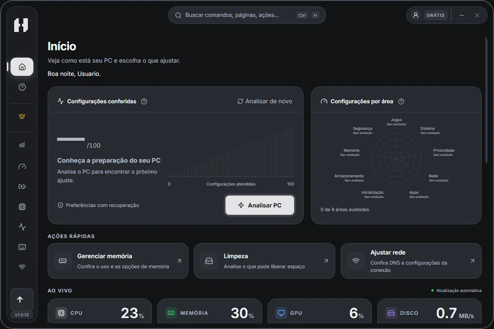
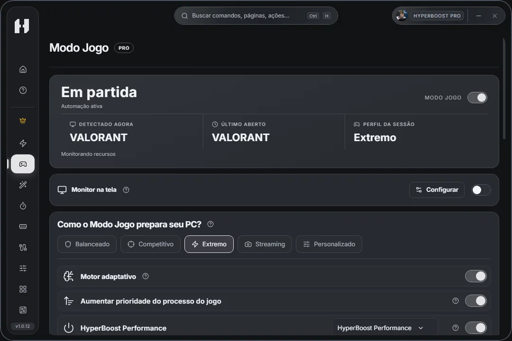

#  HyperBoost

Otimize seu PC para jogar, limpe o Windows e acompanhe o desempenho em um só lugar. Revise cada ajuste antes de aplicar e use a Recuperação para desfazer alterações compatíveis.

## Baixar para Windows

**[Baixar o instalador oficial (.exe)](https://www.hyperboostapps.com/api/download?redirect=1)**

[](https://github.com/brundevs/HyperBoost/releases/latest)  

[Notas da versão](https://github.com/brundevs/HyperBoost/releases/latest) · [Site oficial](https://www.hyperboostapps.com) · [Suporte](#suporte)

1. Execute o instalador. O Windows solicitará permissão de administrador.
2. Abra o HyperBoost, siga a introdução e aguarde a confirmação do ponto de restauração. Se aparecer um erro, confira a orientação do aplicativo antes de continuar.

O aplicativo verifica atualizações e preserva suas configurações e seu histórico. O download e o reinício respeitam suas preferências e as operações em andamento. [Como atualizar](RELEASES.md).

<details>
<summary>Verificar o instalador com SHA-256 (opcional)</summary>

Na pasta do download, abra o PowerShell e execute o comando abaixo. Troque `X.Y.Z` pela versão no nome do arquivo que você baixou.

```powershell
Get-FileHash -Algorithm SHA256 -LiteralPath '.\HyperBoost-Setup-X.Y.Z.exe'
```

Compare o resultado com a linha desse instalador no arquivo `SHA256SUMS.txt` publicado na [release da mesma versão](https://github.com/brundevs/HyperBoost/releases).

</details>

## Tela inicial



<sub>HyperBoost 1.0.12 · Tela inicial do aplicativo.</sub>

## Modo Jogo

**Incluído no Pro e no Founder.** Escolha um perfil e ative a detecção automática. Ao abrir um jogo compatível, o HyperBoost aplica as ações que você escolheu para a partida. Ao encerrar o jogo, ele restaura as ações temporárias que oferecem recuperação.



<sub>HyperBoost 1.0.12 · Tela principal do Modo Jogo.</sub>

O monitor é opcional e começa desligado. Quando a captura é compatível com o jogo, ele permite acompanhar FPS e uso de recursos. [Veja como configurar o Modo Jogo](https://www.hyperboostapps.com/ferramentas/modo-jogo?lang=pt).

## Gratuito, Pro e Founder

- **Gratuito** · Limpeza, monitoramento, diagnóstico e recuperação de ajustes compatíveis. Você pode começar sem conta.
- **Pro** · Tudo do Gratuito, mais PC Boost, Modo Jogo e ajustes avançados. Assinatura mensal, trimestral ou anual.
- **Founder** · Ferramentas do Gratuito e do Pro com acesso vitalício, em pagamento único.

A disponibilidade dos ajustes depende do Windows, do hardware e dos drivers. Limpezas e algumas remoções são irreversíveis. [Compare os planos e consulte os preços da sua região](https://www.hyperboostapps.com/precos?lang=pt).

## Guias das ferramentas

Veja as capturas e saiba quando usar cada recurso. [Português](docs/ferramentas.md) · [English](docs/tools.en.md) · [Español](docs/herramientas.es.md)

## Suporte

**[Acessar o suporte oficial do HyperBoost](https://www.hyperboostapps.com/suporte?lang=pt)**

Se aparecer uma falha no aplicativo, use **Reportar erro** na notificação. Com uma conta conectada, você pode revisar o relato antes de enviá-lo. Também é possível [reportar um problema público no GitHub](https://github.com/brundevs/HyperBoost/issues/new?template=bug.yml). Informe as versões do HyperBoost e do Windows e remova dados pessoais antes de publicar.

[Guia para começar](https://www.hyperboostapps.com/como-usar?lang=pt) · [Perguntas frequentes](https://www.hyperboostapps.com/faq?lang=pt)

## Comunidade

[Discord](https://discord.gg/wZn9XebX5B) · [Avaliações de usuários](https://www.hyperboostapps.com/avaliacoes?lang=pt) · [Sugerir uma melhoria](https://github.com/brundevs/HyperBoost/issues/new?template=improvement.yml)

## Sobre este repositório

Este é o canal público de distribuição e documentação do HyperBoost. Os instaladores e arquivos de verificação estão em [Releases](https://github.com/brundevs/HyperBoost/releases); o código-fonte do aplicativo é privado.

HyperBoost é um software proprietário. As licenças e atribuições dos componentes utilizados acompanham a instalação.
