# Ferramentas do HyperBoost

[Português](ferramentas.md) · [English](tools.en.md) · [Español](herramientas.es.md)

Capturas reais do HyperBoost 1.0.10 e 1.0.12. A disponibilidade depende do hardware, dos drivers e do Windows. Identificadores da conta estão ocultos; a foto foi incluída com autorização.

[Explorar todas as ferramentas](https://www.hyperboostapps.com/ferramentas?lang=pt)

## Pro

<strong>PC Boost</strong> · Pro

Prepare o PC para seu objetivo sem procurar ajustes em vários menus. O PC Boost reúne as recomendações para você escolher o que aplicar.

**Quando usar:** Antes de preparar o computador para um jogo ou de revisar os ajustes que combinam com sua rotina.

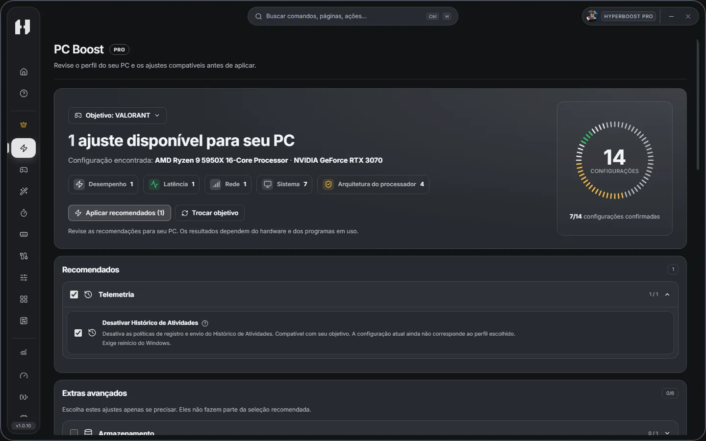

[Ver o guia e as perguntas](https://www.hyperboostapps.com/ferramentas/pc-boost?lang=pt)

<strong>Modo Jogo</strong> · Pro

O Modo Jogo detecta jogos compatíveis e aplica o perfil escolhido ao iniciar a partida. O monitor é opcional e acompanha FPS e uso de recursos quando há captura.

**Quando usar:** Quando quiser preparar o PC automaticamente ao abrir o jogo e acompanhar o comportamento da sessão.

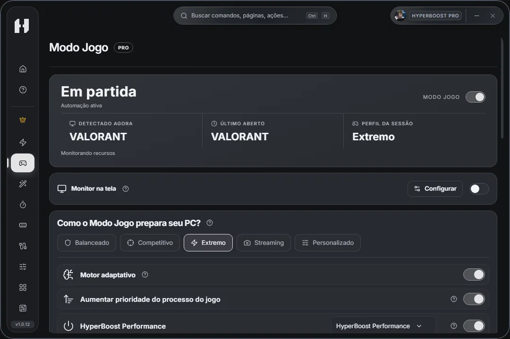

HyperBoost 1.0.12 · Tela principal do Modo Jogo.

[Ver o guia e as perguntas](https://www.hyperboostapps.com/ferramentas/modo-jogo?lang=pt)

<strong>Apps</strong> · Pro

Ajuste programas como Discord e navegadores em um só lugar. Encontre as opções disponíveis sem procurar em vários menus.

**Quando usar:** Quando quiser revisar o comportamento dos programas que usa junto com seus jogos ou no dia a dia.

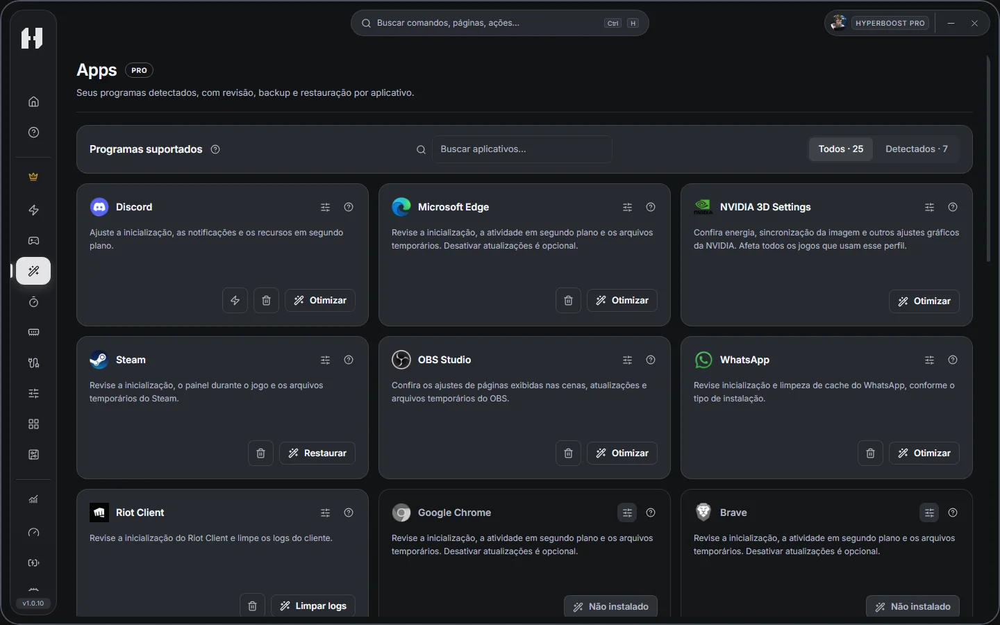

[Ver o guia e as perguntas](https://www.hyperboostapps.com/ferramentas/apps?lang=pt)

<strong>Latência</strong> · Pro

Reúna as opções de mouse, vídeo e conexão que quer revisar para jogar. Entenda cada ajuste e escolha o que combina com seu PC.

**Quando usar:** Quando quiser conferir ajustes ligados à resposta dos comandos sem se perder nas configurações do Windows.

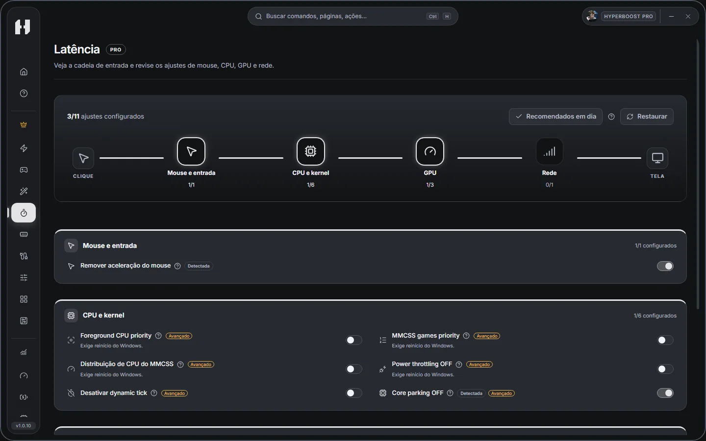

[Ver o guia e as perguntas](https://www.hyperboostapps.com/ferramentas/latencia?lang=pt)

<strong>Memória</strong> · Pro

Veja quanto da memória seus programas estão usando e configure quando fazer a limpeza. Cuide da RAM sem repetir a mesma tarefa manualmente.

**Quando usar:** Quando muitos programas estiverem abertos ou você quiser organizar uma rotina de limpeza da memória.

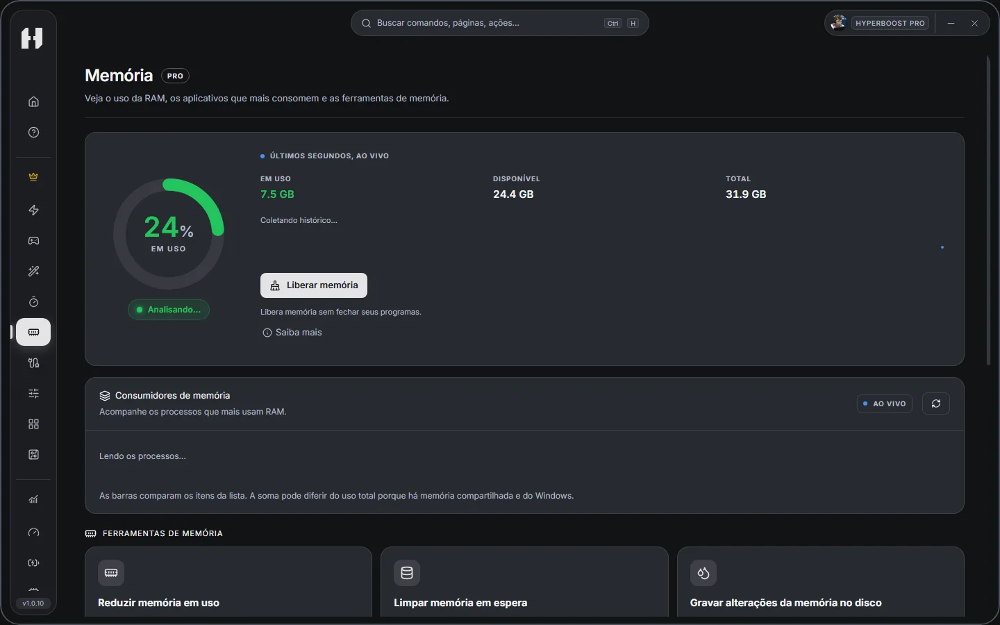

[Ver o guia e as perguntas](https://www.hyperboostapps.com/ferramentas/memoria?lang=pt)

<strong>Rede</strong> · Pro

Compare as opções de DNS na sua conexão e reúna os ajustes de rede em um só lugar. Escolha com base nos resultados do seu PC.

**Quando usar:** Quando quiser comparar as opções de conexão disponíveis e escolher qual usar no computador.

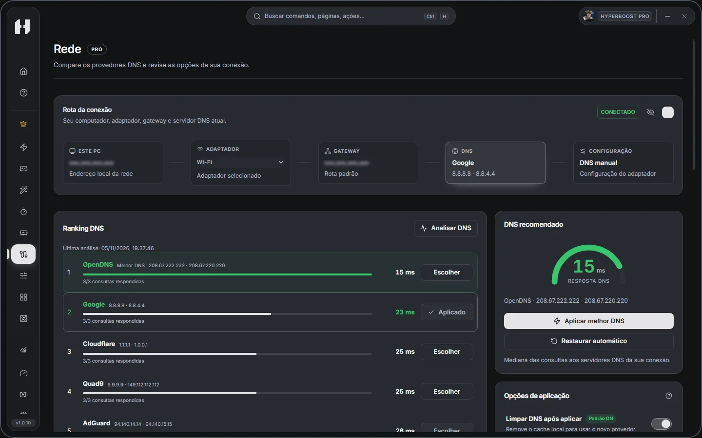

[Ver o guia e as perguntas](https://www.hyperboostapps.com/ferramentas/rede?lang=pt)

<strong>Tweaks</strong> · Pro

Deixe o Windows mais próximo do seu jeito de usar. Encontre ajustes organizados por categoria, com explicações para decidir o que mudar.

**Quando usar:** Quando quiser personalizar o Windows além das opções mais comuns, entendendo o efeito de cada escolha.

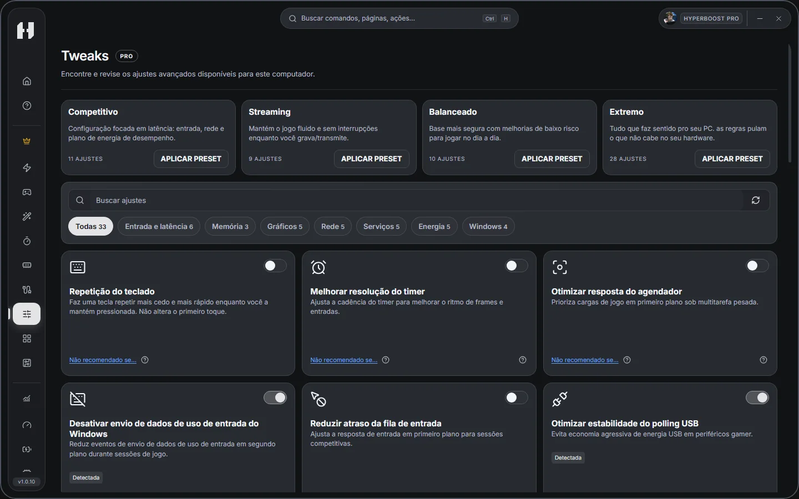

[Ver o guia e as perguntas](https://www.hyperboostapps.com/ferramentas/tweaks?lang=pt)

<strong>Windows</strong> · Pro

Organize os recursos e preferências do Windows sem visitar vários painéis. Escolha o que deseja manter na sua rotina.

**Quando usar:** Ao configurar um PC novo ou adaptar o Windows ao seu trabalho, estudo e jogos.

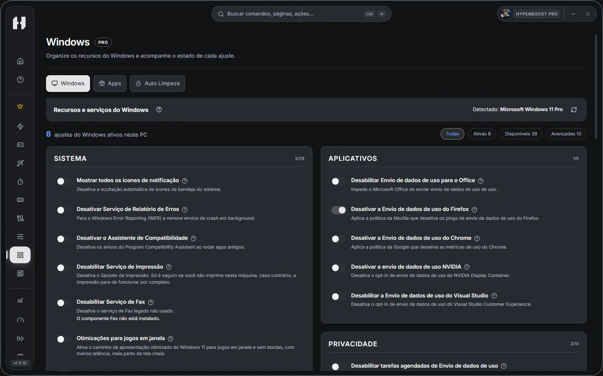

[Ver o guia e as perguntas](https://www.hyperboostapps.com/ferramentas/windows?lang=pt)

<strong>Hardware e BIOS</strong> · Pro

Conheça os detalhes do seu hardware e veja os resultados que o HyperBoost consegue confirmar. Consulte tudo sem entrar na BIOS nem alterar suas configurações.

**Quando usar:** Antes de pedir suporte, planejar uma troca de peças ou conferir a configuração do computador.

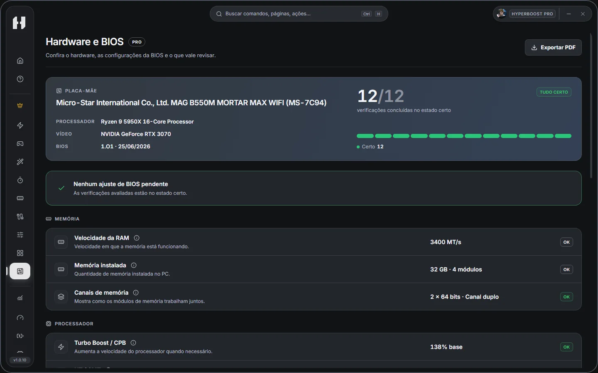

[Ver o guia e as perguntas](https://www.hyperboostapps.com/ferramentas/hardware-e-bios?lang=pt)

## Desempenho

<strong>Otimização</strong> · Grátis

Escolha o que quer organizar no PC e vá direto à ferramenta certa. Encontre atalhos para energia, inicialização, privacidade e outras tarefas.

**Quando usar:** Quando souber o que quer fazer no computador, mas ainda não souber qual ferramenta abrir.

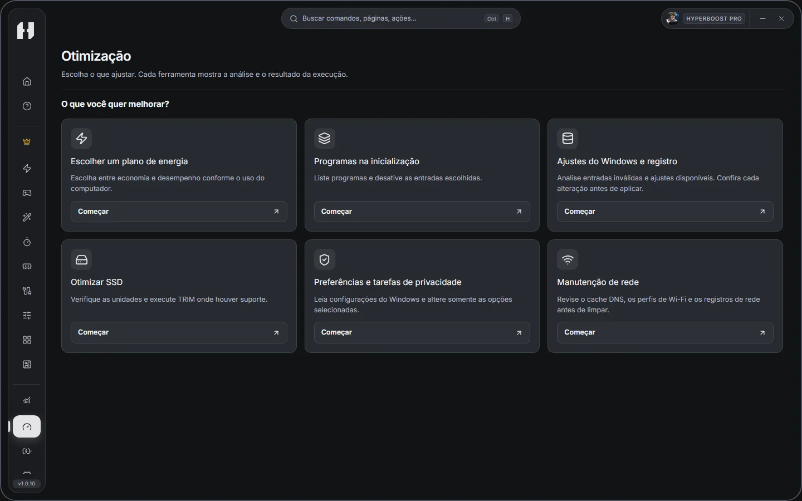

[Ver o guia e as perguntas](https://www.hyperboostapps.com/ferramentas/otimizacao?lang=pt)

<strong>Planos de energia</strong> · Grátis

Escolha como seu PC usa energia para trabalhar ou jogar. Troque entre os planos disponíveis e volte ao anterior quando sua rotina mudar.

**Quando usar:** Ao alternar entre jogos, trabalho e uso na bateria, conforme os planos disponíveis no computador.

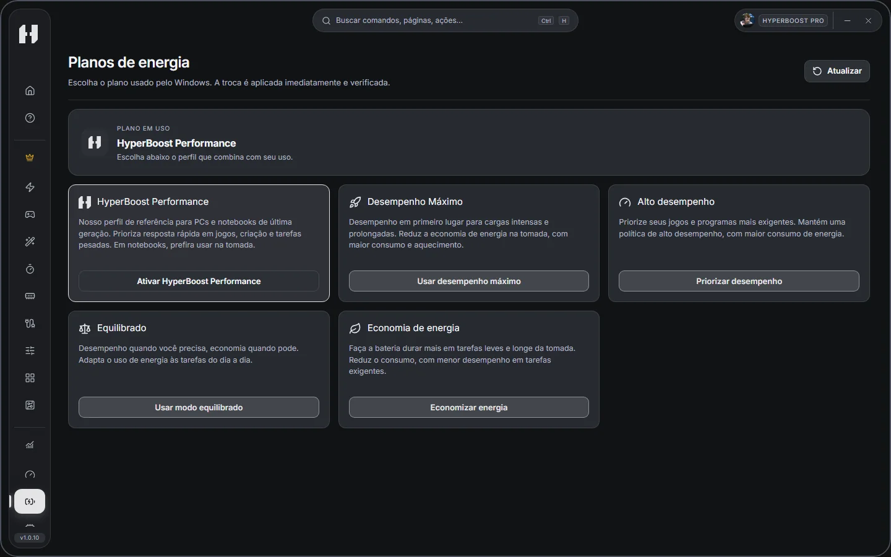

[Ver o guia e as perguntas](https://www.hyperboostapps.com/ferramentas/planos-de-energia?lang=pt)

<strong>Meu computador</strong> · Grátis

Saiba quais peças estão no seu PC sem precisar abrir o gabinete. Consulte processador, placa de vídeo, memória e discos para planejar seus próximos passos.

**Quando usar:** Antes de comprar uma peça, instalar um jogo ou informar sua configuração ao suporte.

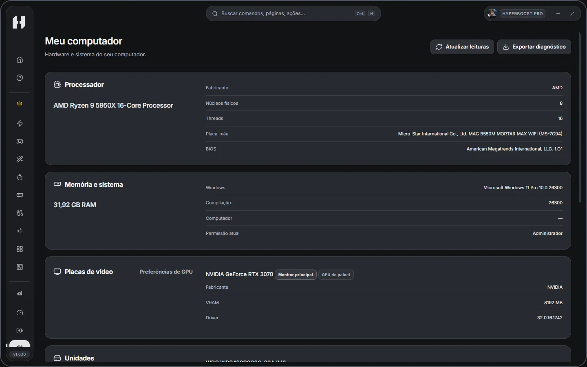

[Ver o guia e as perguntas](https://www.hyperboostapps.com/ferramentas/meu-computador?lang=pt)

<strong>Monitoramento</strong> · Grátis

Veja o que está exigindo do seu PC enquanto você usa. Acompanhe os gráficos e encontre os programas que mais consomem recursos.

**Quando usar:** Quando o PC parecer ocupado, um programa estiver lento ou você quiser acompanhar o uso durante uma tarefa.

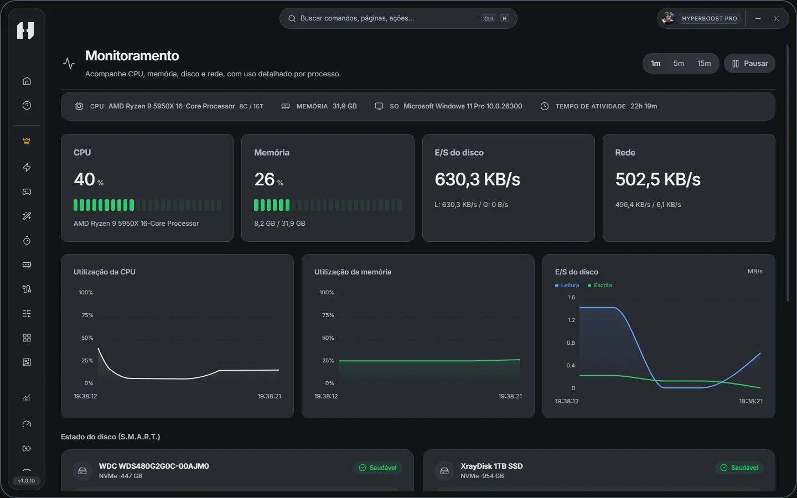

[Ver o guia e as perguntas](https://www.hyperboostapps.com/ferramentas/monitoramento?lang=pt)

<strong>Testes de periféricos</strong> · Grátis

Teste seus acessórios antes de trocar uma peça ou começar uma chamada. Confira teclado, mouse, controle, áudio, câmera e tela no mesmo lugar.

**Quando usar:** Ao conectar um acessório novo, investigar uma falha ou preparar uma chamada e uma partida.

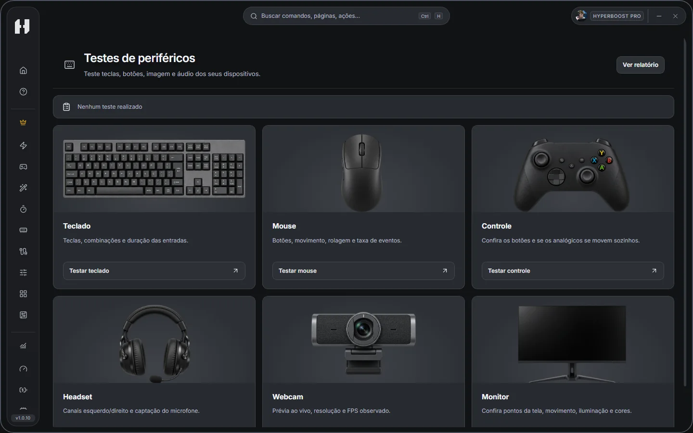

[Ver o guia e as perguntas](https://www.hyperboostapps.com/ferramentas/testes-de-perifericos?lang=pt)

<strong>Teste de internet</strong> · Grátis

Confira sua conexão sem sair do HyperBoost. Use as medições para entender uma lentidão e comparar o comportamento da internet em diferentes momentos.

**Quando usar:** Quando a navegação, uma chamada ou um jogo apresentar lentidão e você quiser conferir a conexão.

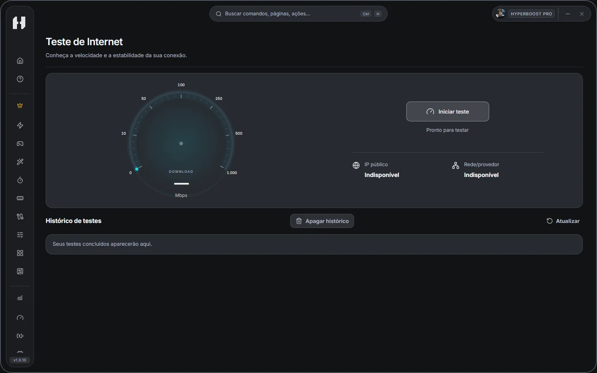

[Ver o guia e as perguntas](https://www.hyperboostapps.com/ferramentas/teste-de-internet?lang=pt)

<strong>Manutenção de rede</strong> · Grátis

Encontre as ferramentas para cuidar da conexão quando ela apresentar problemas. Reúna a limpeza de dados de rede e a organização das redes salvas.

**Quando usar:** Quando precisar investigar uma conexão com problemas ou organizar redes que não utiliza mais.

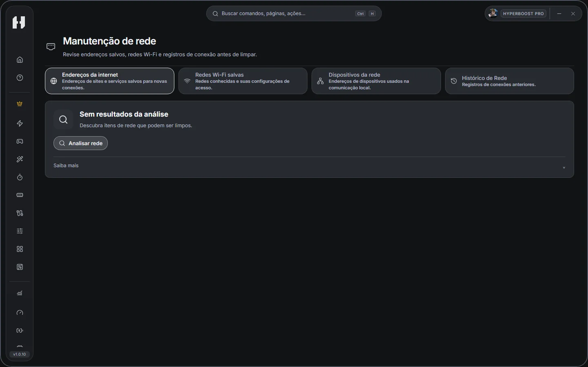

[Ver o guia e as perguntas](https://www.hyperboostapps.com/ferramentas/manutencao-de-rede?lang=pt)

<strong>Teste de teclado</strong> · Grátis

Uma tecla não responde como deveria? Veja quais teclas o computador reconhece antes de decidir trocar o teclado.

**Quando usar:** Ao testar um teclado novo ou investigar uma tecla que falha.

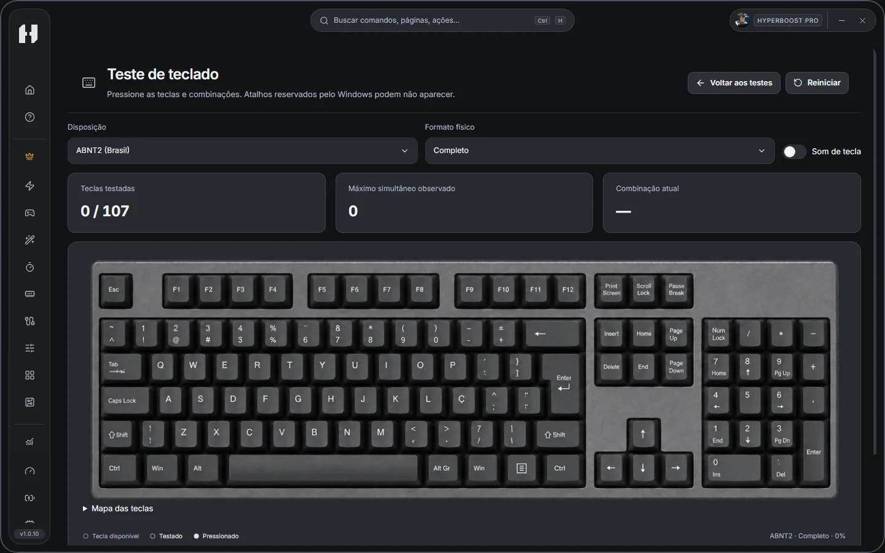

[Ver o guia e as perguntas](https://www.hyperboostapps.com/ferramentas?lang=pt&ferramenta=keyboard)

<strong>Teste de mouse</strong> · Grátis

Confira os cliques e movimentos do seu mouse em um teste guiado. Investigue um comportamento estranho antes de trocar o acessório.

**Quando usar:** Quando um botão ou movimento do mouse parecer diferente do esperado.

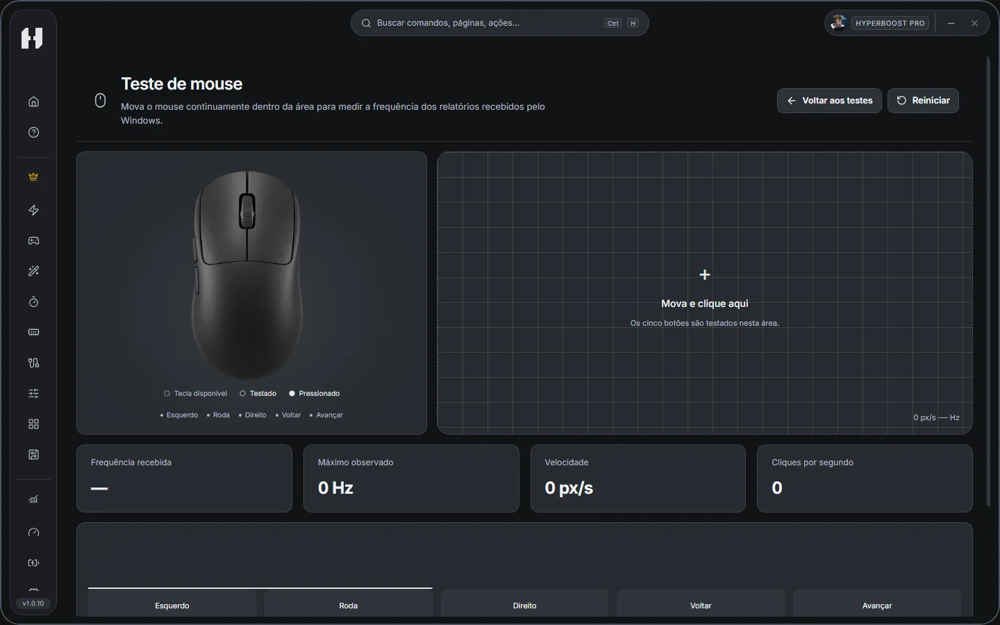

[Ver o guia e as perguntas](https://www.hyperboostapps.com/ferramentas?lang=pt&ferramenta=mouse)

<strong>Teste de controle</strong> · Grátis

Prepare o controle para jogar. Confira se os comandos do dispositivo conectado estão sendo reconhecidos pelo PC.

**Quando usar:** Ao conectar um controle ou investigar um comando que não responde como deveria.

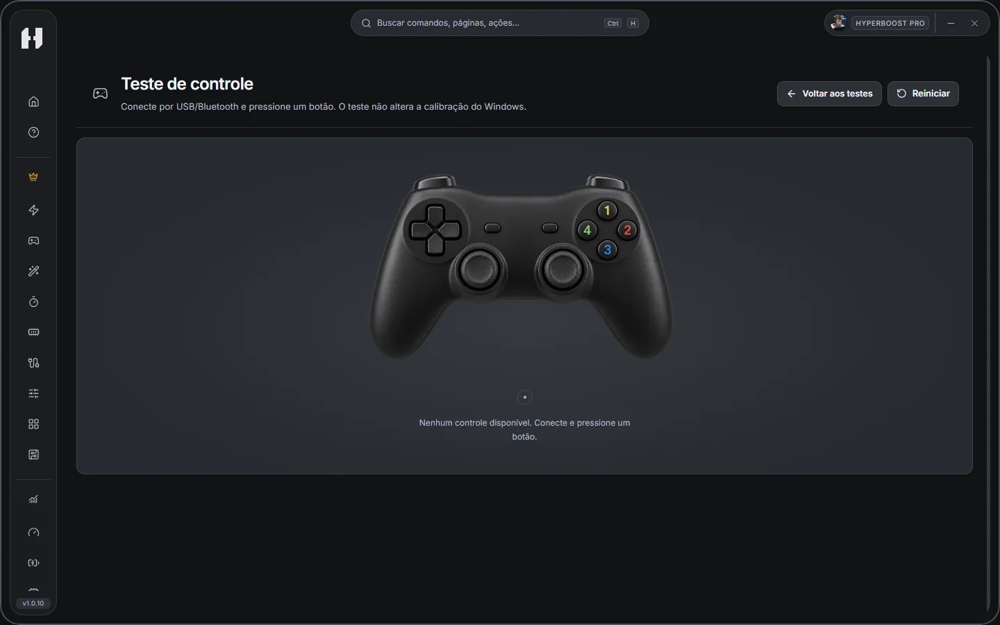

[Ver o guia e as perguntas](https://www.hyperboostapps.com/ferramentas?lang=pt&ferramenta=controller)

<strong>Teste de áudio</strong> · Grátis

Teste o áudio e o microfone antes da chamada ou da partida. Confira os dispositivos disponíveis e faça os testes de som no HyperBoost.

**Quando usar:** Antes de uma chamada, transmissão ou partida com conversa por voz.

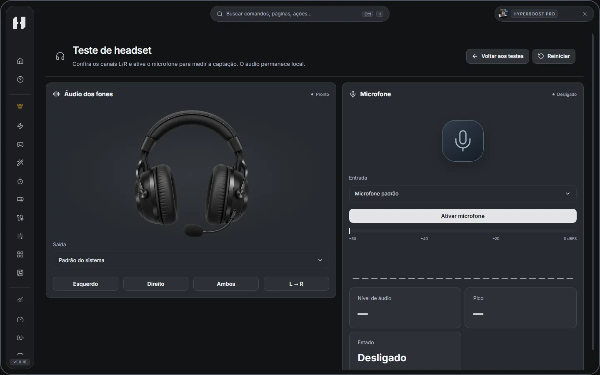

[Ver o guia e as perguntas](https://www.hyperboostapps.com/ferramentas?lang=pt&ferramenta=headset)

<strong>Teste de câmera</strong> · Grátis

Confira a imagem da câmera antes de entrar na reunião ou começar uma transmissão. A prévia só começa quando você inicia e permite o acesso.

**Quando usar:** Antes de uma reunião ou ao conferir uma câmera recém-conectada.

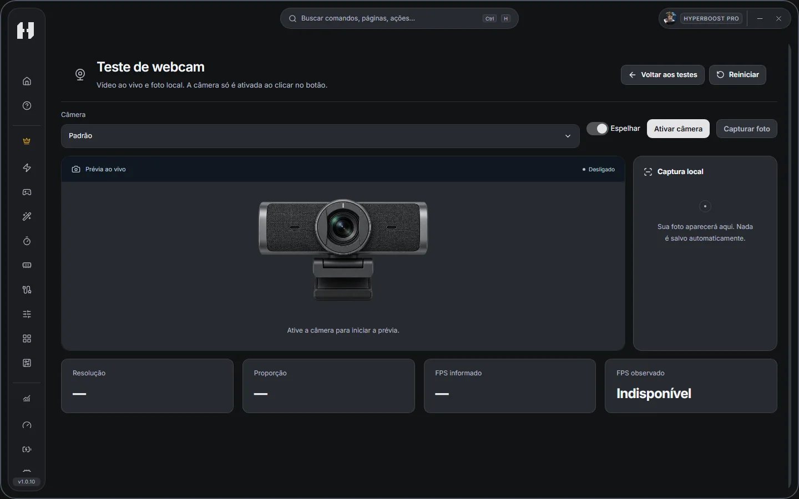

[Ver o guia e as perguntas](https://www.hyperboostapps.com/ferramentas?lang=pt&ferramenta=webcam)

<strong>Teste de monitor</strong> · Grátis

Confira sua tela com padrões visuais de teste. Observe as cores e procure pontos ou diferenças visíveis no monitor.

**Quando usar:** Ao testar um monitor novo ou observar algo diferente nas cores e na imagem.

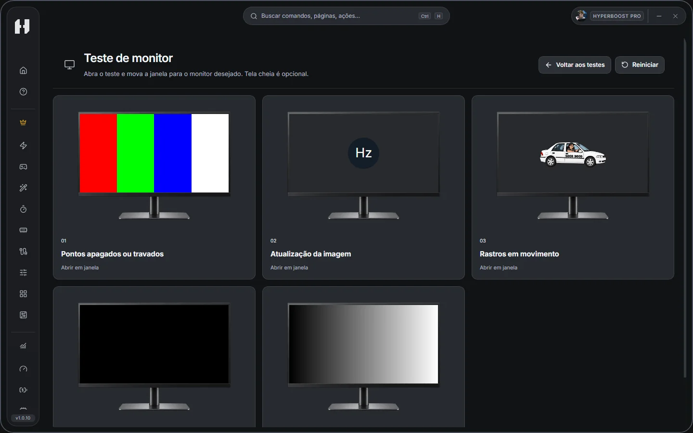

[Ver o guia e as perguntas](https://www.hyperboostapps.com/ferramentas?lang=pt&ferramenta=display)

<strong>Resultado dos periféricos</strong> · Grátis

Veja em um só lugar o resultado dos testes que você realizou. Consulte quais acessórios foram testados e o que ainda falta conferir.

**Quando usar:** Depois de testar seus acessórios e querer consultar os resultados juntos.

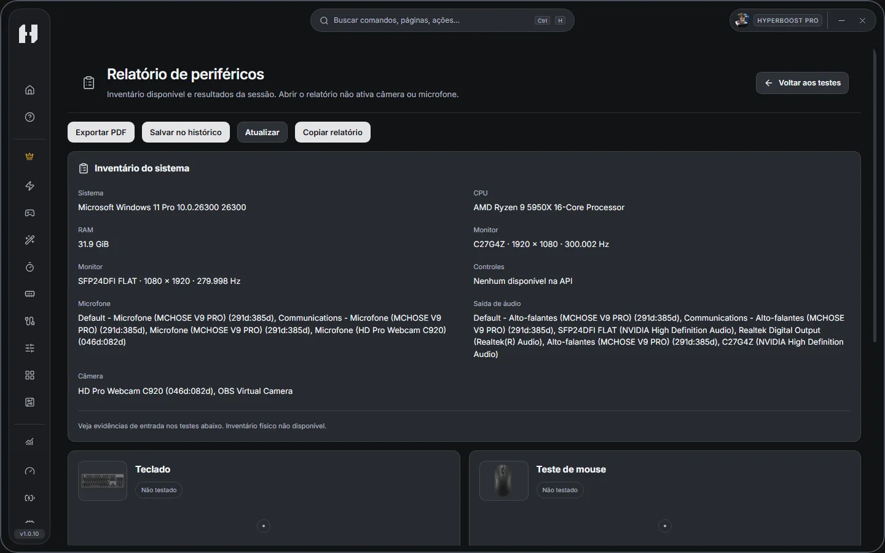

[Ver o guia e as perguntas](https://www.hyperboostapps.com/ferramentas?lang=pt&ferramenta=peripheral-report)

## Manutenção

<strong>Limpeza</strong> · Grátis

Abra espaço para o que importa. Encontre arquivos desnecessários e escolha o que remover antes de iniciar a limpeza.

**Quando usar:** Quando o disco estiver ficando cheio ou você quiser organizar os arquivos que se acumulam no uso diário.

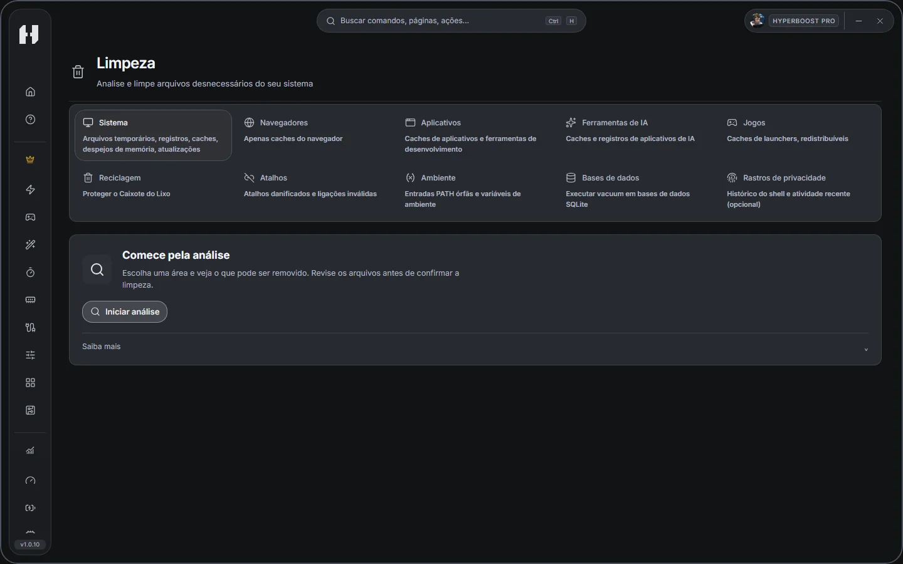

[Ver o guia e as perguntas](https://www.hyperboostapps.com/ferramentas/limpeza?lang=pt)

<strong>Inicialização</strong> · Grátis

Escolha quais programas precisam abrir junto com o Windows. Deixe na inicialização apenas o que faz sentido para seu dia a dia.

**Quando usar:** Quando muitos programas abrirem ao ligar o PC ou você quiser rever o que inicia automaticamente.

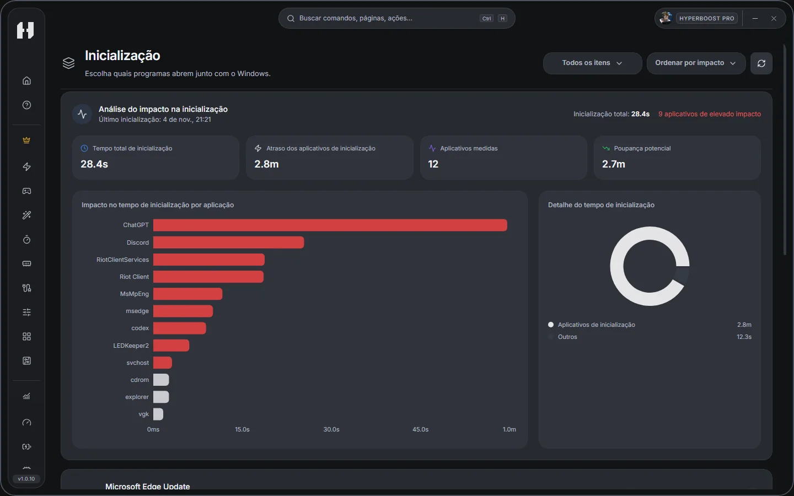

[Ver o guia e as perguntas](https://www.hyperboostapps.com/ferramentas/inicializacao?lang=pt)

<strong>Scanner de disco</strong> · Grátis

Descubra onde foi parar o espaço do seu disco. Veja quais arquivos e pastas mais ocupam espaço antes de decidir o que organizar.

**Quando usar:** Quando o disco estiver cheio e você ainda não souber quais pastas ou arquivos estão ocupando espaço.

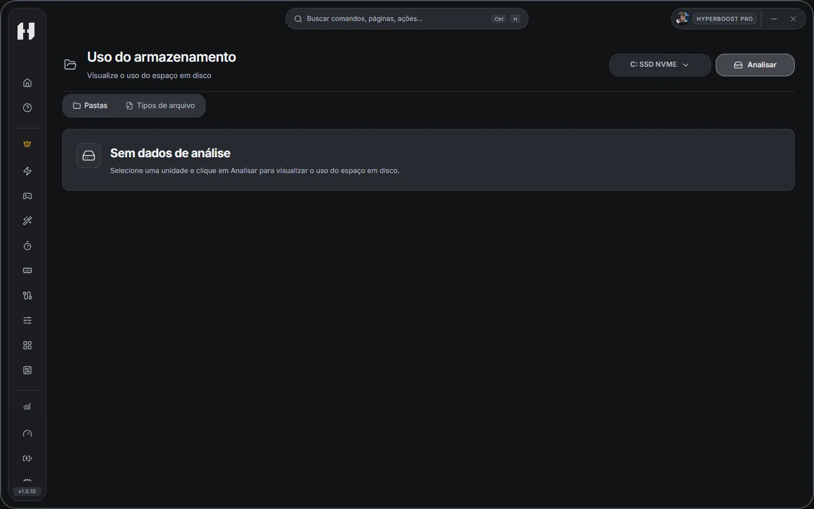

[Ver o guia e as perguntas](https://www.hyperboostapps.com/ferramentas/scanner-de-disco?lang=pt)

<strong>Armazenamento</strong> · Grátis

Encontre o caminho certo para organizar o armazenamento. Acesse as ferramentas de espaço, arquivos duplicados e manutenção sem procurar pelo aplicativo inteiro.

**Quando usar:** Quando precisar liberar ou organizar espaço e quiser escolher a ferramenta adequada para começar.

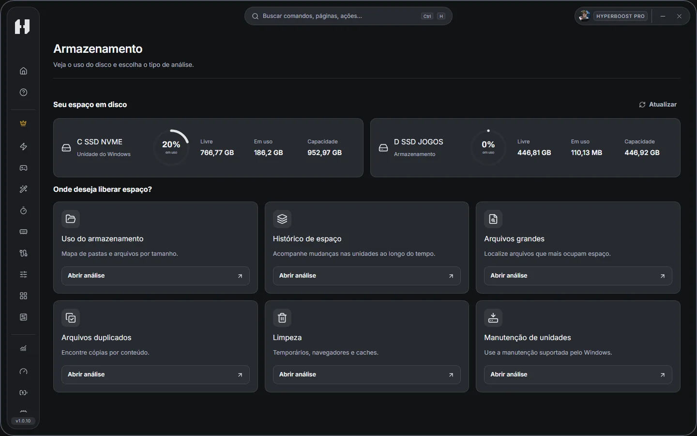

[Ver o guia e as perguntas](https://www.hyperboostapps.com/ferramentas/armazenamento?lang=pt)

<strong>Histórico de armazenamento</strong> · Grátis

Entenda o que mudou nas suas pastas entre uma análise e outra. Compare registros para investigar de onde veio o aumento no espaço ocupado.

**Quando usar:** Quando uma pasta estiver crescendo e você quiser comparar seu conteúdo em momentos diferentes.

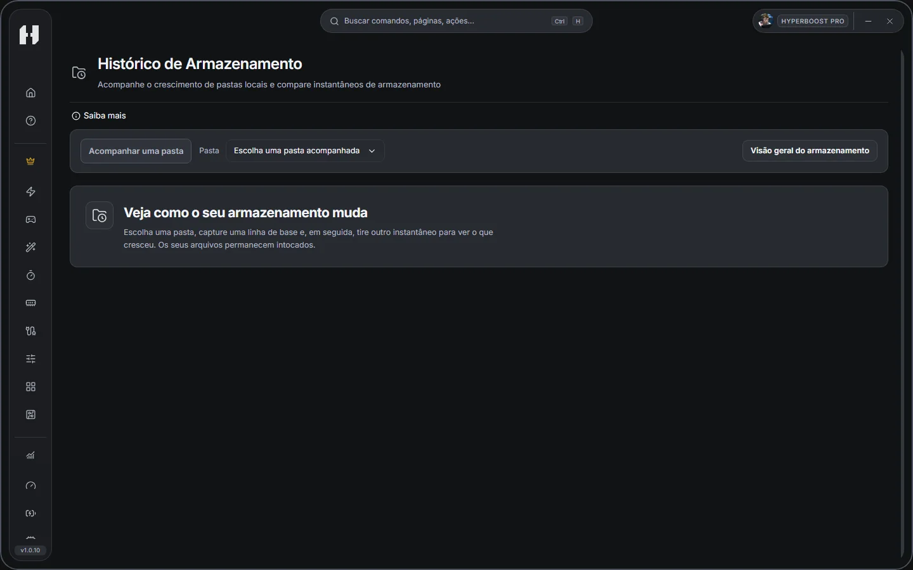

[Ver o guia e as perguntas](https://www.hyperboostapps.com/ferramentas/historico-de-armazenamento?lang=pt)

<strong>Ferramentas</strong> · Grátis

Tenha os utilitários do dia a dia à mão. Encontre atalhos para cuidar do Windows, conferir o PC e trabalhar com arquivos.

**Quando usar:** Quando precisar de uma ferramenta do Windows ou de um utilitário sem procurar em vários lugares.

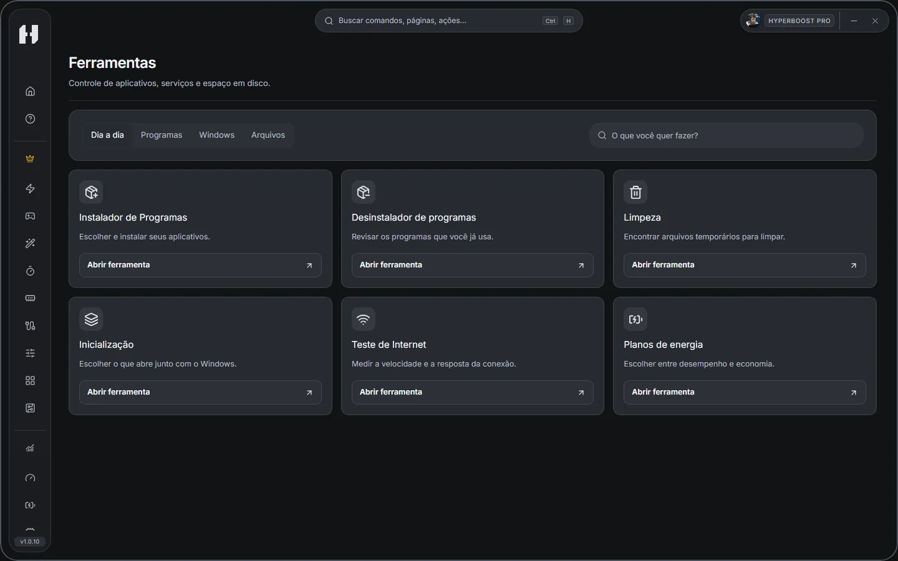

[Ver o guia e as perguntas](https://www.hyperboostapps.com/ferramentas/ferramentas?lang=pt)

<strong>Agendamentos</strong> · Grátis

Deixe as tarefas disponíveis seguirem sua rotina. Escolha quando executar, ajuste a frequência e acompanhe o que foi feito.

**Quando usar:** Quando quiser repetir uma tarefa disponível sem lembrar de iniciá-la manualmente toda vez.

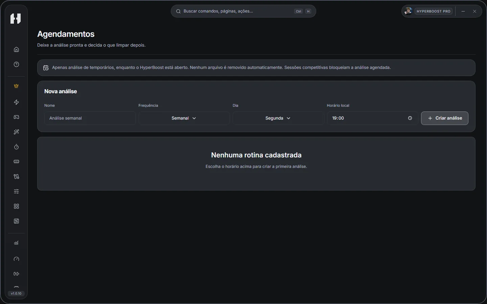

[Ver o guia e as perguntas](https://www.hyperboostapps.com/ferramentas/agendamentos?lang=pt)

<strong>Registro e ajustes</strong> · Grátis

Reúna a análise e a revisão de entradas do Windows em um só lugar. Confira os itens encontrados e escolha o que alterar com uma cópia de segurança.

**Quando usar:** Quando houver um motivo para investigar entradas do Windows e você quiser revisar os resultados antes de mudar algo.

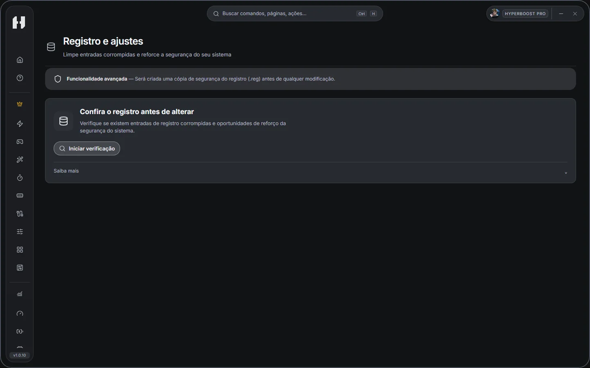

[Ver o guia e as perguntas](https://www.hyperboostapps.com/ferramentas/registro-e-ajustes?lang=pt)

<strong>Privacidade</strong> · Grátis

Escolha como usar os recursos de privacidade do Windows. Reúna preferências de anúncios, pesquisa e sincronização sem procurar em vários painéis.

**Quando usar:** Ao configurar o Windows do seu jeito ou revisar quais recursos de anúncios, pesquisa e sincronização deseja usar.

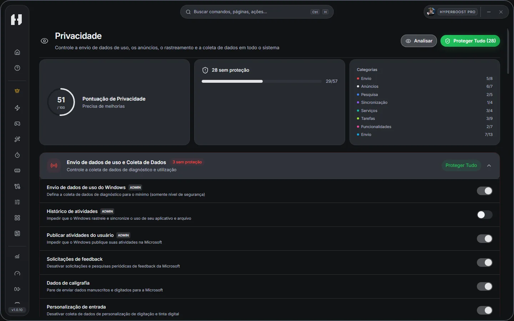

[Ver o guia e as perguntas](https://www.hyperboostapps.com/ferramentas/privacidade?lang=pt)

<strong>Firewall</strong> · Grátis

Entenda as permissões de conexão dos programas no Windows. Encontre regras que merecem revisão e decida o que manter.

**Quando usar:** Quando quiser revisar quais programas têm permissões de rede ou investigar uma regra que não reconhece.

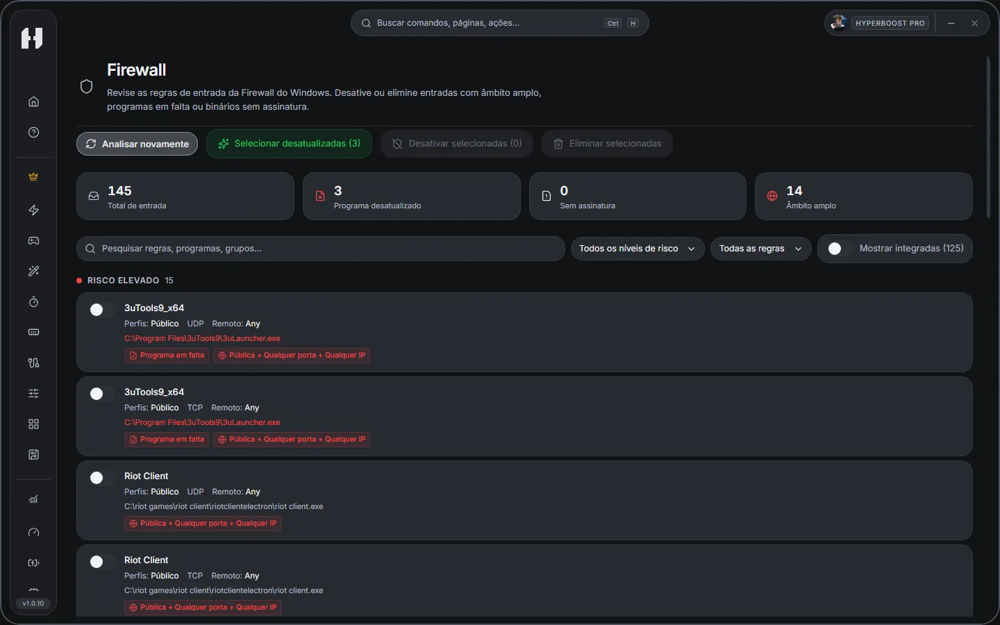

[Ver o guia e as perguntas](https://www.hyperboostapps.com/ferramentas/firewall?lang=pt)

<strong>Verificação de arquivos</strong> · Grátis

Investigue arquivos suspeitos com as verificações disponíveis no HyperBoost. Confira os resultados para decidir o próximo passo, mantendo seu antivírus ativo.

**Quando usar:** Quando um arquivo despertar dúvida e você quiser reunir mais informações antes de decidir o que fazer.

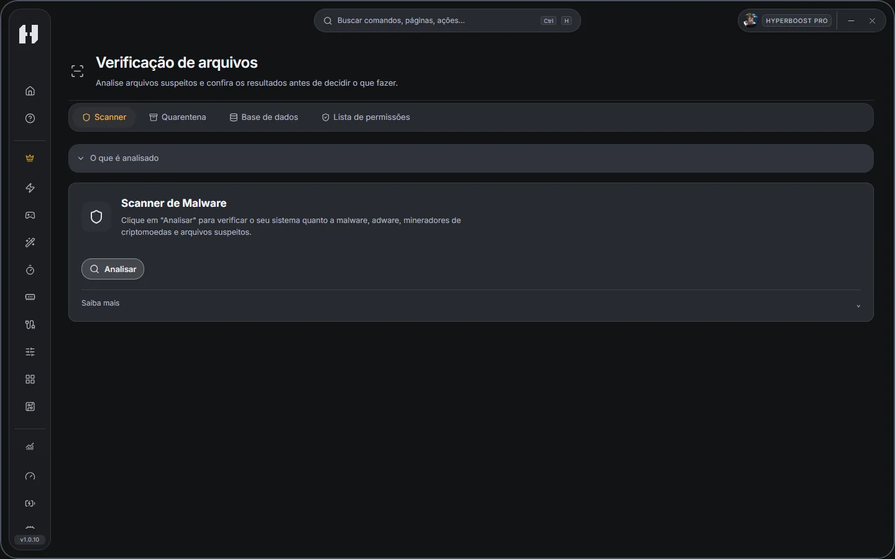

[Ver o guia e as perguntas](https://www.hyperboostapps.com/ferramentas/verificacao-de-arquivos?lang=pt)

<strong>Serviços</strong> · Grátis

Encontre e gerencie os serviços que funcionam no Windows. Confira o que está em execução antes de ajustar como cada serviço inicia.

**Quando usar:** Quando precisar encontrar um serviço específico ou conferir seu estado para uma orientação de suporte.

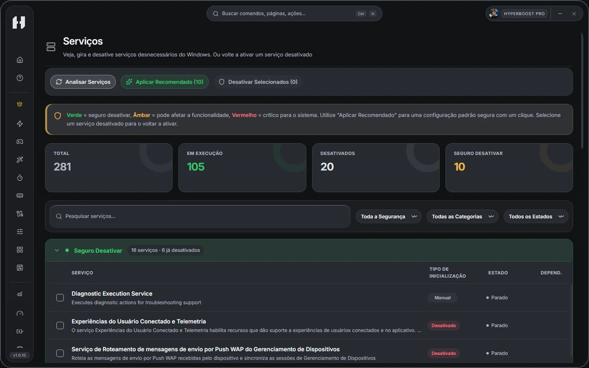

[Ver o guia e as perguntas](https://www.hyperboostapps.com/ferramentas/servicos?lang=pt)

<strong>Arquivos duplicados</strong> · Grátis

Encontre cópias repetidas que estão ocupando espaço. Compare os arquivos e escolha quais manter antes de remover os que não precisa.

**Quando usar:** Depois de copiar fotos, documentos ou backups e suspeitar que há arquivos repetidos em suas pastas.

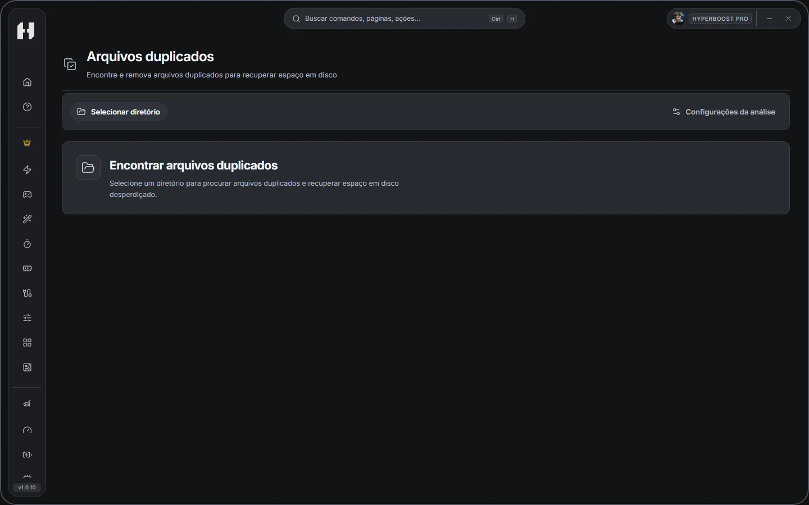

[Ver o guia e as perguntas](https://www.hyperboostapps.com/ferramentas/arquivos-duplicados?lang=pt)

<strong>Arquivos grandes</strong> · Grátis

Encontre os arquivos que mais ocupam espaço sem abrir pasta por pasta. Veja o que vale organizar antes de instalar outro jogo ou programa.

**Quando usar:** Quando precisar de espaço para um jogo, programa ou download e quiser localizar os maiores arquivos.

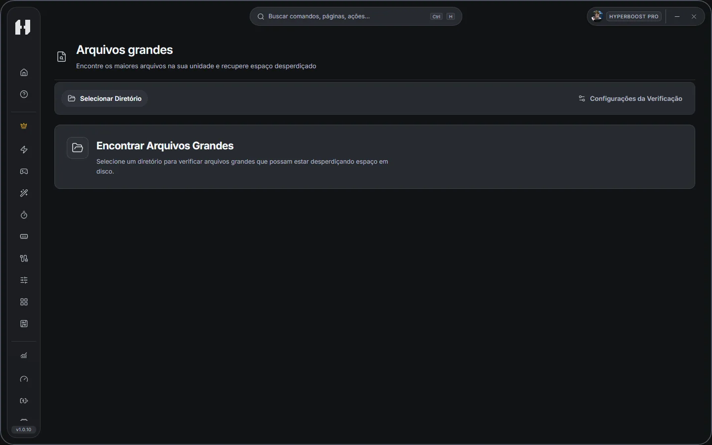

[Ver o guia e as perguntas](https://www.hyperboostapps.com/ferramentas/arquivos-grandes?lang=pt)

<strong>Pastas vazias</strong> · Grátis

Organize pastas que ficaram vazias depois de mover ou remover arquivos. Encontre os caminhos e escolha quais não precisa mais manter.

**Quando usar:** Depois de reorganizar seus arquivos e querer conferir quais pastas ficaram vazias.

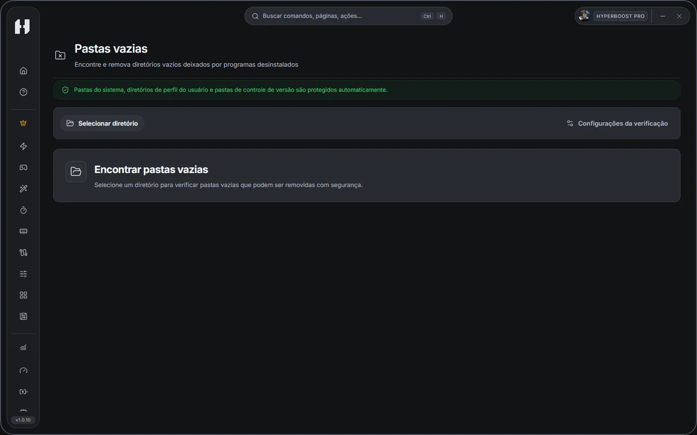

[Ver o guia e as perguntas](https://www.hyperboostapps.com/ferramentas/pastas-vazias?lang=pt)

<strong>Manutenção de unidades</strong> · Grátis

Cuide das suas unidades com as opções de manutenção disponíveis no Windows. Escolha o disco e acompanhe a ação adequada ao seu tipo de unidade.

**Quando usar:** Quando quiser conferir a manutenção disponível para um SSD ou outro disco do computador.

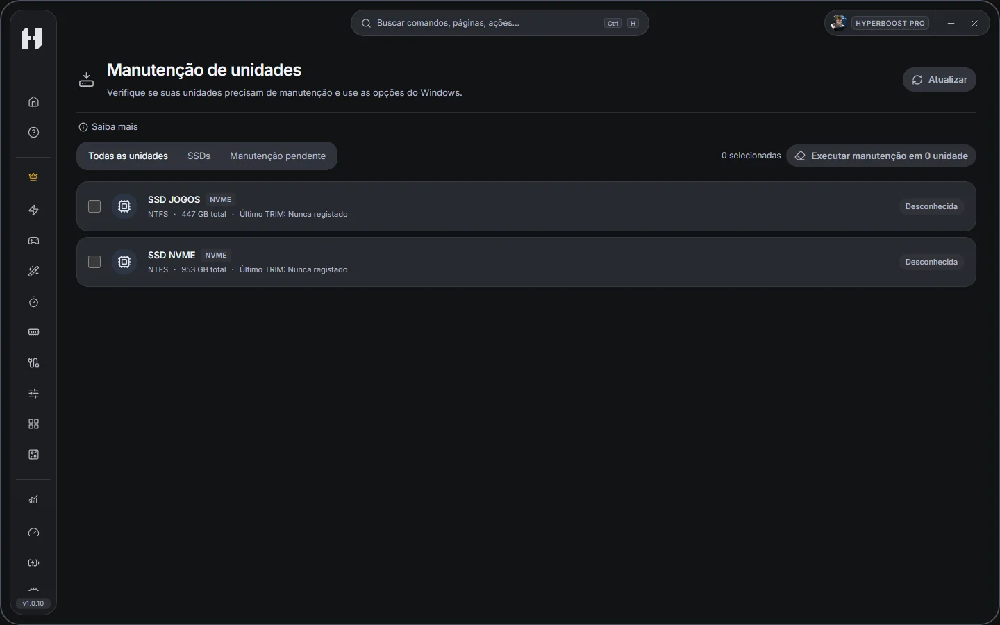

[Ver o guia e as perguntas](https://www.hyperboostapps.com/ferramentas/manutencao-de-unidades?lang=pt)

<strong>Reparar Windows e disco</strong> · Grátis

Investigue falhas do Windows e do disco sem digitar comandos. Acesse as verificações e os reparos disponíveis e acompanhe o resultado.

**Quando usar:** Quando o Windows apresentar erros e você precisar de uma verificação orientada antes de considerar medidas maiores.

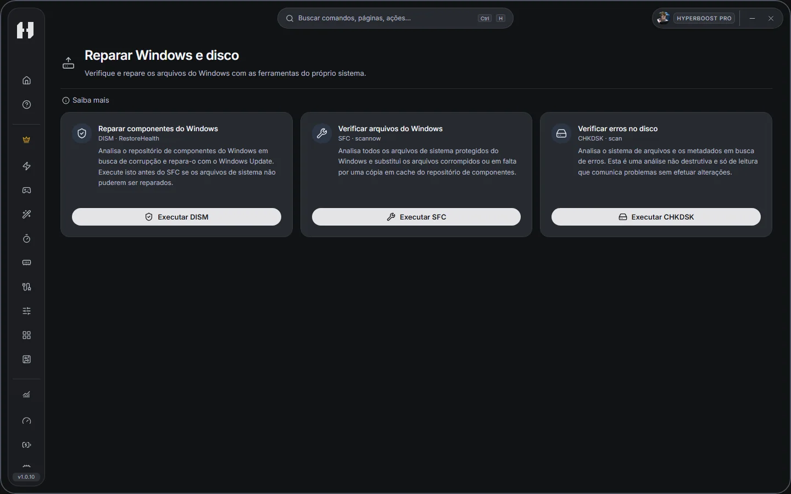

[Ver o guia e as perguntas](https://www.hyperboostapps.com/ferramentas/reparar-windows-e-disco?lang=pt)

<strong>Excluir arquivos</strong> · Grátis

Exclua arquivos escolhidos com uma conferência antes de começar. Use apenas quando tiver certeza: esta ferramenta não oferece restauração.

**Quando usar:** Quando tiver certeza de que não precisa mais dos arquivos e quiser usar uma exclusão sem restauração pelo HyperBoost.

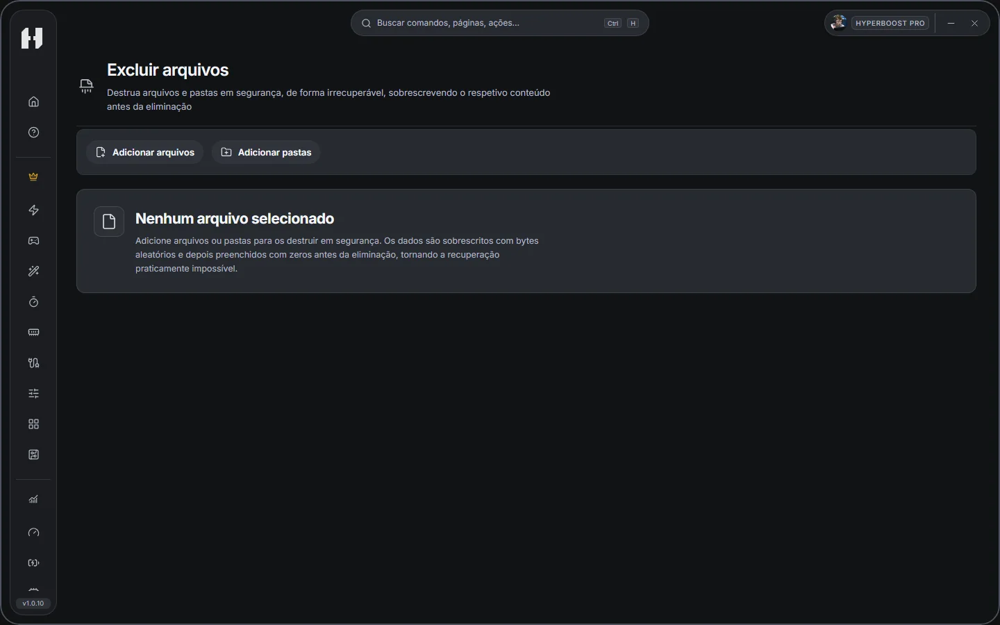

[Ver o guia e as perguntas](https://www.hyperboostapps.com/ferramentas/excluir-arquivos?lang=pt)

## Software

<strong>Atualizar drivers</strong> · Grátis

Procure atualizações para os dispositivos do PC sem conferir cada um separadamente. Veja as opções encontradas e escolha quais instalar.

**Quando usar:** Ao preparar um PC recém-configurado ou conferir se há atualizações para um dispositivo.

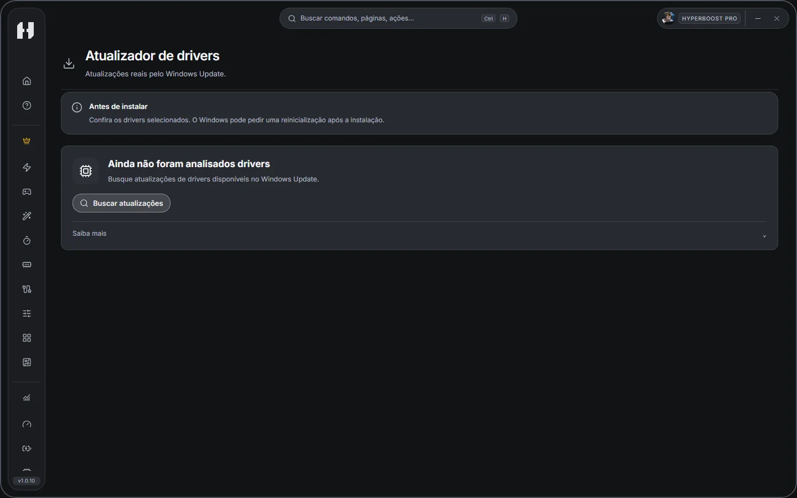

[Ver o guia e as perguntas](https://www.hyperboostapps.com/ferramentas/atualizar-drivers?lang=pt)

<strong>Gerenciar drivers</strong> · Grátis

Organize os drivers já presentes no computador. Confira os pacotes encontrados e identifique os antigos que podem ser removidos.

**Quando usar:** Depois de trocar componentes ou quando quiser organizar os pacotes de drivers que ficaram no PC.

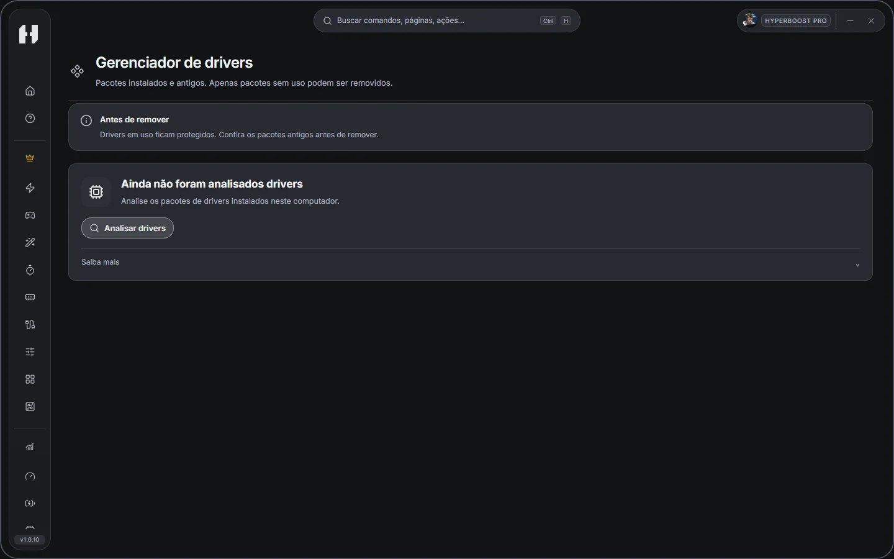

[Ver o guia e as perguntas](https://www.hyperboostapps.com/ferramentas/gerenciar-drivers?lang=pt)

<strong>Desinstalar apps</strong> · Grátis

Encontre os programas que não usa mais e inicie a remoção pelo HyperBoost. Organize seus aplicativos sem procurar cada desinstalador por conta própria.

**Quando usar:** Quando quiser tirar do PC programas que não utiliza ou organizar os aplicativos instalados.

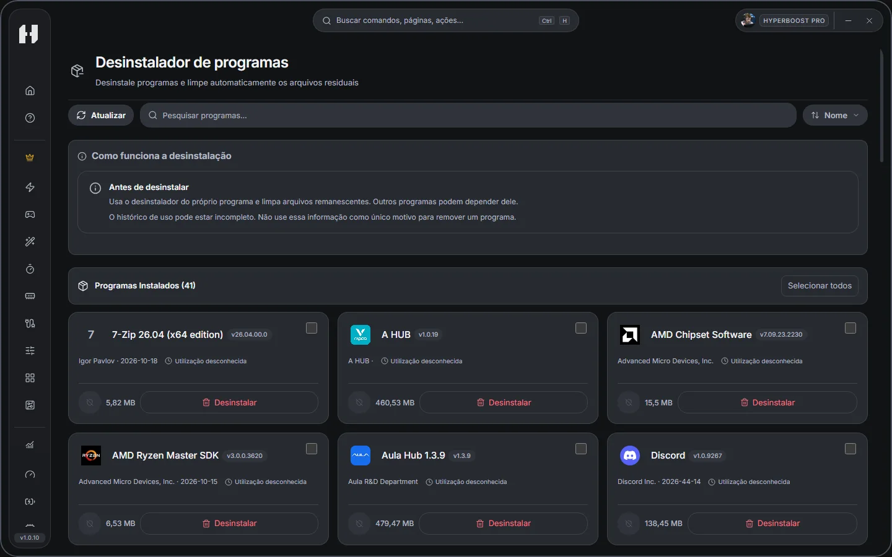

[Ver o guia e as perguntas](https://www.hyperboostapps.com/ferramentas/desinstalar-apps?lang=pt)

<strong>Instalar apps</strong> · Grátis

Busque e instale os aplicativos disponíveis direto pelo HyperBoost, sem procurar downloads no navegador. Ideal para preparar um PC após a formatação ou instalar seus programas do dia a dia.

**Quando usar:** Depois de formatar o PC, trocar de computador ou quando quiser instalar vários programas sem visitar um site de cada vez.

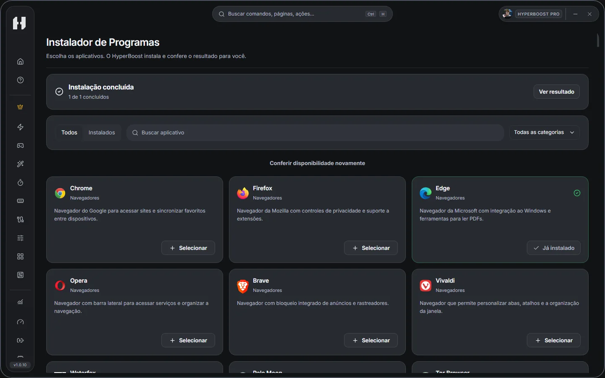

[Ver o guia e as perguntas](https://www.hyperboostapps.com/ferramentas/instalar-apps?lang=pt)

<strong>Remover bloatware</strong> · Grátis

Escolha quais aplicativos pré-instalados quer manter no PC. Encontre os que você não usa e remova os itens permitidos em um só lugar.

**Quando usar:** Ao preparar um PC novo ou após formatar, quando houver aplicativos pré-instalados que não fazem parte da sua rotina.

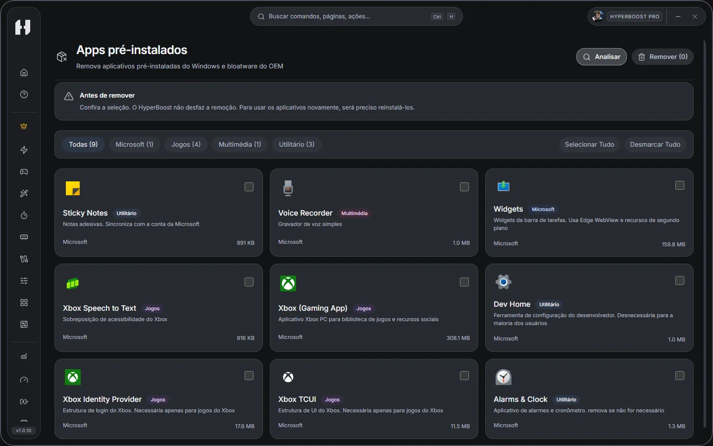

[Ver o guia e as perguntas](https://www.hyperboostapps.com/ferramentas/remover-bloatware?lang=pt)

<strong>Menu de contexto</strong> · Grátis

Deixe o menu do botão direito mais organizado. Escolha quais entradas quer manter sem precisar desinstalar os programas correspondentes.

**Quando usar:** Quando o menu do botão direito estiver cheio de opções que você não utiliza.

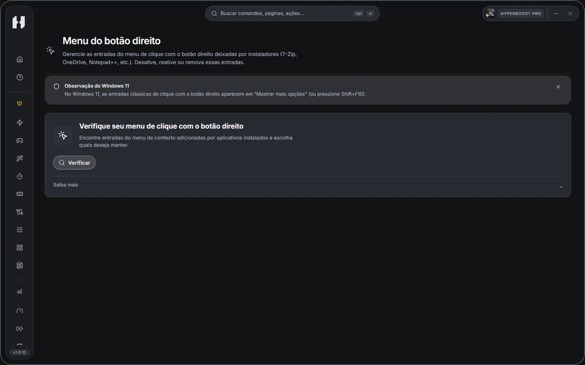

[Ver o guia e as perguntas](https://www.hyperboostapps.com/ferramentas/menu-de-contexto?lang=pt)

<strong>Atualizar apps</strong> · Grátis

Encontre atualizações dos seus aplicativos em um só lugar. Escolha os programas reconhecidos que quer atualizar sem conferir um por um.

**Quando usar:** Quando quiser colocar em dia os programas reconhecidos pelo HyperBoost sem abrir cada aplicativo para conferir.

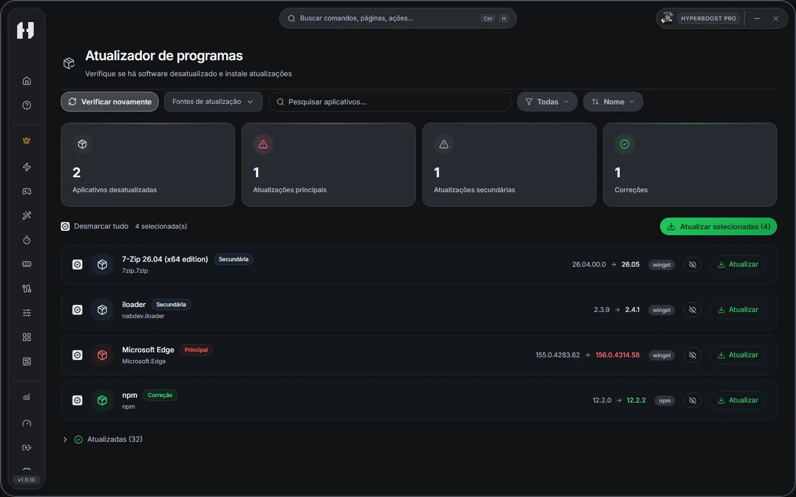

[Ver o guia e as perguntas](https://www.hyperboostapps.com/ferramentas/atualizar-apps?lang=pt)

## Atividade e recuperação

<strong>Recuperação</strong> · Grátis

Mudou um ajuste e quer voltar? Encontre as alterações com backup e restaure o estado salvo pelo HyperBoost quando essa opção estiver disponível.

**Quando usar:** Quando quiser desfazer uma alteração com backup ou conferir uma recuperação pendente.

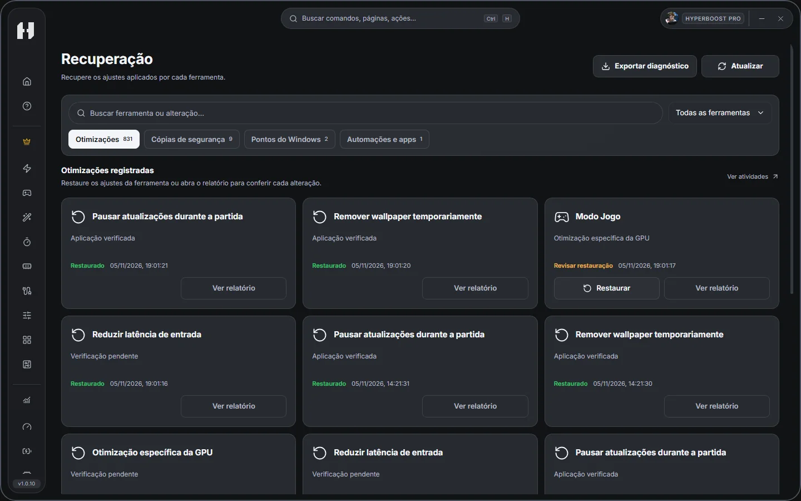

[Ver o guia e as perguntas](https://www.hyperboostapps.com/ferramentas/recuperacao?lang=pt)

<strong>Atividade</strong> · Grátis

Saiba o que o HyperBoost fez no seu PC. Encontre as tarefas executadas e confira quando terminaram, o resultado e os detalhes disponíveis.

**Quando usar:** Quando quiser confirmar uma limpeza, consultar uma instalação ou entender o resultado de uma tarefa.

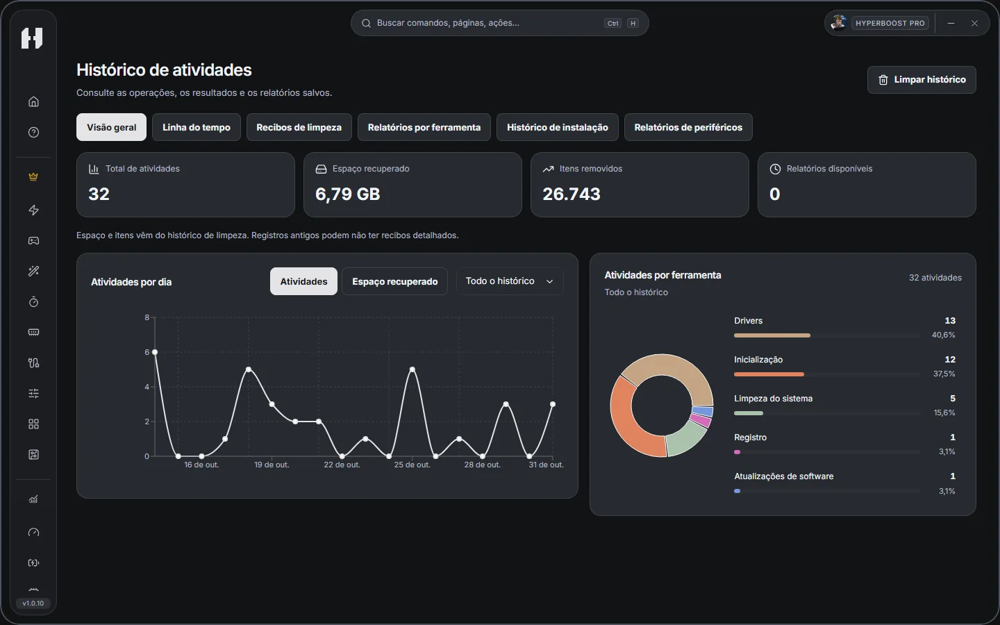

[Ver o guia e as perguntas](https://www.hyperboostapps.com/ferramentas/atividade?lang=pt)

## Conheça o aplicativo

<strong>Início</strong> · Grátis

Veja seu PC de relance: acompanhe o uso dos recursos e encontre o próximo passo para organizar o sistema.

**Quando usar:** Ao abrir o HyperBoost e querer saber por onde começar, sem procurar ferramenta por ferramenta.

[Ver o guia e as perguntas](https://www.hyperboostapps.com/ferramentas?lang=pt&ferramenta=home)

<strong>Configurações</strong> · Grátis

Deixe o HyperBoost com a sua cara. Escolha tema, idioma, tamanho da janela e preferências para usar o aplicativo do seu jeito.

**Quando usar:** Quando quiser ajustar a aparência e o comportamento do próprio HyperBoost.

[Ver o guia e as perguntas](https://www.hyperboostapps.com/ferramentas?lang=pt&ferramenta=settings)

