# Ferramentas do HyperBoost

Capturas reais do HyperBoost 1.0.10. A disponibilidade dos recursos depende do hardware, dos drivers e do Windows. Os dados pessoais foram ocultados.

[Explorar o catálogo no site](https://www.hyperboostapps.com/ferramentas?lang=pt) · [Baixar a última versão](https://github.com/brundevs/HyperBoost/releases/latest)

## Ferramentas Pro

<strong>PC Boost</strong> · Pro

Analise seu PC e revise os ajustes de um perfil antes de aplicar. Útil para reunir as opções em uma só revisão.

[Ver no site e assistir ao vídeo](https://www.hyperboostapps.com/ferramentas?lang=pt&ferramenta=competitive)

<strong>Modo Jogo</strong> · Pro

Escolha as ações que serão usadas durante a partida e acompanhe a sessão. As ações temporárias oferecem restauração ao terminar.

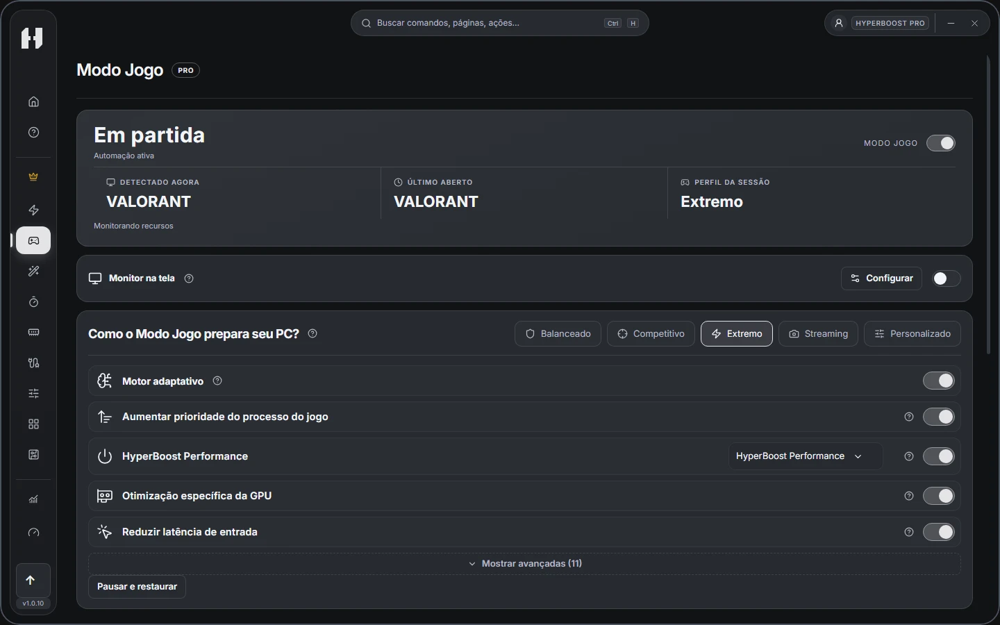

[Ver no site](https://www.hyperboostapps.com/ferramentas?lang=pt&ferramenta=games)

<strong>Apps</strong> · Pro

Revise ajustes de programas compatíveis, como Discord e navegadores. Confira o resultado de cada opção.

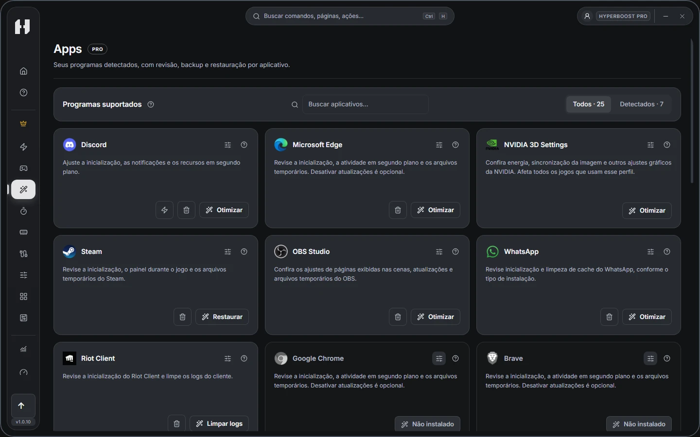

[Ver no site](https://www.hyperboostapps.com/ferramentas?lang=pt&ferramenta=apps)

<strong>Latência</strong> · Pro

Confira preferências de entrada, CPU, GPU e rede. Revise os avisos antes de escolher ajustes avançados.

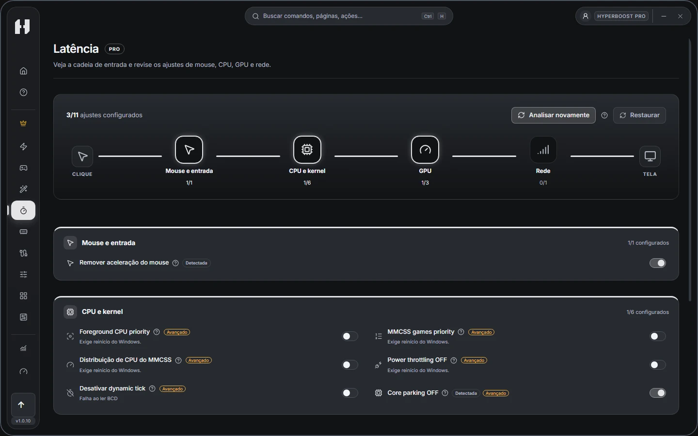

[Ver no site](https://www.hyperboostapps.com/ferramentas?lang=pt&ferramenta=latency)

<strong>Memória</strong> · Pro

Acompanhe a RAM e configure a limpeza automática. Útil para revisar consumo e intervalos de execução.

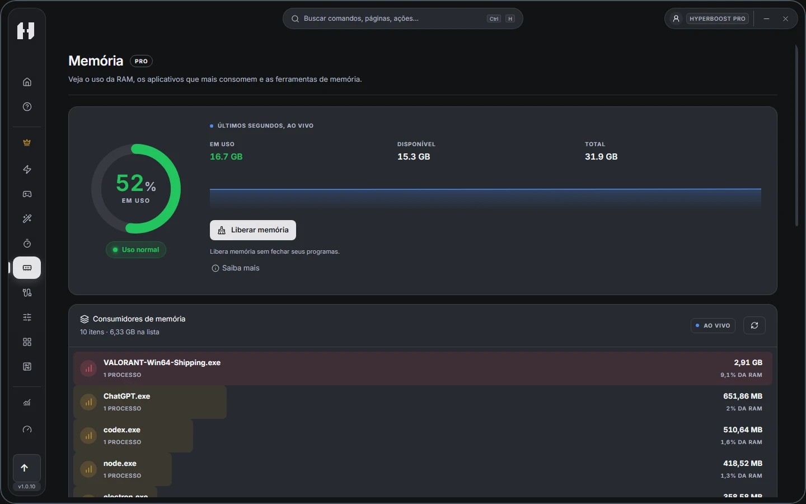

[Ver no site](https://www.hyperboostapps.com/ferramentas?lang=pt&ferramenta=memory)

<strong>Rede</strong> · Pro

Compare servidores DNS e revise ajustes de conexão. Confira os resultados antes de mudar sua configuração.

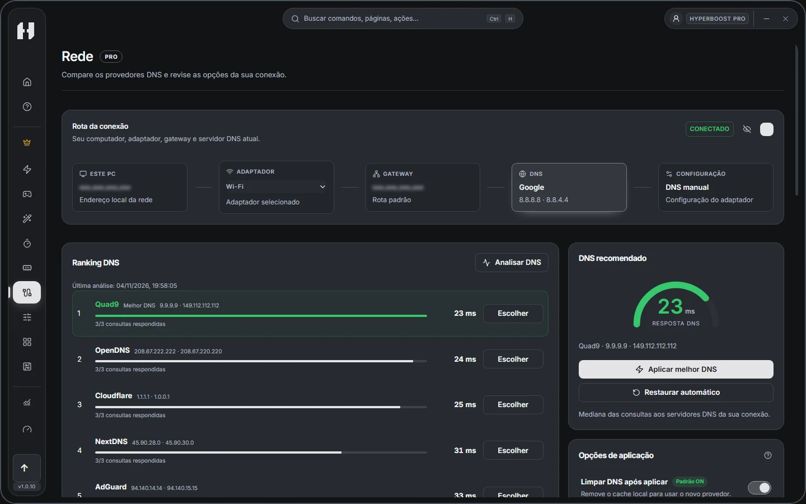

[Ver no site](https://www.hyperboostapps.com/ferramentas?lang=pt&ferramenta=pro-network)

<strong>Tweaks</strong> · Pro

Escolha ajustes específicos do Windows e confira os cuidados de cada um. Aplique apenas o que fizer sentido para seu uso.

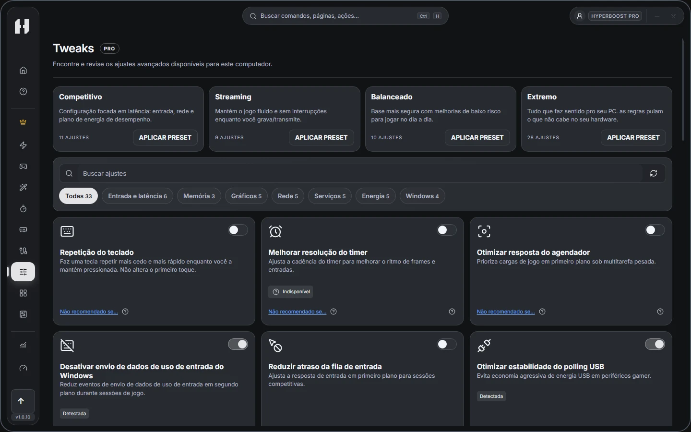

[Ver no site](https://www.hyperboostapps.com/ferramentas?lang=pt&ferramenta=tweaks)

<strong>Windows</strong> · Pro

Organize preferências de interface e recursos do Windows. Revise as opções por categoria.

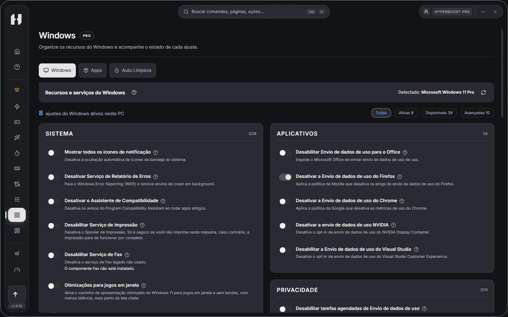

[Ver no site](https://www.hyperboostapps.com/ferramentas?lang=pt&ferramenta=windows)

<strong>Hardware e BIOS</strong> · Pro

Consulte memória, firmware e recursos identificados no seu PC. A análise não altera a BIOS.

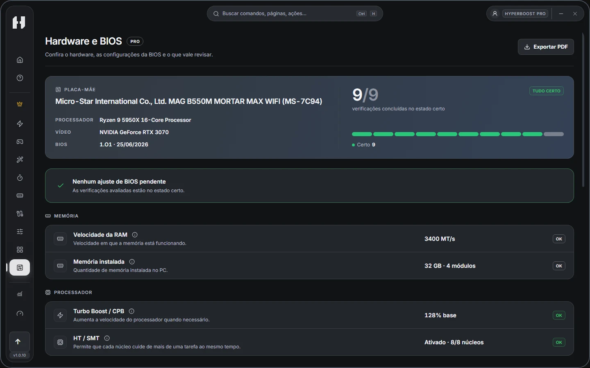

[Ver no site](https://www.hyperboostapps.com/ferramentas?lang=pt&ferramenta=bios)

## Desempenho

<strong>Otimização</strong> · Grátis

Veja os ajustes disponíveis e selecione o que deseja revisar. A compatibilidade depende do computador.

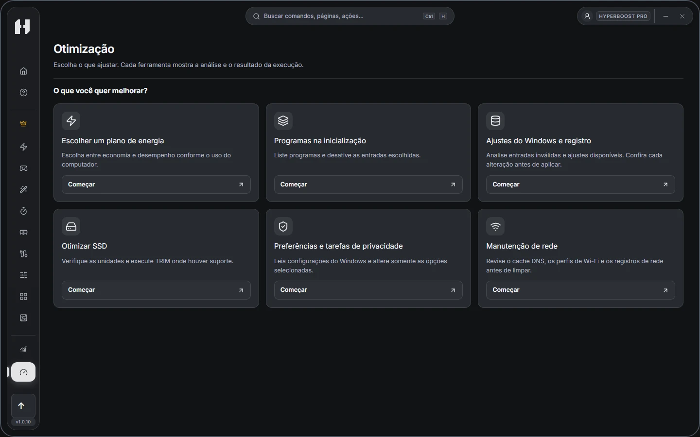

[Ver no site](https://www.hyperboostapps.com/ferramentas?lang=pt&ferramenta=optimization)

<strong>Planos de energia</strong> · Grátis

Confira e escolha o plano de energia do Windows. Útil para organizar os planos usados no trabalho e nos jogos.

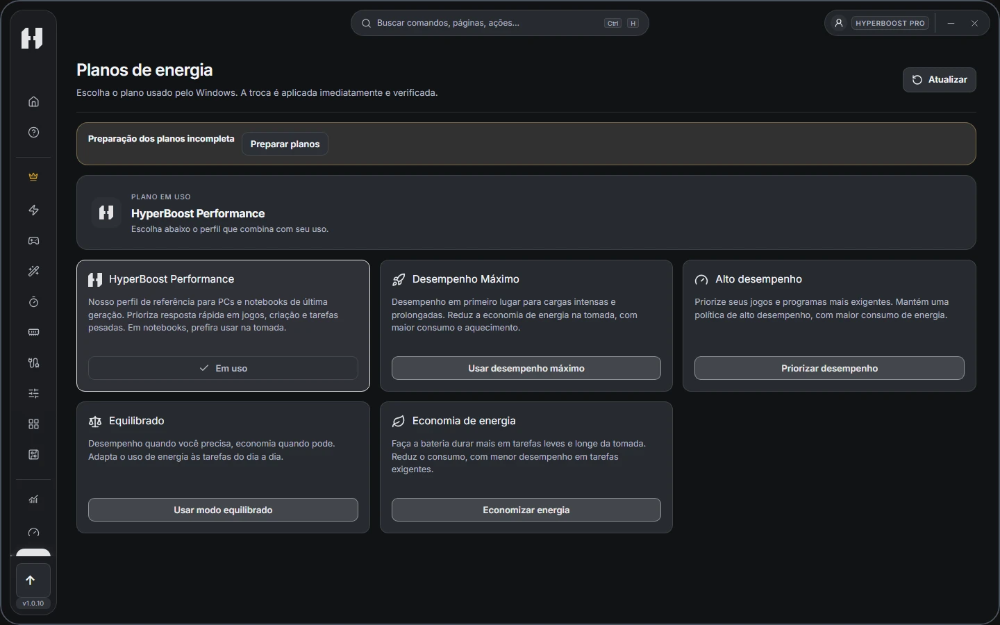

[Ver no site](https://www.hyperboostapps.com/ferramentas?lang=pt&ferramenta=energy)

<strong>Meu computador</strong> · Grátis

Consulte processador, placa de vídeo, memória e armazenamento. Útil para conhecer a configuração antes de escolher ajustes.

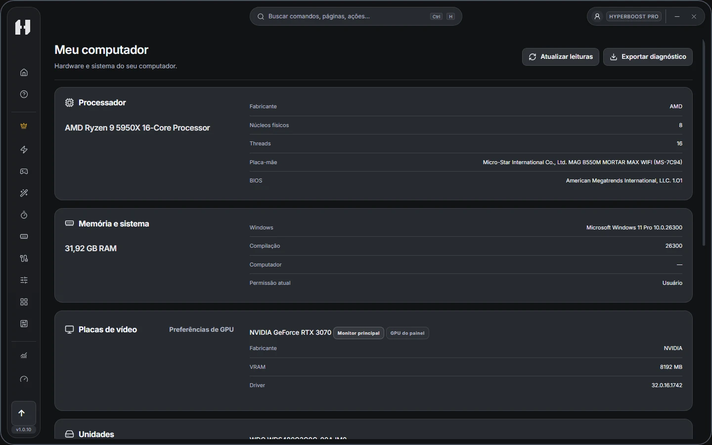

[Ver no site](https://www.hyperboostapps.com/ferramentas?lang=pt&ferramenta=device)

<strong>Monitoramento</strong> · Grátis

Acompanhe CPU, GPU, RAM e sensores disponíveis. Use os gráficos para observar o computador durante o uso.

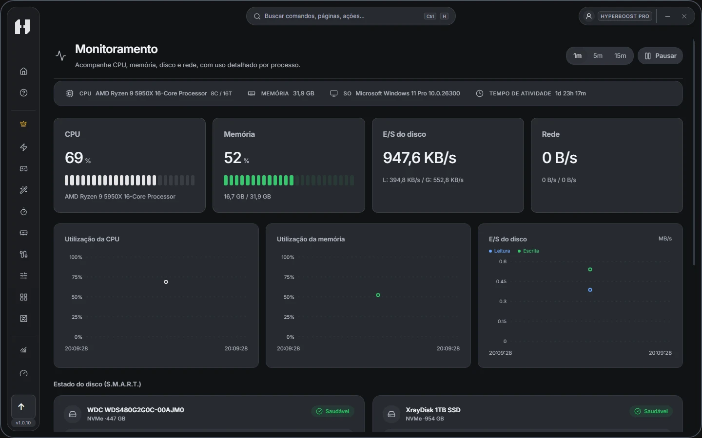

[Ver no site e assistir ao vídeo](https://www.hyperboostapps.com/ferramentas?lang=pt&ferramenta=monitor)

<strong>Testes de periféricos</strong> · Grátis

Abra testes de teclado, mouse, controle, áudio, câmera e monitor. Os testes ajudam a conferir o funcionamento dos dispositivos.

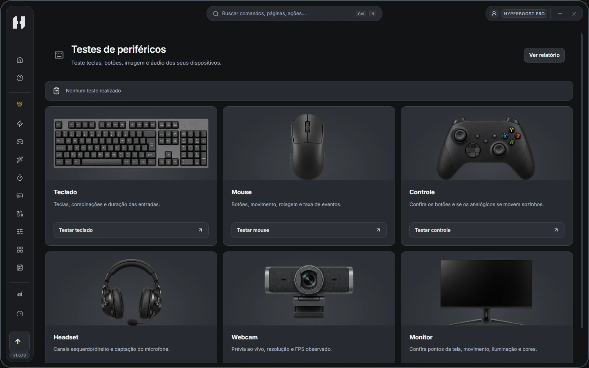

[Ver no site](https://www.hyperboostapps.com/ferramentas?lang=pt&ferramenta=peripherals)

<strong>Teste de internet</strong> · Grátis

Confira as medições de conexão disponíveis. Útil para investigar lentidão e variações na rede.

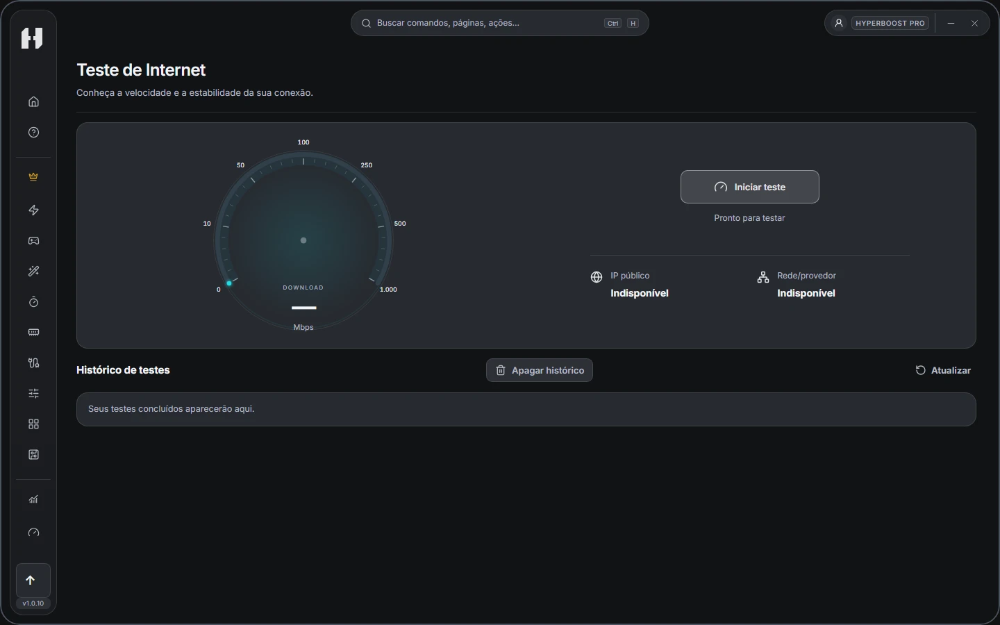

[Ver no site](https://www.hyperboostapps.com/ferramentas?lang=pt&ferramenta=internet)

<strong>Manutenção de rede</strong> · Grátis

Revise as opções de manutenção da conexão. Algumas ações interrompem a rede temporariamente.

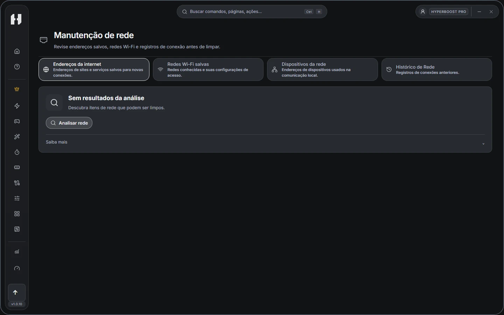

[Ver no site](https://www.hyperboostapps.com/ferramentas?lang=pt&ferramenta=network)

<strong>Teste de teclado</strong> · Grátis

Confira as teclas reconhecidas pelo teste. Útil para investigar teclas que falham ou acionam outra função.

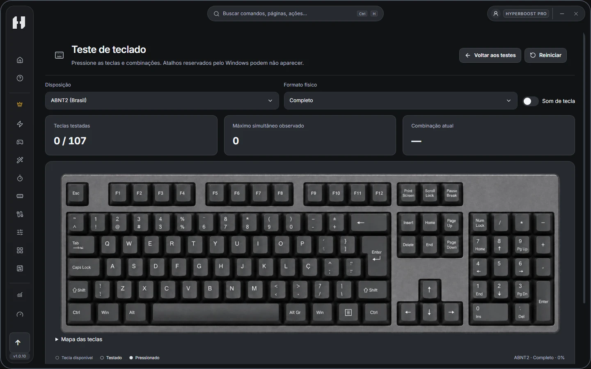

[Ver no site](https://www.hyperboostapps.com/ferramentas?lang=pt&ferramenta=keyboard)

<strong>Teste de mouse</strong> · Grátis

Confira botões e movimentos nos testes disponíveis. Use os resultados para investigar o comportamento do mouse.

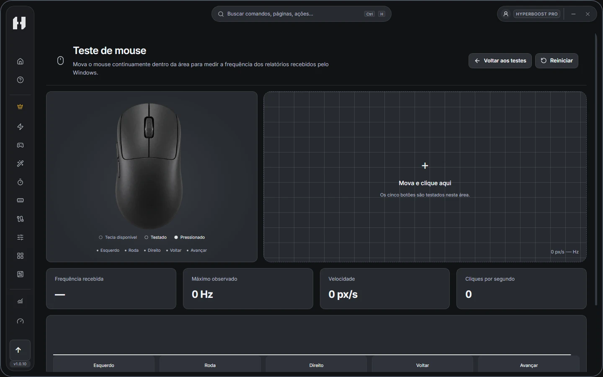

[Ver no site](https://www.hyperboostapps.com/ferramentas?lang=pt&ferramenta=mouse)

<strong>Teste de controle</strong> · Grátis

Confira os comandos de um controle conectado. Os resultados dependem do dispositivo reconhecido pelo Windows.

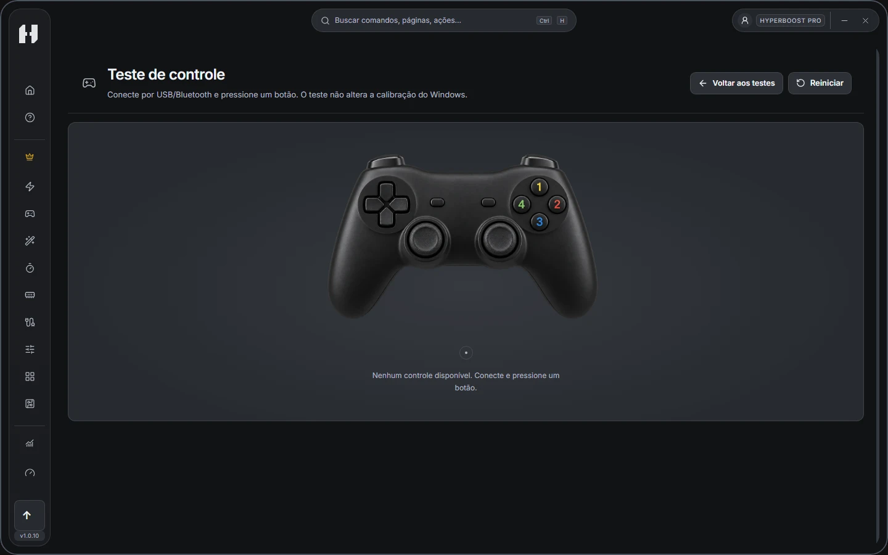

[Ver no site](https://www.hyperboostapps.com/ferramentas?lang=pt&ferramenta=controller)

<strong>Teste de áudio</strong> · Grátis

Confira os dispositivos de áudio e os testes disponíveis. Microfone e reprodução exigem sua participação.

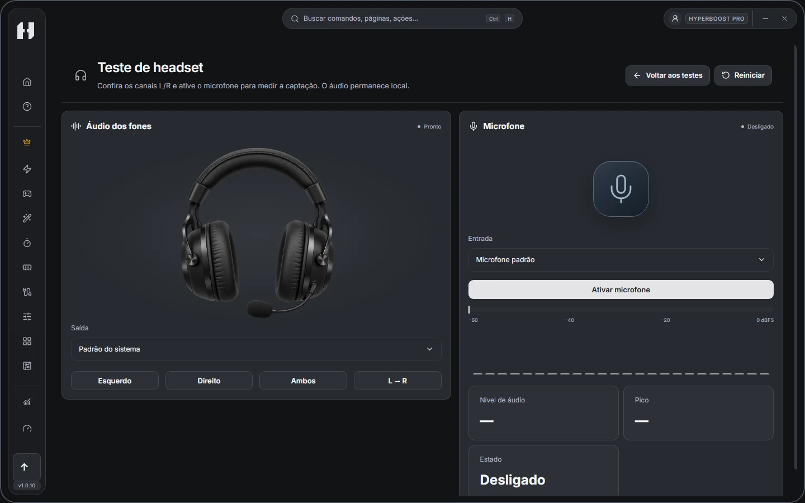

[Ver no site](https://www.hyperboostapps.com/ferramentas?lang=pt&ferramenta=headset)

<strong>Teste de câmera</strong> · Grátis

Confira a câmera nos testes disponíveis. A imagem só é capturada quando você autoriza e inicia a função.

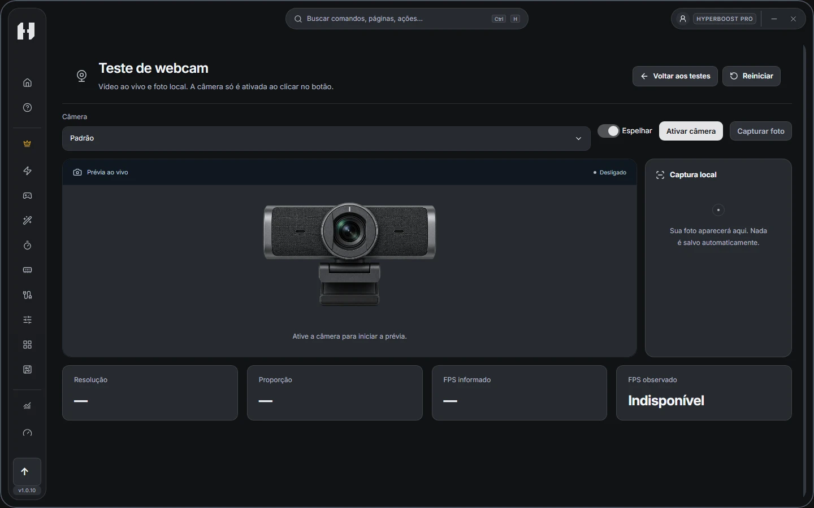

[Ver no site](https://www.hyperboostapps.com/ferramentas?lang=pt&ferramenta=webcam)

<strong>Teste de monitor</strong> · Grátis

Confira padrões e opções de teste da tela. Útil para observar cores e defeitos visíveis no monitor.

[Ver no site](https://www.hyperboostapps.com/ferramentas?lang=pt&ferramenta=display)

<strong>Resultado dos periféricos</strong> · Grátis

Revise os resultados disponíveis dos testes de periféricos. Testes ainda não realizados permanecem sem resultado.

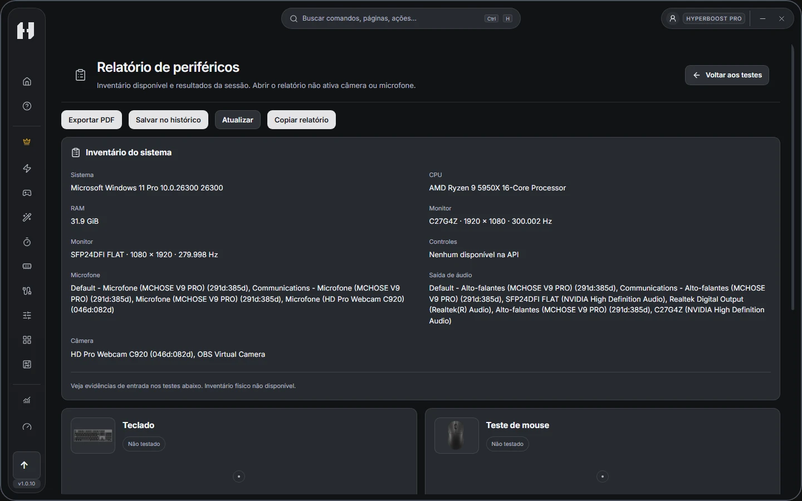

[Ver no site](https://www.hyperboostapps.com/ferramentas?lang=pt&ferramenta=peripheral-report)

## Manutenção

<strong>Limpeza</strong> · Grátis

Analise arquivos desnecessários e revise a seleção antes de limpar. Útil para liberar espaço com controle sobre o que será removido.

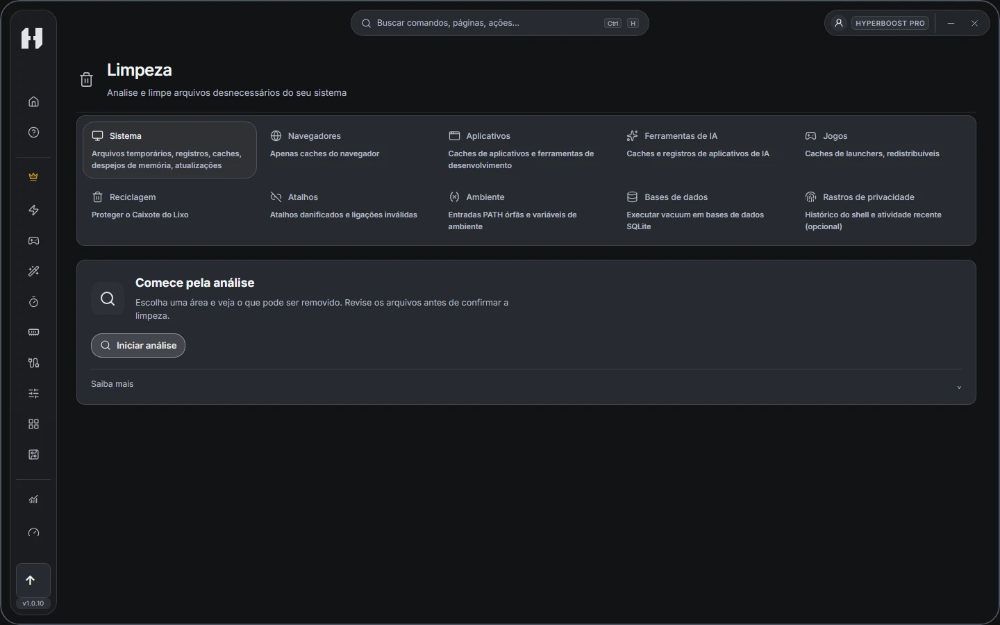

[Ver no site](https://www.hyperboostapps.com/ferramentas?lang=pt&ferramenta=cleanup)

<strong>Inicialização</strong> · Grátis

Confira os programas que iniciam com o Windows. Revise cada entrada antes de desabilitar ou excluir.

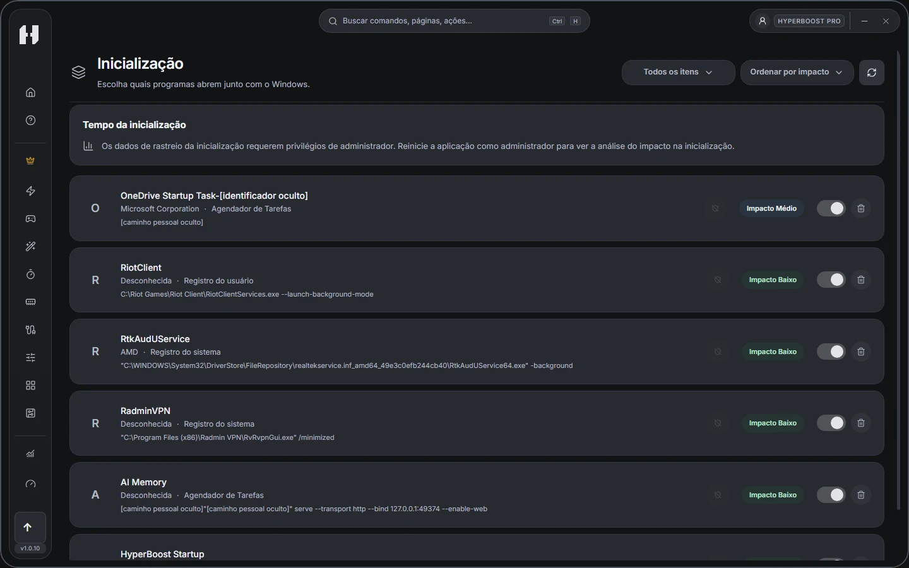

[Ver no site](https://www.hyperboostapps.com/ferramentas?lang=pt&ferramenta=startup)

<strong>Scanner de disco</strong> · Grátis

Veja como pastas e arquivos ocupam o disco. Use a análise para localizar o que mais consome espaço.

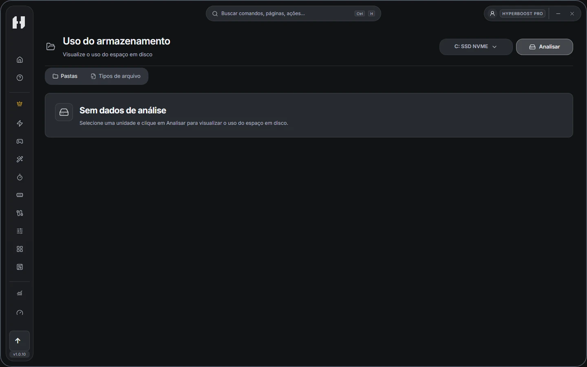

[Ver no site](https://www.hyperboostapps.com/ferramentas?lang=pt&ferramenta=disk)

<strong>Armazenamento</strong> · Grátis

Consulte suas unidades e o espaço disponível. Útil para acompanhar a capacidade e planejar a organização dos arquivos.

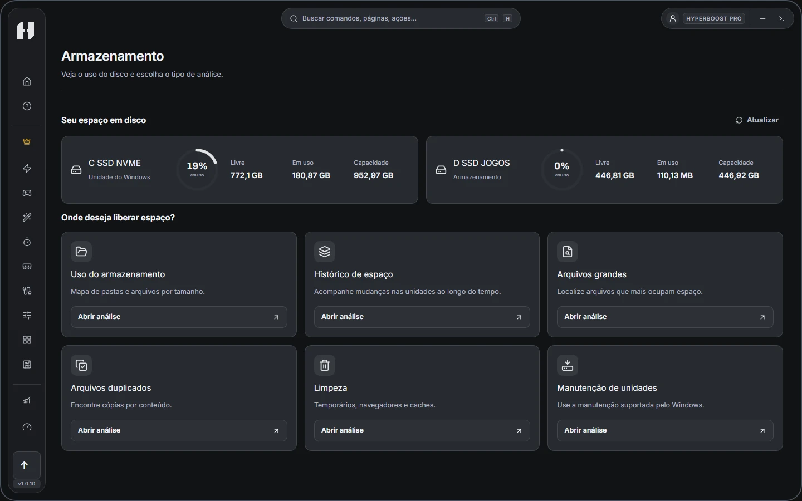

[Ver no site](https://www.hyperboostapps.com/ferramentas?lang=pt&ferramenta=storage)

<strong>Histórico de armazenamento</strong> · Grátis

Compare os registros disponíveis de uso do disco. Útil para acompanhar a variação do espaço ao longo do tempo.

[Ver no site](https://www.hyperboostapps.com/ferramentas?lang=pt&ferramenta=storage-history)

<strong>Ferramentas</strong> · Grátis

Encontre utilitários de manutenção e diagnóstico. Abra a ferramenta correspondente ao problema que deseja investigar.

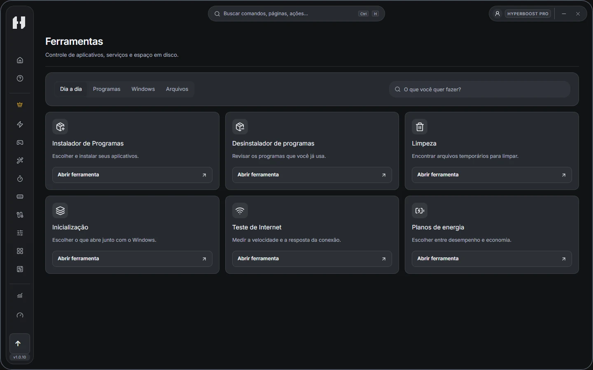

[Ver no site](https://www.hyperboostapps.com/ferramentas?lang=pt&ferramenta=tools)

<strong>Agendamentos</strong> · Grátis

Organize as tarefas automáticas disponíveis. Confira o horário e as ações antes de ativar um agendamento.

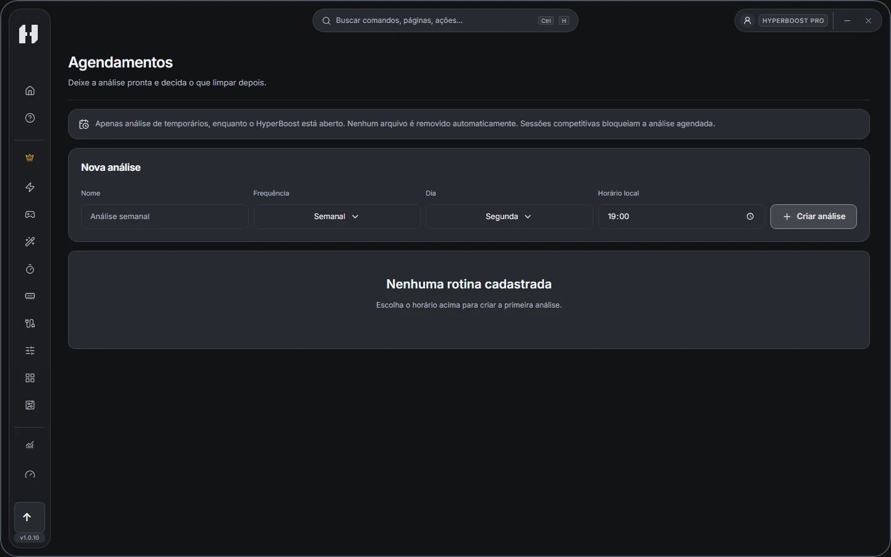

[Ver no site](https://www.hyperboostapps.com/ferramentas?lang=pt&ferramenta=schedules)

<strong>Registro e ajustes</strong> · Grátis

Confira as opções de análise do Registro. Revise os itens encontrados antes de confirmar alterações.

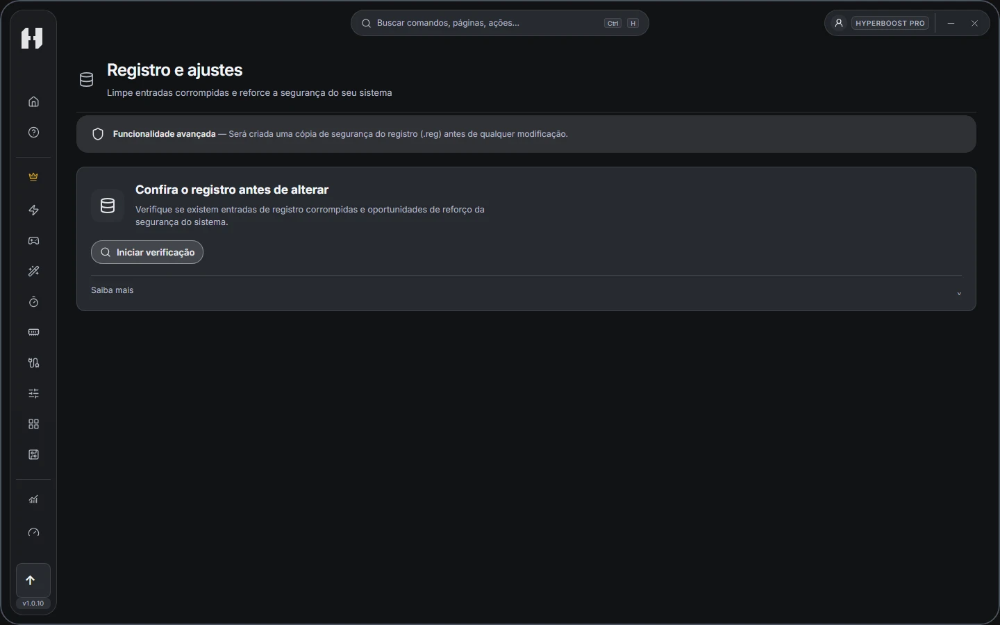

[Ver no site](https://www.hyperboostapps.com/ferramentas?lang=pt&ferramenta=registry)

<strong>Privacidade</strong> · Grátis

Revise as preferências de privacidade disponíveis. Confira o efeito de cada opção antes de aplicar.

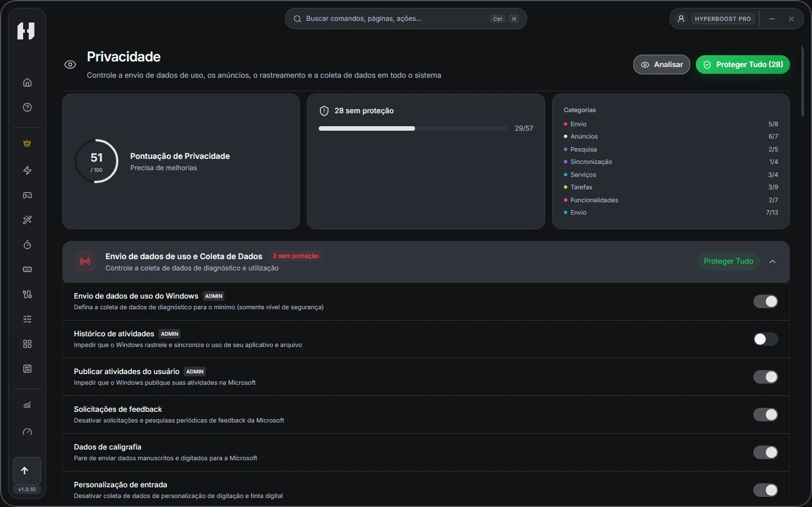

[Ver no site](https://www.hyperboostapps.com/ferramentas?lang=pt&ferramenta=privacy)

<strong>Firewall</strong> · Grátis

Consulte as informações e regras de rede disponíveis. Útil para revisar permissões de conexão.

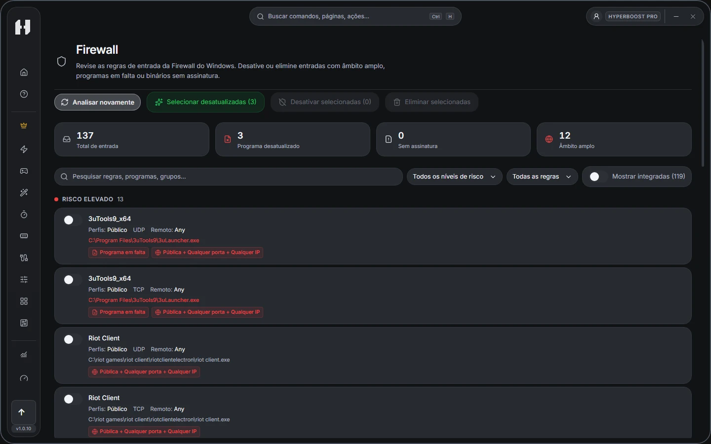

[Ver no site](https://www.hyperboostapps.com/ferramentas?lang=pt&ferramenta=firewall)

<strong>Verificação de arquivos</strong> · Grátis

Confira as opções de verificação disponíveis. Essa ferramenta não substitui a proteção de um antivírus.

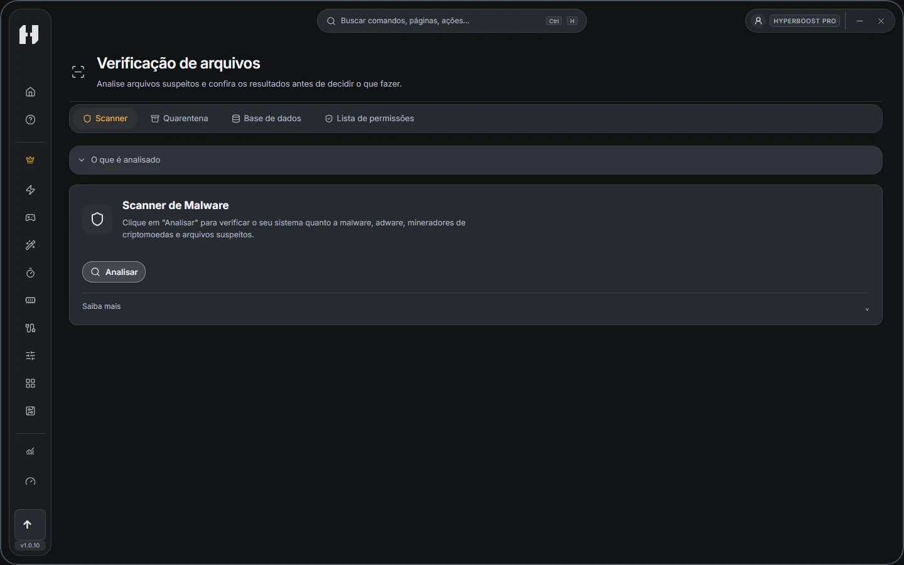

[Ver no site](https://www.hyperboostapps.com/ferramentas?lang=pt&ferramenta=malware)

<strong>Serviços</strong> · Grátis

Consulte os serviços e seus estados. Entenda a função de cada serviço antes de mudar sua inicialização.

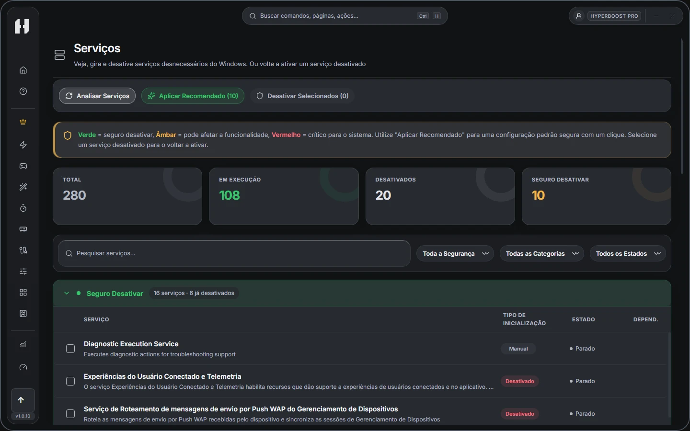

[Ver no site](https://www.hyperboostapps.com/ferramentas?lang=pt&ferramenta=services)

<strong>Arquivos duplicados</strong> · Grátis

Procure arquivos duplicados e compare os resultados. Revise as cópias antes de escolher quais remover.

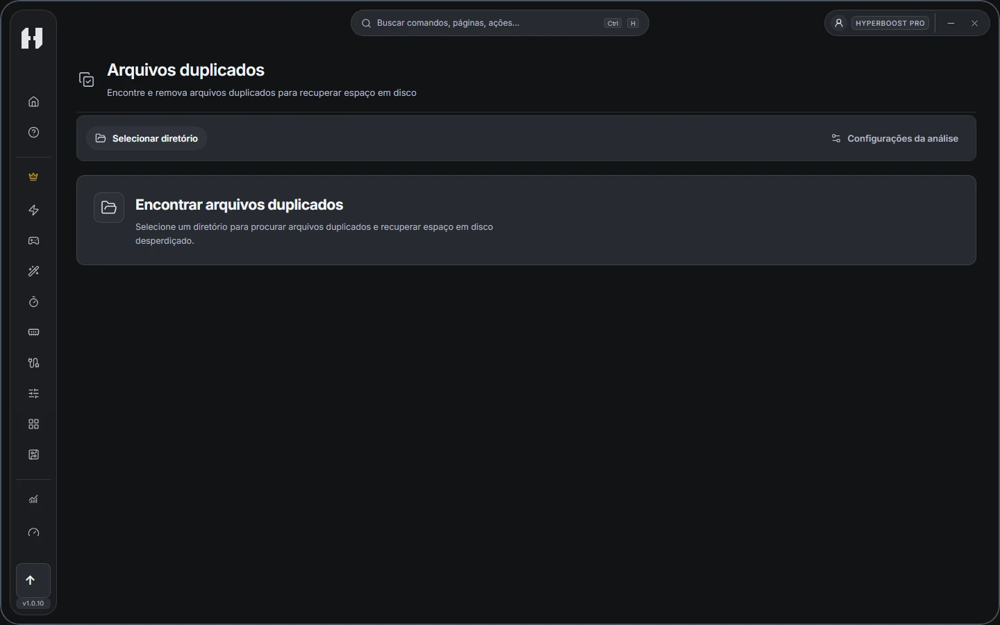

[Ver no site](https://www.hyperboostapps.com/ferramentas?lang=pt&ferramenta=duplicates)

<strong>Arquivos grandes</strong> · Grátis

Localize arquivos que ocupam mais espaço. Útil para organizar o disco sem apagar arquivos automaticamente.

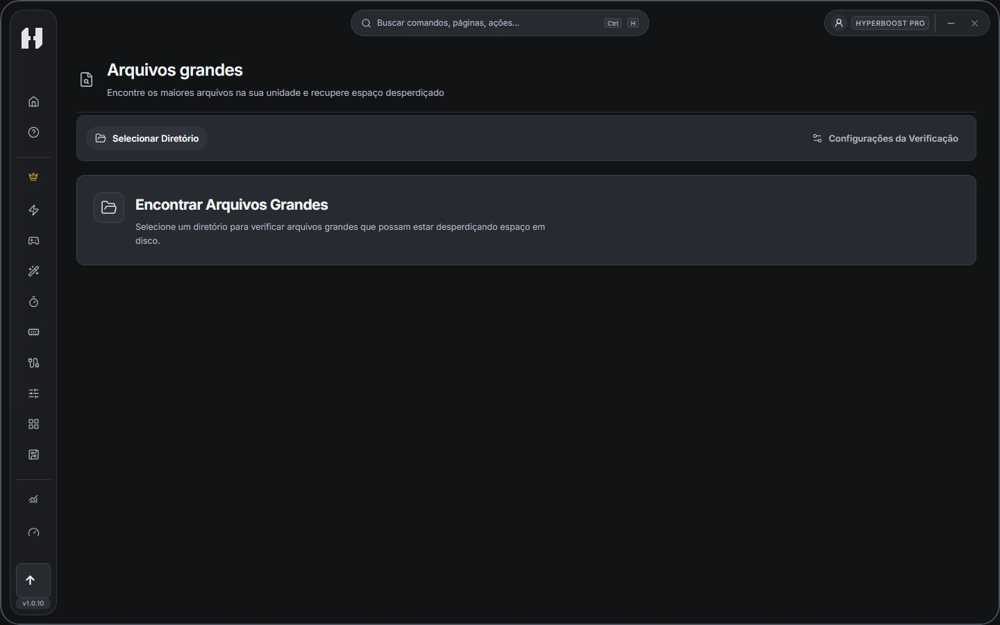

[Ver no site](https://www.hyperboostapps.com/ferramentas?lang=pt&ferramenta=large-files)

<strong>Pastas vazias</strong> · Grátis

Encontre pastas sem arquivos e revise os caminhos. Remova apenas as pastas que não são necessárias.

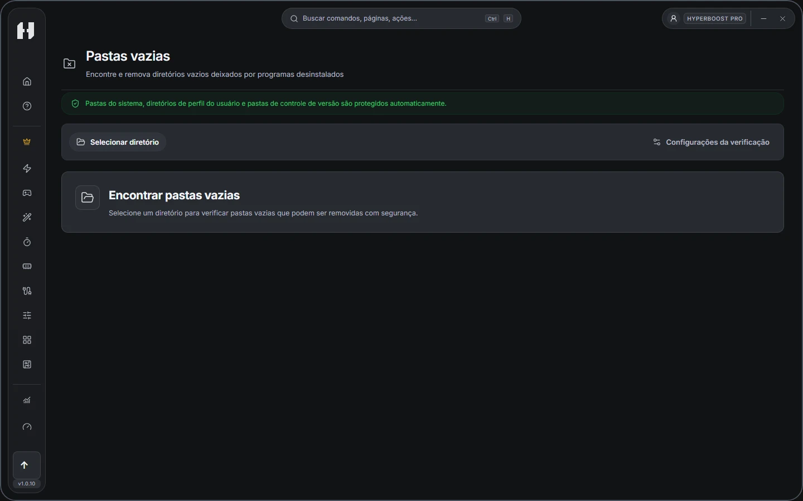

[Ver no site](https://www.hyperboostapps.com/ferramentas?lang=pt&ferramenta=empty-folders)

<strong>Manutenção de unidades</strong> · Grátis

Confira as ações disponíveis para suas unidades. Revise o tipo de disco e os cuidados de cada operação.

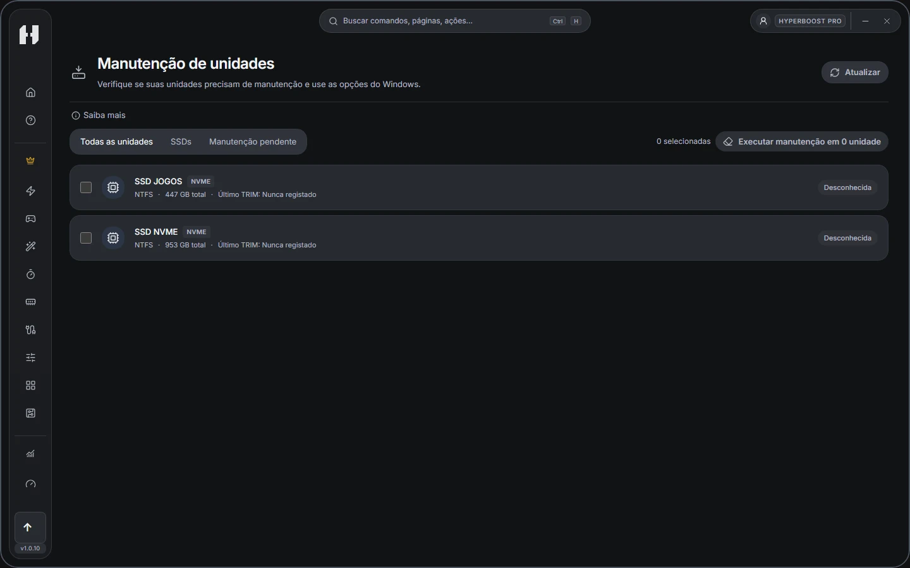

[Ver no site](https://www.hyperboostapps.com/ferramentas?lang=pt&ferramenta=disk-maintenance)

<strong>Reparar Windows e disco</strong> · Grátis

Consulte as opções de verificação e reparo. Algumas operações demoram ou exigem reinicialização.

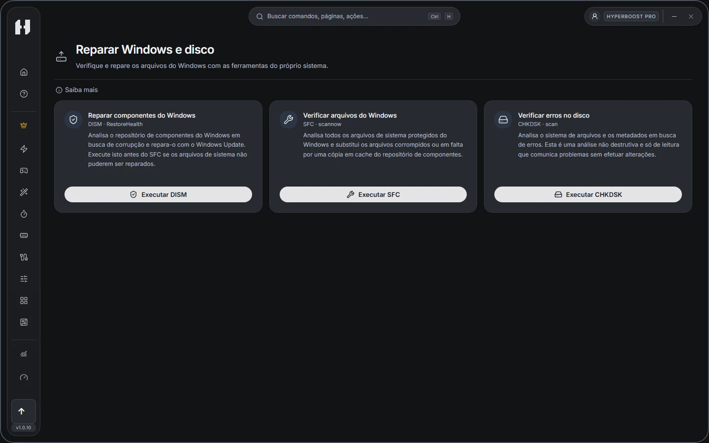

[Ver no site](https://www.hyperboostapps.com/ferramentas?lang=pt&ferramenta=disk-repair)

<strong>Excluir arquivos</strong> · Grátis

Selecione arquivos para a exclusão oferecida pela ferramenta. Confira cuidadosamente a seleção: essa ação não oferece restauração.

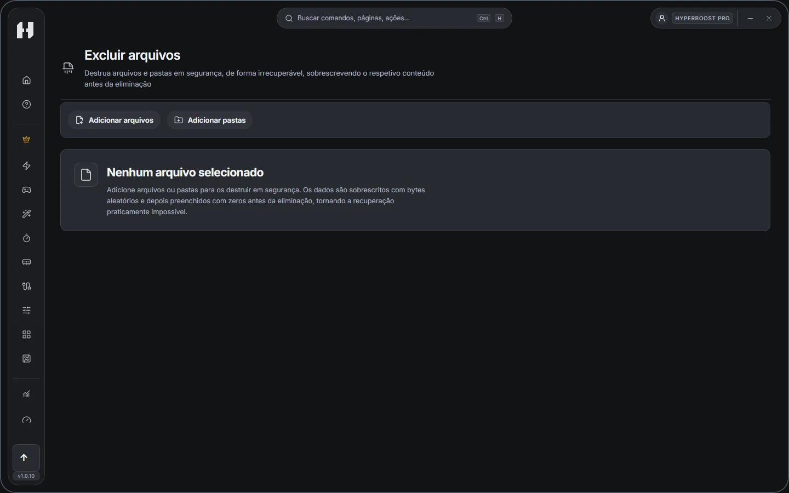

[Ver no site](https://www.hyperboostapps.com/ferramentas?lang=pt&ferramenta=shredder)

## Software

<strong>Atualizar drivers</strong> · Grátis

Procure atualizações de drivers e revise os resultados. Confira o dispositivo e a origem antes de instalar.

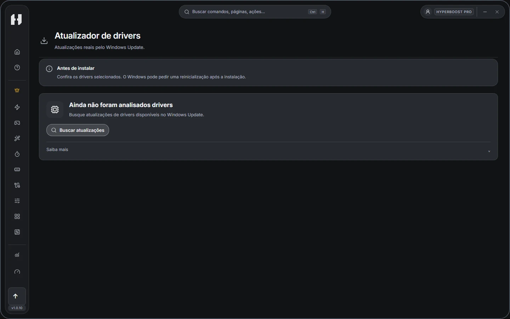

[Ver no site](https://www.hyperboostapps.com/ferramentas?lang=pt&ferramenta=driver-updates)

<strong>Gerenciar drivers</strong> · Grátis

Consulte os drivers identificados e suas opções de gerenciamento. Útil para conferir versões e dispositivos.

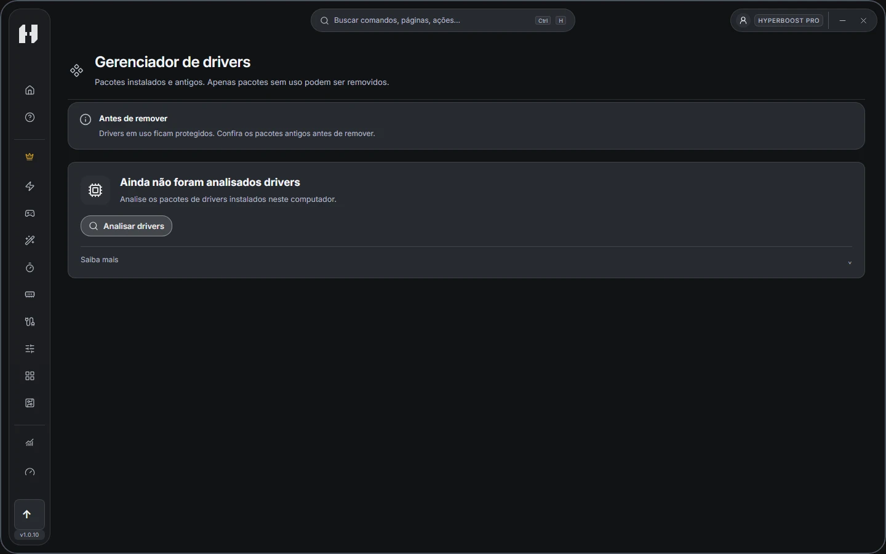

[Ver no site](https://www.hyperboostapps.com/ferramentas?lang=pt&ferramenta=drivers)

<strong>Desinstalar apps</strong> · Grátis

Confira os programas instalados e selecione o que deseja remover. A desinstalação pode exigir confirmação do próprio programa.

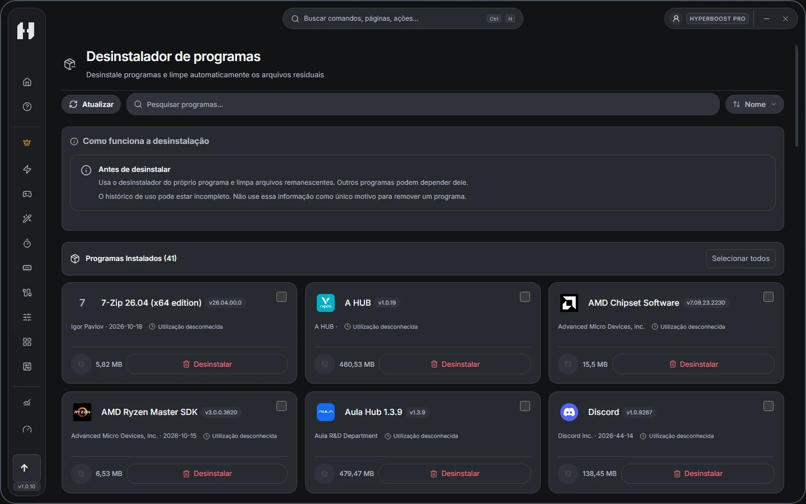

[Ver no site](https://www.hyperboostapps.com/ferramentas?lang=pt&ferramenta=uninstaller)

<strong>Instalar apps</strong> · Grátis

Busque programas, confira a disponibilidade e revise a instalação. O resultado identifica a fonte usada.

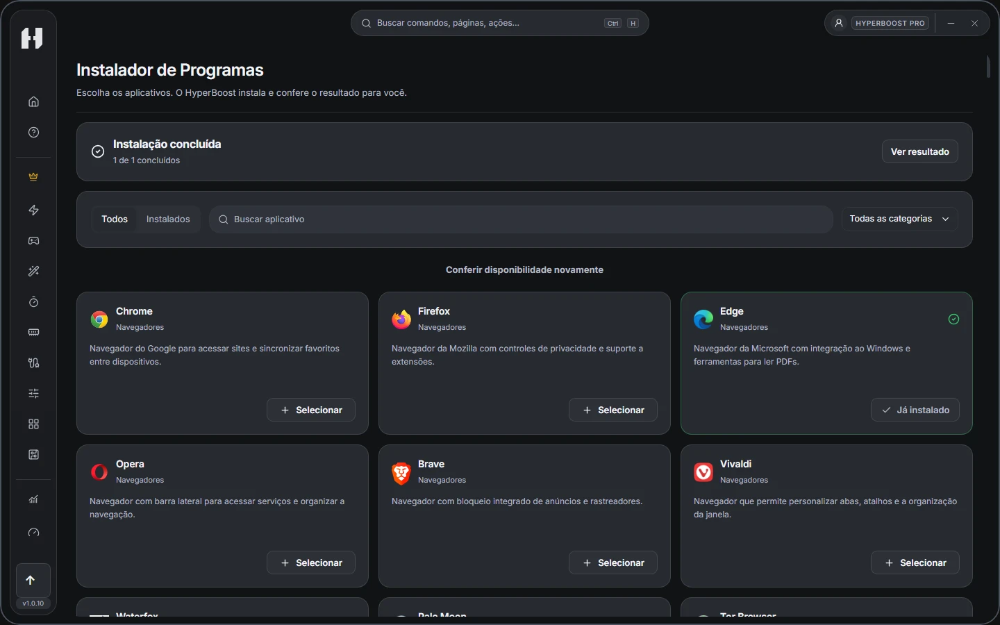

[Ver no site](https://www.hyperboostapps.com/ferramentas?lang=pt&ferramenta=installer)

<strong>Remover bloatware</strong> · Grátis

Revise os aplicativos pré-instalados que podem ser removidos. Preserve os componentes de que você precisa.

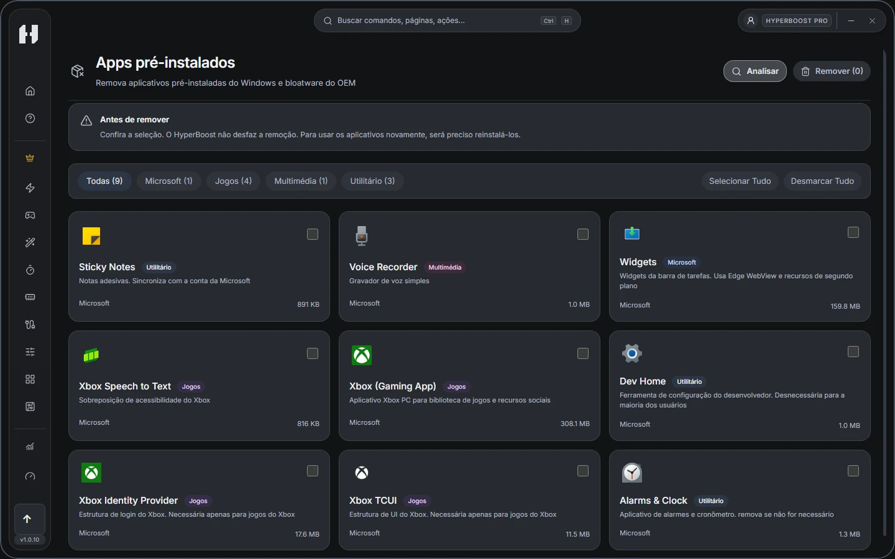

[Ver no site](https://www.hyperboostapps.com/ferramentas?lang=pt&ferramenta=debloater)

<strong>Menu de contexto</strong> · Grátis

Confira as entradas do menu do botão direito. Revise os itens antes de alterar sua disponibilidade.

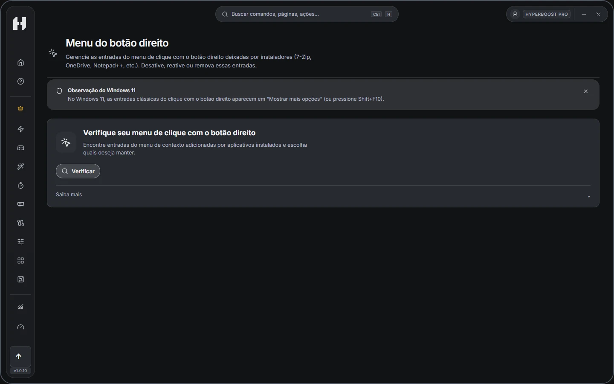

[Ver no site](https://www.hyperboostapps.com/ferramentas?lang=pt&ferramenta=context-menu)

<strong>Atualizar apps</strong> · Grátis

Procure atualizações dos programas reconhecidos. Revise as versões antes de solicitar a instalação.

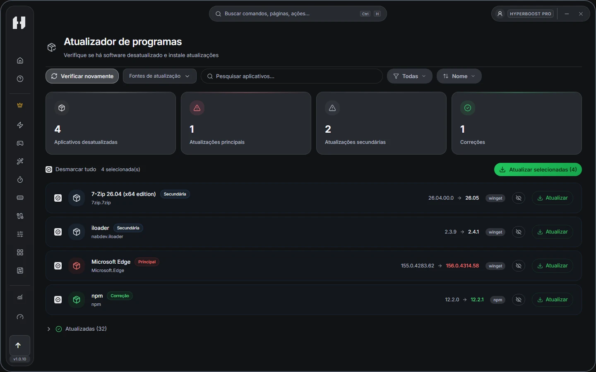

[Ver no site](https://www.hyperboostapps.com/ferramentas?lang=pt&ferramenta=software-updates)

## Atividade e recuperação

<strong>Recuperação</strong> · Grátis

Consulte backups e alterações que oferecem restauração. Útil para revisar o estado anterior e as pendências de recuperação.

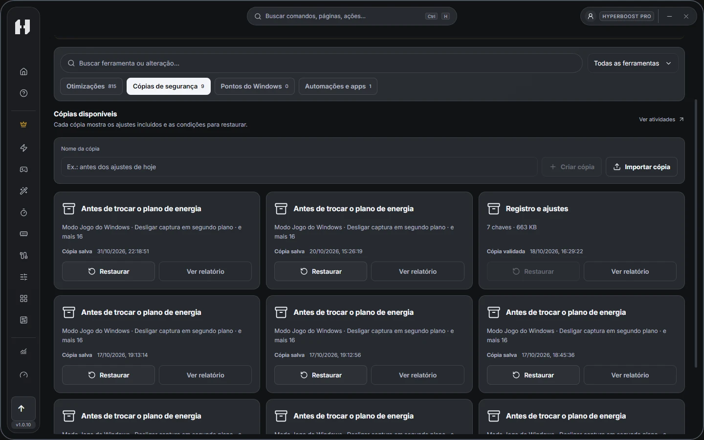

[Ver no site](https://www.hyperboostapps.com/ferramentas?lang=pt&ferramenta=recovery)

<strong>Atividade</strong> · Grátis

Acompanhe operações, resultados e recibos. Use os filtros para encontrar o que aconteceu em uma ferramenta.

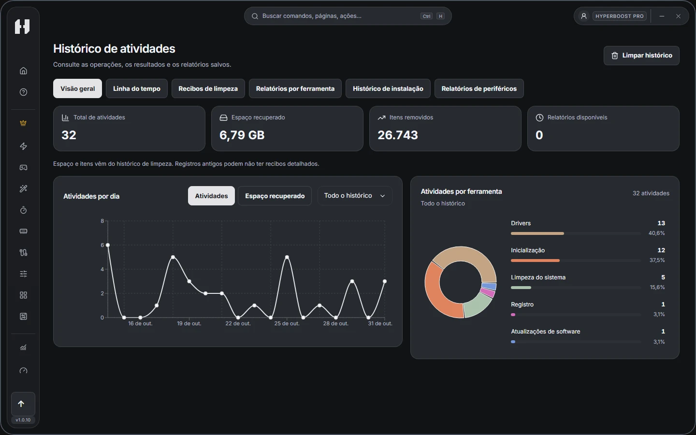

[Ver no site](https://www.hyperboostapps.com/ferramentas?lang=pt&ferramenta=activities)

## Conheça o aplicativo

<strong>Início</strong> · Grátis

Confira as configurações e o uso de recursos. Use os atalhos para revisar os próximos ajustes.

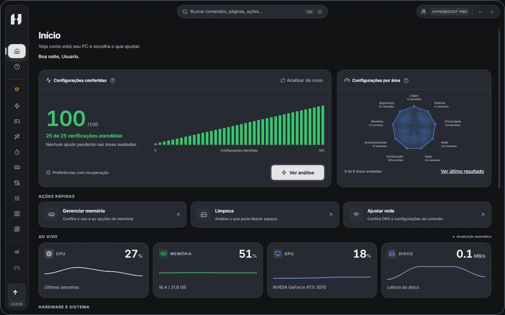

[Ver no site e assistir ao vídeo](https://www.hyperboostapps.com/ferramentas?lang=pt&ferramenta=home)

<strong>Configurações</strong> · Grátis

Escolha tema, idioma e preferências do HyperBoost. Os efeitos visuais do aplicativo têm controle próprio.

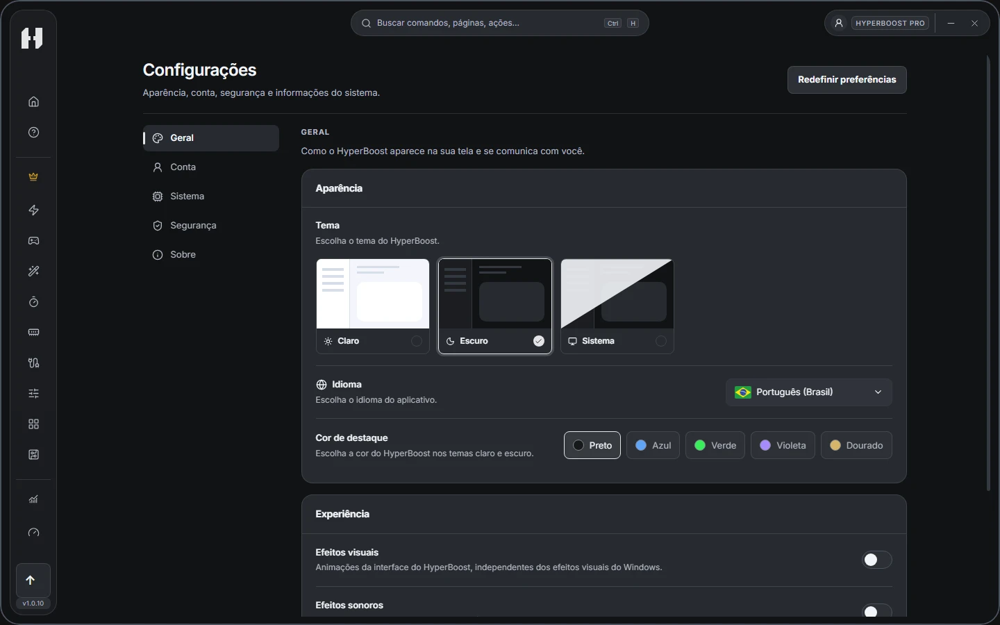

[Ver no site](https://www.hyperboostapps.com/ferramentas?lang=pt&ferramenta=settings)

