# Herramientas de HyperBoost

[Português](ferramentas.md) · [English](tools.en.md) · [Español](herramientas.es.md)

Capturas reales de HyperBoost 1.0.10. La disponibilidad depende del hardware, los controladores y Windows. Los identificadores de la cuenta están ocultos; la foto se incluye con autorización.

[Explorar todas las herramientas](https://www.hyperboostapps.com/ferramentas?lang=es)

## Pro

<strong>PC Boost</strong> · Pro

Prepare su PC para su objetivo sin tener que buscar en los menús de configuración. PC Boost reúne recomendaciones para que puedas elegir qué aplicar.

**Cuándo usarla:** Antes de preparar tu computadora para un juego o revisar configuraciones que se adapten a tu rutina.

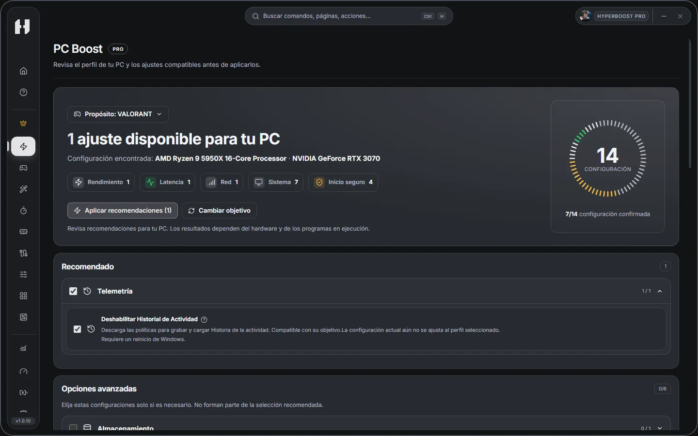

[Ver la guía y las preguntas](https://www.hyperboostapps.com/ferramentas/pc-boost?lang=es)

<strong>Modo Juego</strong> · Pro

Elige cómo preparar tu PC para jugar y sigue tu sesión. Mantenga juntos los perfiles, la configuración de la sesión y un monitor en pantalla opcional.

**Cuándo usarla:** Cuando quieras utilizar un perfil de juego y seguir cómo se comporta tu PC durante una sesión.

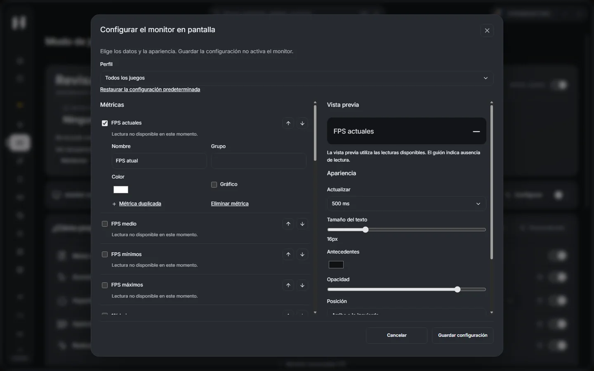

Configuración del monitor en pantalla.

[Ver la guía y las preguntas](https://www.hyperboostapps.com/ferramentas/modo-juego?lang=es)

<strong>Apps</strong> · Pro

Ajusta aplicaciones como Discord y navegadores en un solo lugar. Encuentre opciones disponibles sin tener que buscar en diferentes menús.

**Cuándo usarla:** Cuando quieras revisar cómo se comportan las aplicaciones junto con tus juegos o en el uso diario.

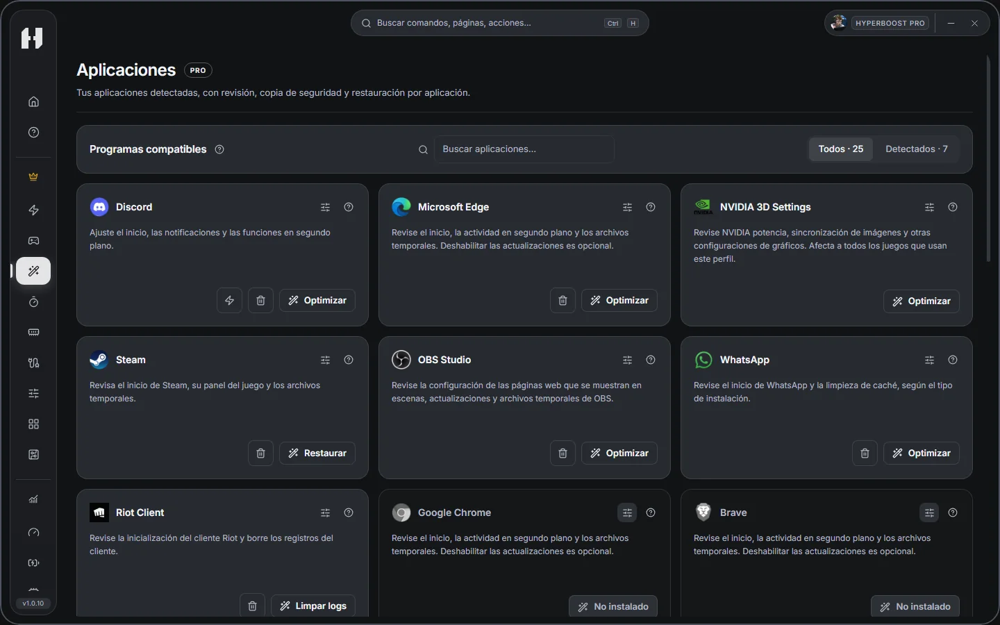

[Ver la guía y las preguntas](https://www.hyperboostapps.com/ferramentas/apps?lang=es)

<strong>Latencia</strong> · Pro

Reúna las configuraciones de mouse, gráficos y conexión que desea revisar para juegos. Comprenda cada opción y elija la que se adapte a su PC.

**Cuándo usarla:** Cuando desee revisar la configuración relacionada con la respuesta de entrada sin perderse en Windows configuración.

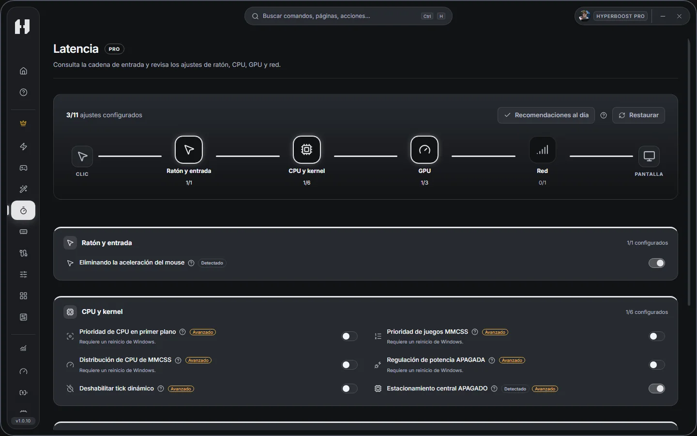

[Ver la guía y las preguntas](https://www.hyperboostapps.com/ferramentas/latencia?lang=es)

<strong>Memoria</strong> · Pro

Vea cuánta memoria usan sus aplicaciones y elija cuándo se ejecuta la limpieza. Administre la RAM sin repetir la misma tarea manualmente.

**Cuándo usarla:** Cuando hay muchas aplicaciones abiertas o desea configurar una rutina de limpieza de memoria.

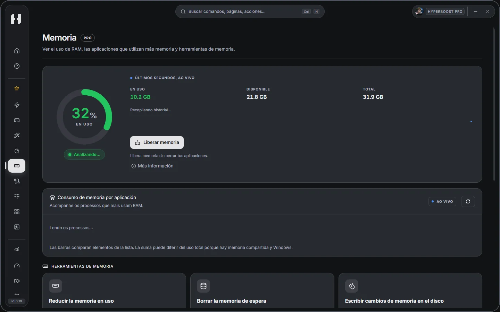

[Ver la guía y las preguntas](https://www.hyperboostapps.com/ferramentas/memoria?lang=es)

<strong>Red</strong> · Pro

Compare las opciones de DNS en su conexión y mantenga la configuración de red en un solo lugar. Elija utilizar los resultados desde su propia PC.

**Cuándo usarla:** Cuando desee comparar las opciones de conexión disponibles y elegir cuál usar en su computadora.

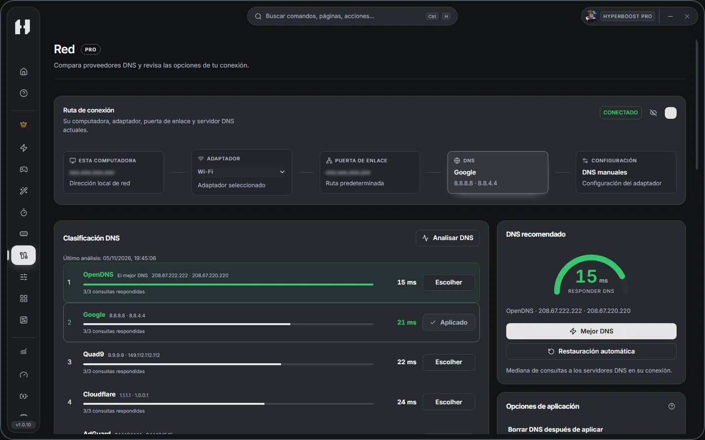

[Ver la guía y las preguntas](https://www.hyperboostapps.com/ferramentas/red?lang=es)

<strong>Ajustes</strong> · Pro

Haga que Windows se adapte a la forma en que usa su PC. Encuentre configuraciones agrupadas por categoría, con explicaciones que lo ayudarán a decidir qué cambiar.

**Cuándo usarla:** Cuando desee personalizar Windows más allá de las configuraciones comunes y comprender cada opción.

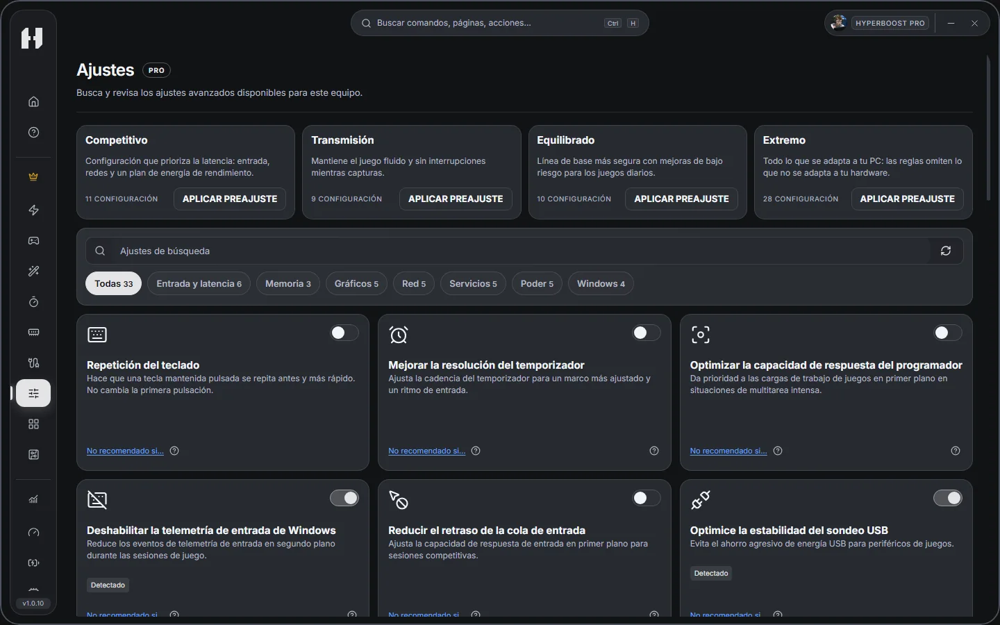

[Ver la guía y las preguntas](https://www.hyperboostapps.com/ferramentas/ajustes?lang=es)

<strong>Windows</strong> · Pro

Organice Windows funciones y preferencias sin visitar varios paneles. Elige lo que quieres mantener en tu rutina.

**Cuándo usarla:** Al configurar una nueva PC o adaptar Windows para trabajar, estudiar y jugar.

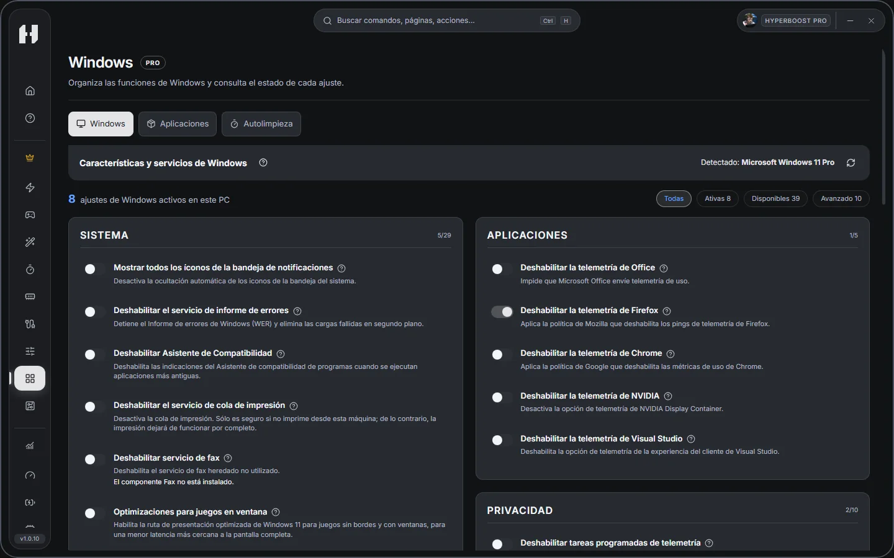

[Ver la guía y las preguntas](https://www.hyperboostapps.com/ferramentas/windows?lang=es)

<strong>Hardware y BIOS</strong> · Pro

Conozca su hardware y vea los hallazgos que HyperBoost puede confirmar. Revíselos sin ingresar al BIOS ni cambiar su configuración.

**Cuándo usarla:** Antes de solicitar soporte, planificar una actualización de hardware o verificar la configuración de su computadora.

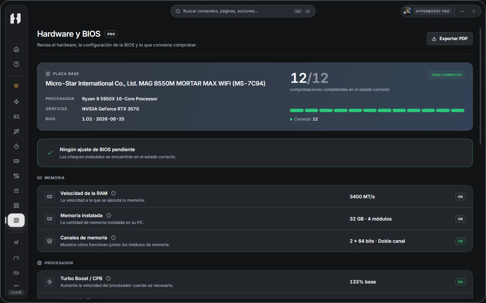

[Ver la guía y las preguntas](https://www.hyperboostapps.com/ferramentas/hardware-y-bios?lang=es)

## Actuación

<strong>Optimización</strong> · Gratis

Elija lo que desea organizar en su PC y vaya directamente a la herramienta adecuada. Encuentre atajos para energía, inicio, privacidad y otras tareas.

**Cuándo usarla:** Cuando sabes lo que quieres hacer en tu PC pero no estás seguro de qué herramienta abrir.

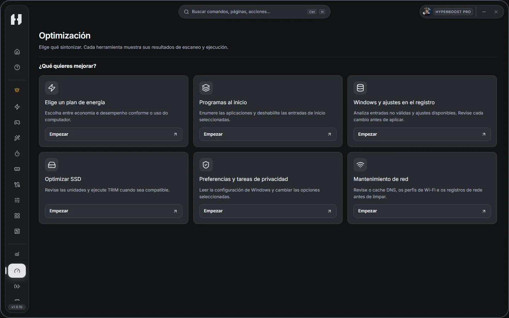

[Ver la guía y las preguntas](https://www.hyperboostapps.com/ferramentas/optimizacion?lang=es)

<strong>Planes de energía</strong> · Gratis

Elija cómo su PC usa la energía para trabajar o jugar. Cambie entre los planes disponibles y regrese al anterior cuando sus necesidades cambien.

**Cuándo usarla:** Al cambiar entre juegos, trabajo y uso de batería, según los planes disponibles en tu PC.

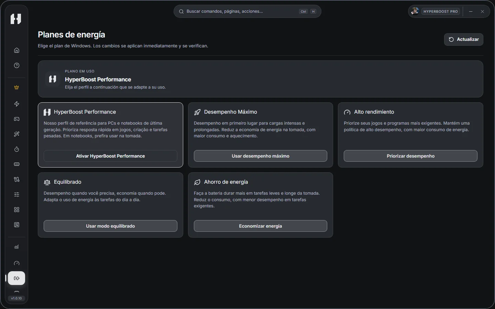

[Ver la guía y las preguntas](https://www.hyperboostapps.com/ferramentas/planes-de-energia?lang=es)

<strong>Mi PC</strong> · Gratis

Descubra lo que hay dentro de su PC sin abrir la carcasa. Verifique el procesador, la tarjeta gráfica, la memoria y las unidades para planificar sus próximos pasos.

**Cuándo usarla:** Antes de comprar hardware, instalar un juego o compartir su configuración con soporte.

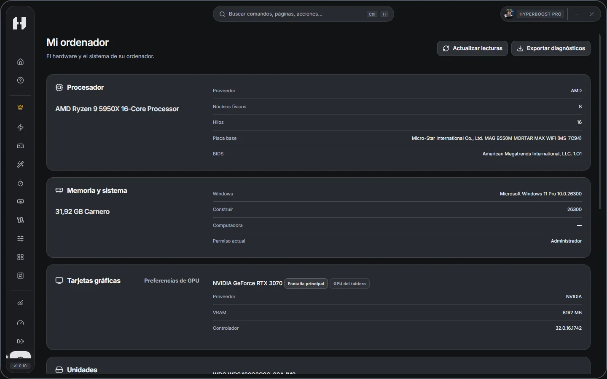

[Ver la guía y las preguntas](https://www.hyperboostapps.com/ferramentas/mi-pc?lang=es)

<strong>Monitorización</strong> · Gratis

Vea qué demanda recursos mientras usa su PC. Siga los gráficos en vivo y encuentre las aplicaciones que utilizan la mayor cantidad de recursos.

**Cuándo usarla:** Cuando su PC parece ocupada, una aplicación se siente lenta o desea seguir el uso de recursos durante una tarea.

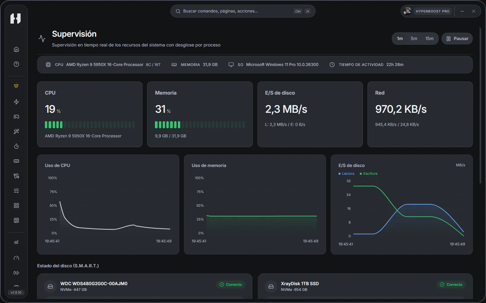

[Ver la guía y las preguntas](https://www.hyperboostapps.com/ferramentas/monitorizacion?lang=es)

<strong>Pruebas de periféricos</strong> · Gratis

Pruebe sus accesorios antes de reemplazar el hardware o iniciar una llamada. Verifique su teclado, mouse, controlador, audio, cámara y pantalla en un solo lugar.

**Cuándo usarla:** Al conectar un nuevo accesorio, investigar una falla o prepararse para una llamada o juego.

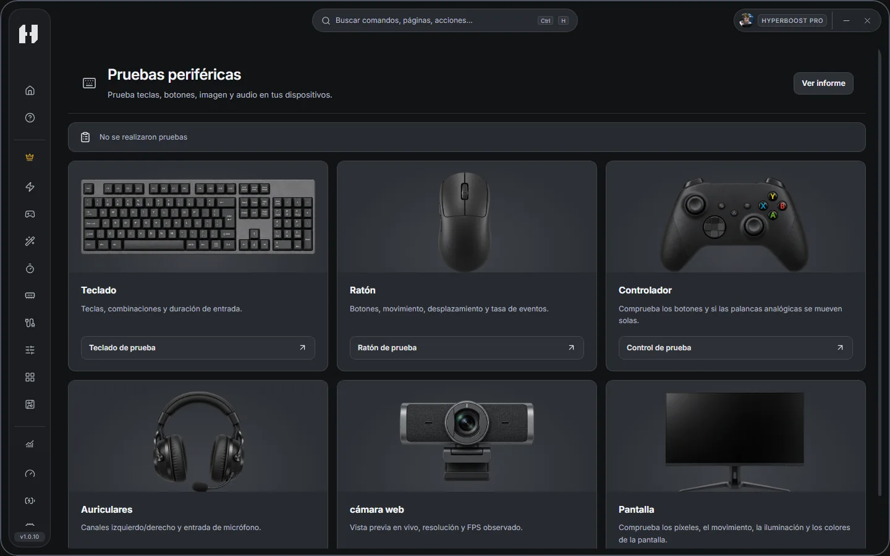

[Ver la guía y las preguntas](https://www.hyperboostapps.com/ferramentas/pruebas-de-perifericos?lang=es)

<strong>Prueba de internet</strong> · Gratis

Verifica tu conexión sin salir de HyperBoost. Utilice mediciones para investigar ralentizaciones y comparar su Internet en diferentes momentos.

**Cuándo usarla:** Al navegar, una llamada o un juego se siente lento y desea verificar su conexión.

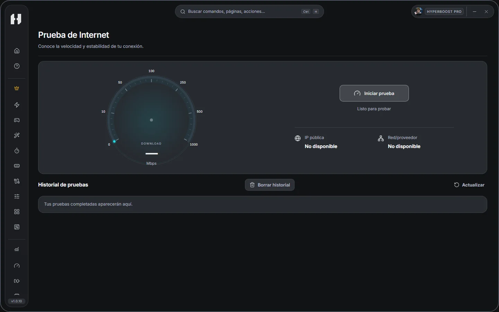

[Ver la guía y las preguntas](https://www.hyperboostapps.com/ferramentas/prueba-de-internet?lang=es)

<strong>Mantenimiento de red</strong> · Gratis

Encuentre herramientas para mantener su conexión cuando surjan problemas. Mantenga juntas la limpieza de datos de la red y la administración de la red guardada.

**Cuándo usarla:** Al investigar problemas de conexión u organizar redes que ya no utilizas.

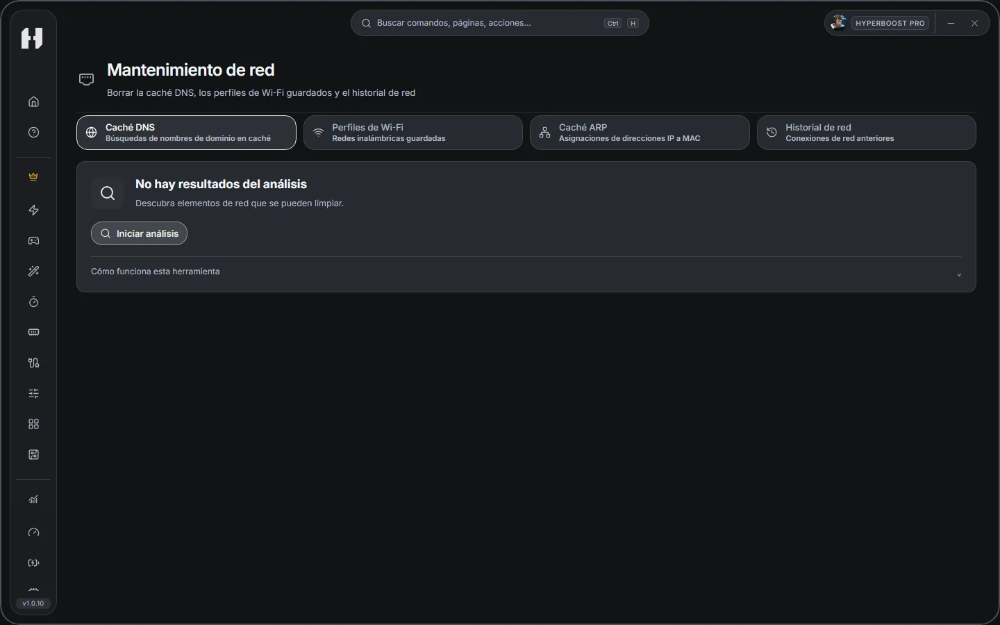

[Ver la guía y las preguntas](https://www.hyperboostapps.com/ferramentas/mantenimiento-de-red?lang=es)

<strong>Prueba de teclado</strong> · Gratis

¿Una clave que no responde como se esperaba? Vea qué teclas reconoce su PC antes de decidir reemplazar el teclado.

**Cuándo usarla:** Al probar un teclado nuevo o investigar una tecla defectuosa.

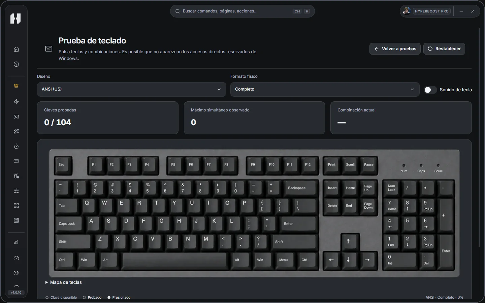

[Ver la guía y las preguntas](https://www.hyperboostapps.com/ferramentas?lang=es&ferramenta=keyboard)

<strong>Prueba de ratón</strong> · Gratis

Verifique los clics y el movimiento de su mouse con una prueba guiada. Investigue el comportamiento inusual antes de reemplazar el accesorio.

**Cuándo usarla:** Cuando un botón o movimiento del mouse parece diferente de lo esperado.

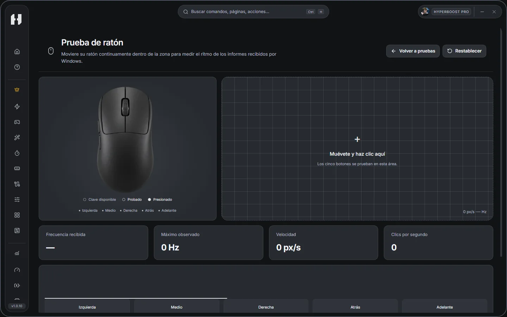

[Ver la guía y las preguntas](https://www.hyperboostapps.com/ferramentas?lang=es&ferramenta=mouse)

<strong>Prueba de mando</strong> · Gratis

Prepara tu mando para jugar. Compruebe si su PC reconoce los comandos del dispositivo conectado.

**Cuándo usarla:** Al conectar un controlador o investigar un comando que no responde como se esperaba.

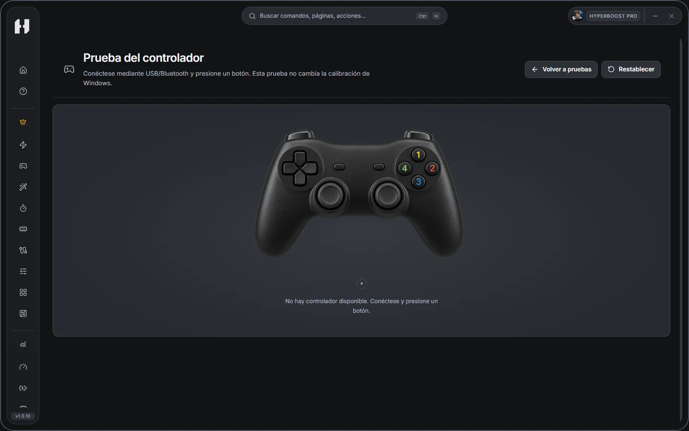

[Ver la guía y las preguntas](https://www.hyperboostapps.com/ferramentas?lang=es&ferramenta=controller)

<strong>Prueba de audio</strong> · Gratis

Pruebe el audio y el micrófono antes de una llamada o juego. Verifique los dispositivos disponibles y ejecute pruebas de sonido en HyperBoost.

**Cuándo usarla:** Antes de una llamada, transmisión o juego con chat de voz.

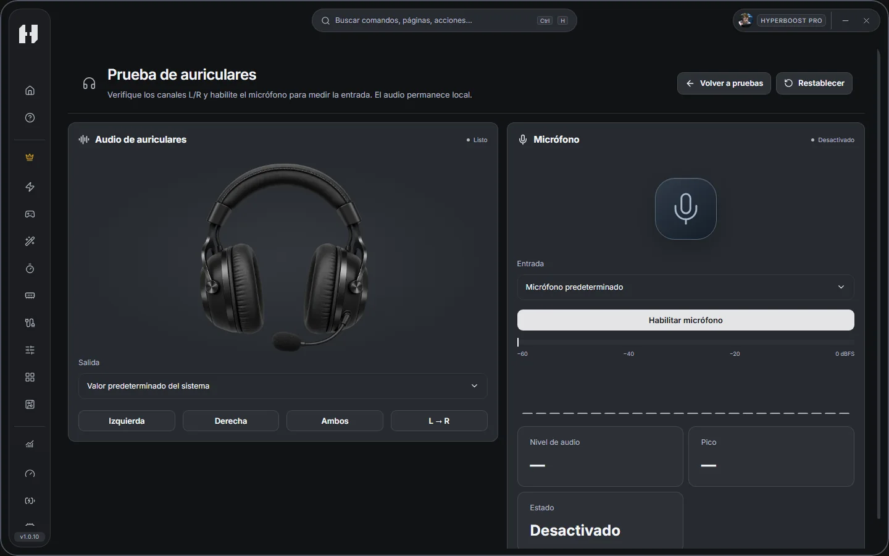

[Ver la guía y las preguntas](https://www.hyperboostapps.com/ferramentas?lang=es&ferramenta=headset)

<strong>Prueba de cámara</strong> · Gratis

Verifique la imagen de su cámara antes de una reunión o transmisión. La vista previa comienza solo cuando comienza y permite el acceso.

**Cuándo usarla:** Antes de una reunión o al comprobar una cámara recién conectada.

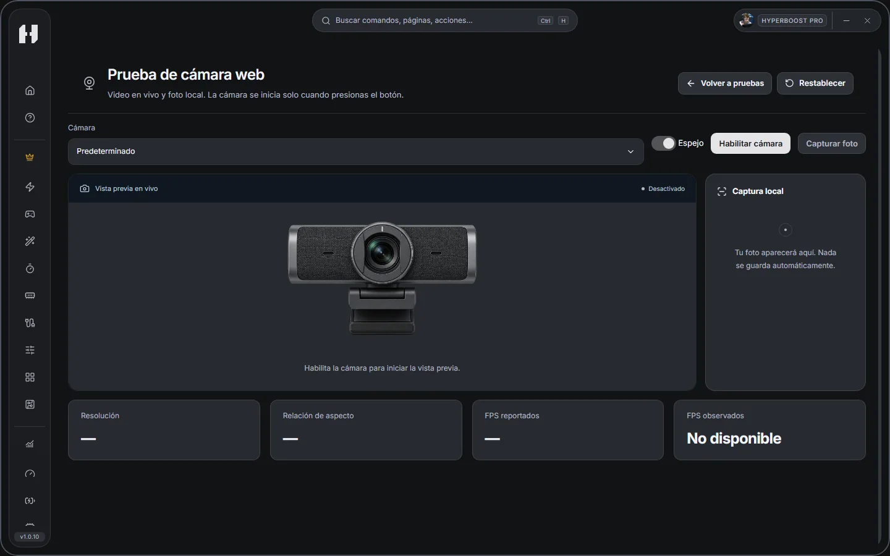

[Ver la guía y las preguntas](https://www.hyperboostapps.com/ferramentas?lang=es&ferramenta=webcam)

<strong>Prueba de pantalla</strong> · Gratis

Verifique su pantalla con patrones de prueba visuales. Inspeccione los colores y busque manchas o diferencias visibles en la pantalla.

**Cuándo usarla:** Al probar un monitor nuevo o notar algo inusual en sus colores o imagen.

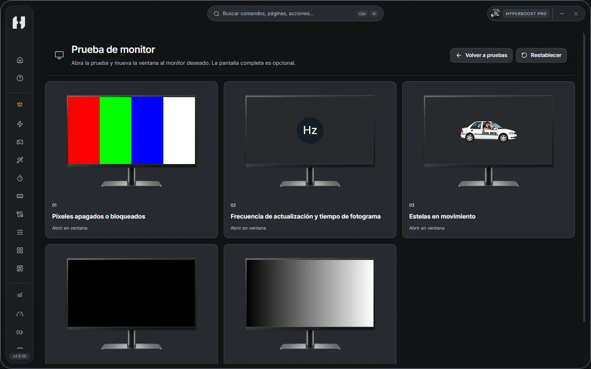

[Ver la guía y las preguntas](https://www.hyperboostapps.com/ferramentas?lang=es&ferramenta=display)

<strong>Resultados de periféricos</strong> · Gratis

Vea los resultados de sus pruebas completadas en un solo lugar. Revise qué accesorios probó y cuáles aún deben revisarse.

**Cuándo usarla:** Después de probar sus accesorios cuando quieran revisar los resultados juntos.

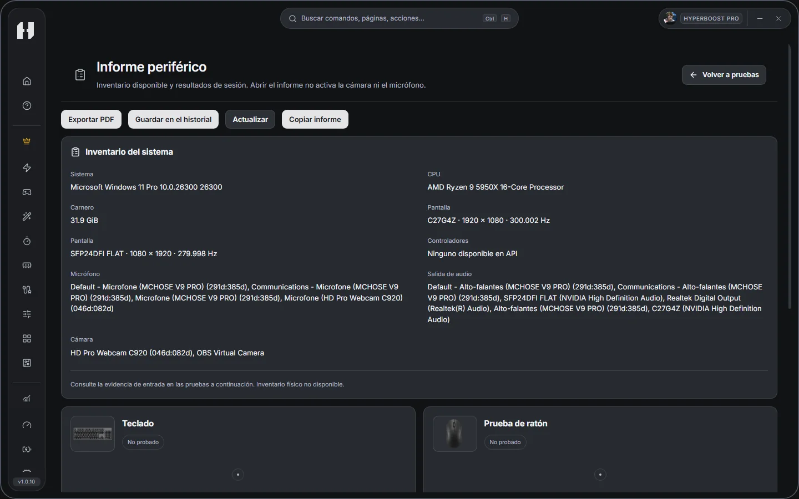

[Ver la guía y las preguntas](https://www.hyperboostapps.com/ferramentas?lang=es&ferramenta=peripheral-report)

## Mantenimiento

<strong>Limpieza</strong> · Gratis

Haz espacio para lo que importa. Encuentre archivos innecesarios y elija qué eliminar antes de comenzar la limpieza.

**Cuándo usarla:** Cuando su disco se está llenando o desea organizar archivos que se acumulan con el uso diario.

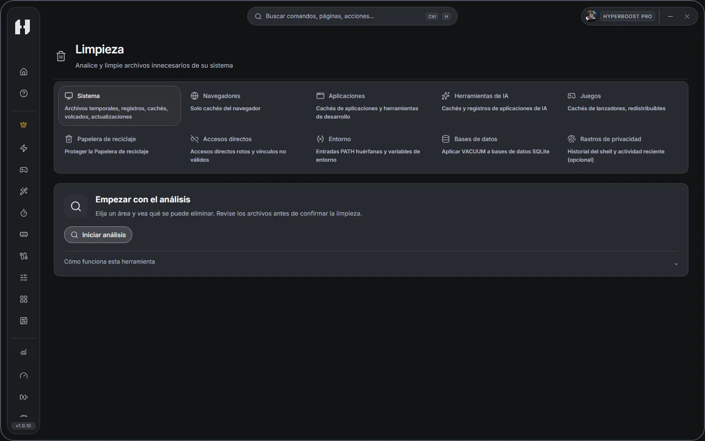

[Ver la guía y las preguntas](https://www.hyperboostapps.com/ferramentas/limpieza?lang=es)

<strong>Inicio de Windows</strong> · Gratis

Elija qué aplicaciones deben abrirse con Windows. Mantenga solo lo que tenga sentido para su rutina diaria en el inicio.

**Cuándo usarla:** Cuando se abren demasiadas aplicaciones al iniciar su PC o desea revisar el inicio automático.

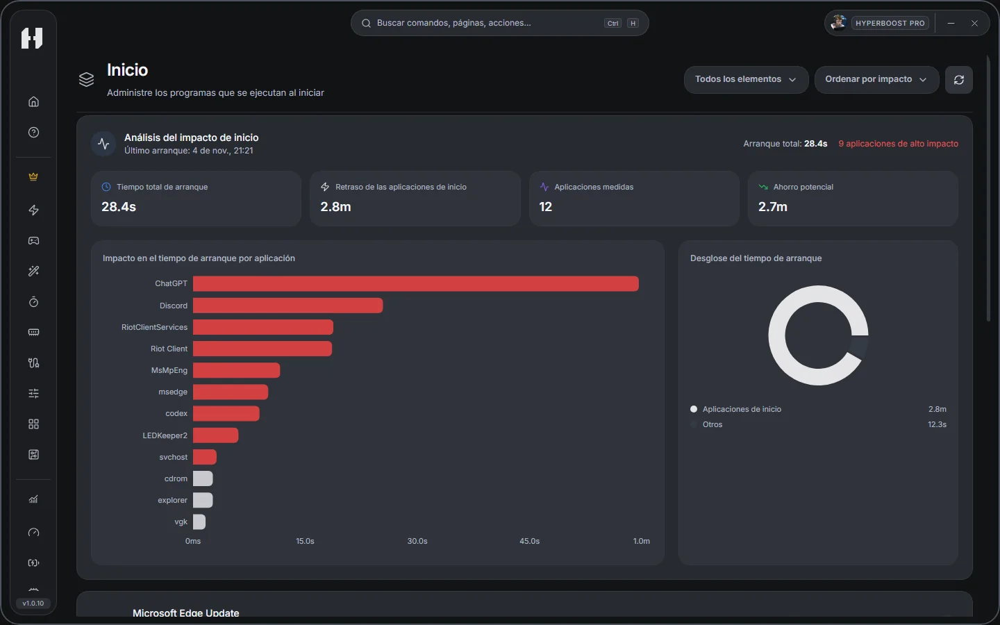

[Ver la guía y las preguntas](https://www.hyperboostapps.com/ferramentas/inicio-de-windows?lang=es)

<strong>Analizador de disco</strong> · Gratis

Descubra adónde fue a parar su espacio en disco. Vea qué archivos y carpetas ocupan más espacio antes de decidir qué organizar.

**Cuándo usarla:** Cuando su disco está lleno y aún no sabe qué carpetas o archivos están ocupando espacio.

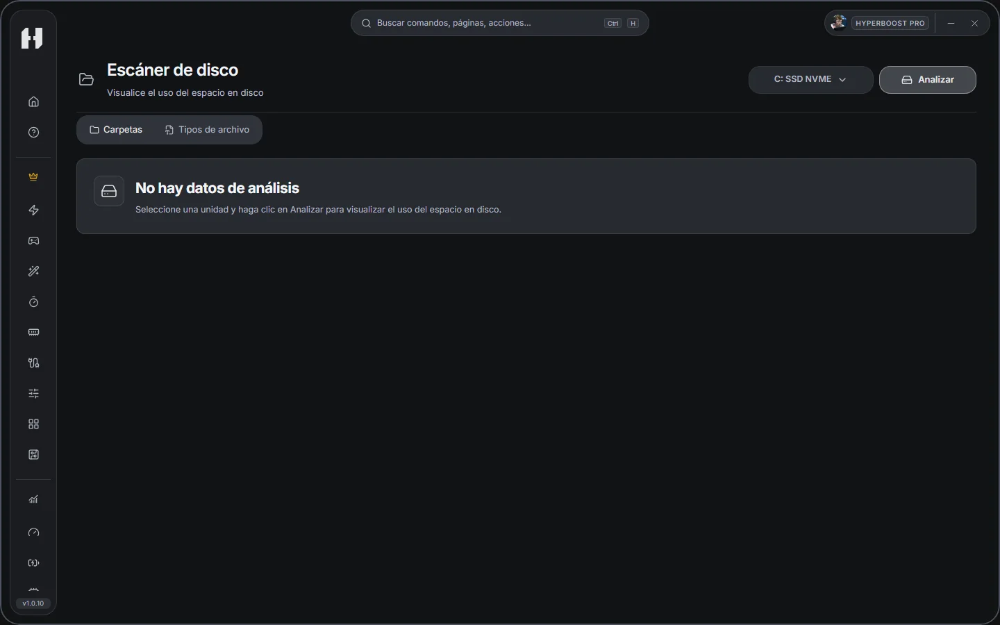

[Ver la guía y las preguntas](https://www.hyperboostapps.com/ferramentas/analizador-de-disco?lang=es)

<strong>Almacenamiento</strong> · Gratis

Encuentre la forma correcta de organizar el almacenamiento. Acceda a herramientas de análisis de espacio, archivos duplicados y mantenimiento sin buscar en toda la aplicación.

**Cuándo usarla:** Cuando necesitas liberar u organizar espacio y quieres elegir la herramienta adecuada para empezar.

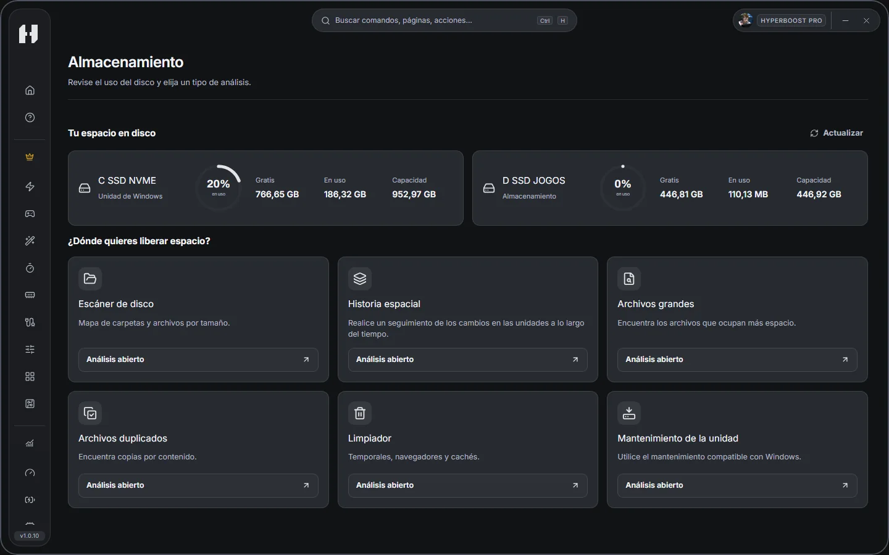

[Ver la guía y las preguntas](https://www.hyperboostapps.com/ferramentas/almacenamiento?lang=es)

<strong>Historial de almacenamiento</strong> · Gratis

Comprenda qué cambió en sus carpetas entre escaneos. Compare registros para investigar por qué aumentó el espacio utilizado.

**Cuándo usarla:** Cuando una carpeta está creciendo y desea comparar su contenido en diferentes momentos.

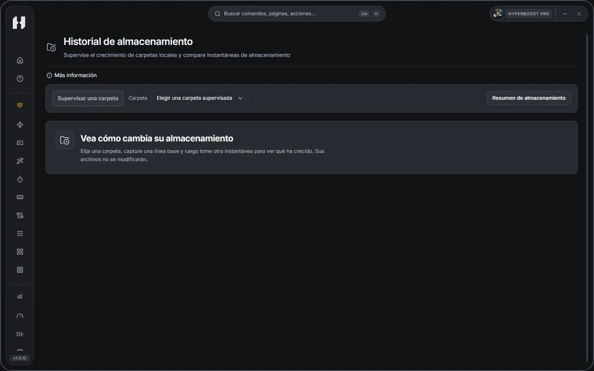

[Ver la guía y las preguntas](https://www.hyperboostapps.com/ferramentas/historial-de-almacenamiento?lang=es)

<strong>Herramientas</strong> · Gratis

Mantenga los servicios públicos diarios a mano. Encuentre atajos para mantener Windows, revisar su PC y trabajar con archivos.

**Cuándo usarla:** Cuando necesitas una herramienta o utilidad Windows sin buscar en diferentes lugares.

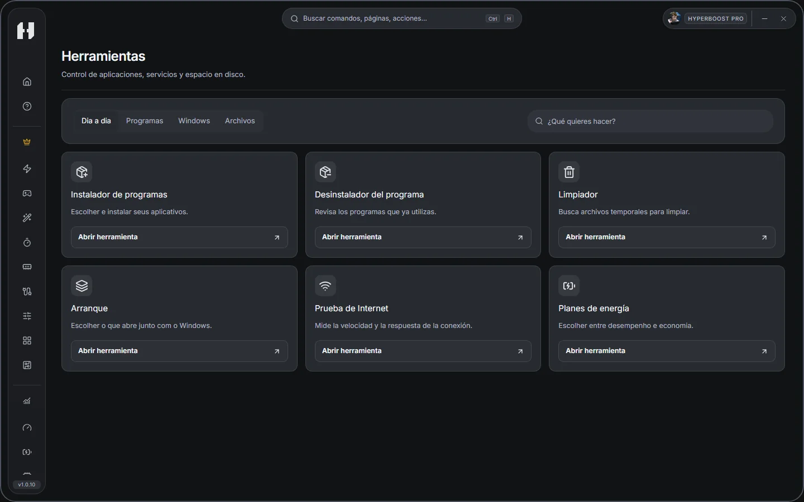

[Ver la guía y las preguntas](https://www.hyperboostapps.com/ferramentas/herramientas?lang=es)

<strong>Tareas programadas</strong> · Gratis

Deje que las tareas disponibles sigan su rutina. Elija cuándo se ejecutan, establezca su frecuencia y siga lo que se completó.

**Cuándo usarla:** Cuando desea repetir una tarea disponible sin recordar iniciarla manualmente cada vez.

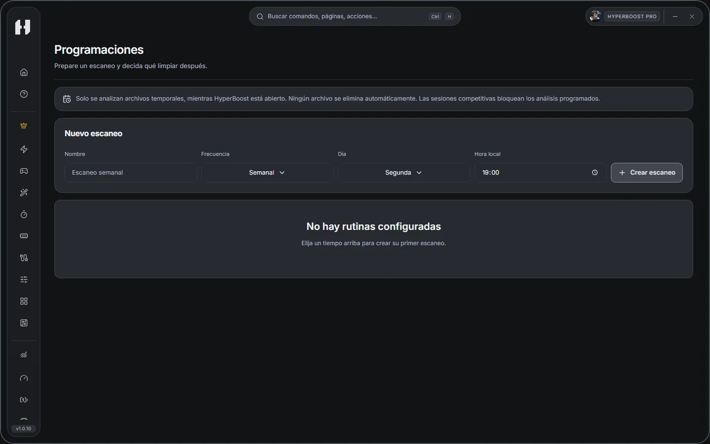

[Ver la guía y las preguntas](https://www.hyperboostapps.com/ferramentas/tareas-programadas?lang=es)

<strong>Registro y ajustes</strong> · Gratis

Mantenga el análisis y la revisión de Windows entradas en un solo lugar. Inspeccione los hallazgos y elija qué cambiar con una copia de seguridad.

**Cuándo usarla:** Cuando hay un motivo para investigar Windows entradas y desea revisar los hallazgos antes de realizar cambios.

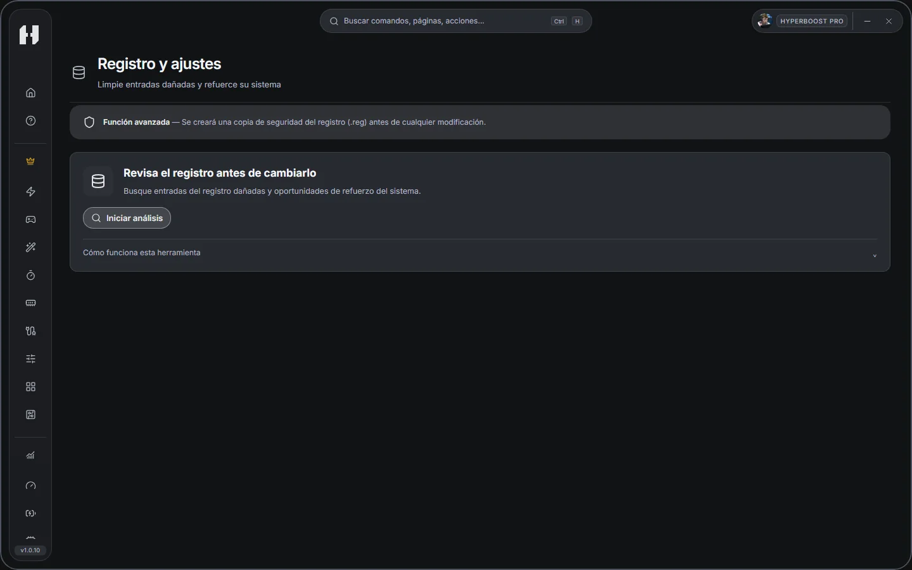

[Ver la guía y las preguntas](https://www.hyperboostapps.com/ferramentas/registro-y-ajustes?lang=es)

<strong>Privacidad</strong> · Gratis

Elige cómo utilizas Windows funciones de privacidad. Mantenga juntas las preferencias de publicidad, búsqueda y sincronización sin tener que buscar en los paneles.

**Cuándo usarla:** Al personalizar Windows o revisar las funciones de publicidad, búsqueda y sincronización que desea utilizar.

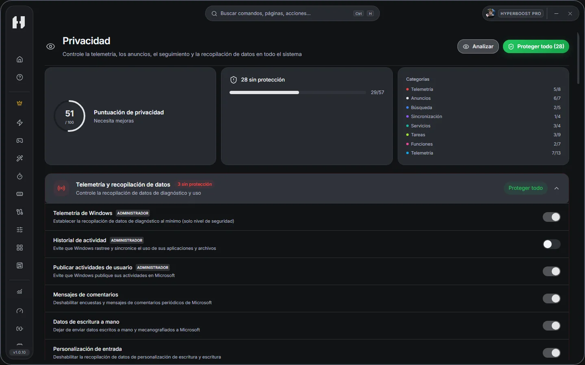

[Ver la guía y las preguntas](https://www.hyperboostapps.com/ferramentas/privacidad?lang=es)

<strong>Firewall</strong> · Gratis

Comprenda los permisos de conexión de Windows para sus aplicaciones. Encuentre reglas que valga la pena revisar y decida cuáles conservar.

**Cuándo usarla:** Al revisar los permisos de red de la aplicación o investigar una regla que no reconoce.

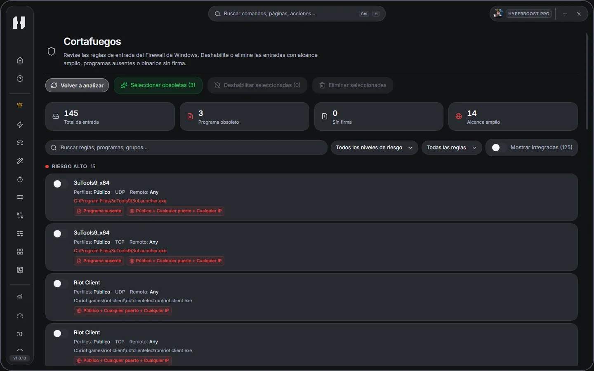

[Ver la guía y las preguntas](https://www.hyperboostapps.com/ferramentas/firewall?lang=es)

<strong>Verificación de archivos</strong> · Gratis

Investigue archivos sospechosos con las comprobaciones disponibles en HyperBoost. Revise los hallazgos para decidir su próximo paso mientras mantiene activo su antivirus.

**Cuándo usarla:** Cuando un archivo parece sospechoso y desea obtener más información antes de decidir qué hacer.

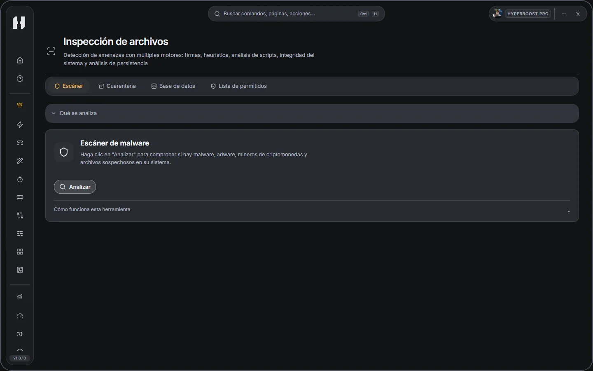

[Ver la guía y las preguntas](https://www.hyperboostapps.com/ferramentas/verificacion-de-archivos?lang=es)

<strong>Servicios</strong> · Gratis

Encuentre y administre servicios que se ejecutan en Windows. Vea qué está activo antes de ajustar cómo se inicia cada servicio.

**Cuándo usarla:** Cuando necesita encontrar un servicio específico o verificar su estado mientras sigue las instrucciones de soporte.

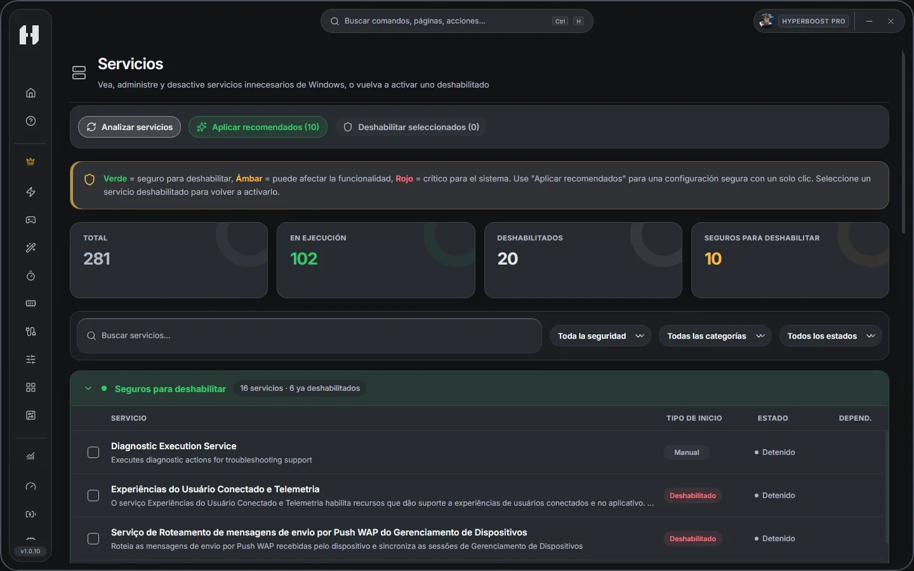

[Ver la guía y las preguntas](https://www.hyperboostapps.com/ferramentas/servicios?lang=es)

<strong>Archivos duplicados</strong> · Gratis

Encuentra copias repetidas ocupando espacio. Compare archivos y elija cuáles conservar antes de eliminar los que no necesita.

**Cuándo usarla:** Después de copiar fotos, documentos o copias de seguridad cuando sospeches que tus carpetas contienen archivos duplicados.

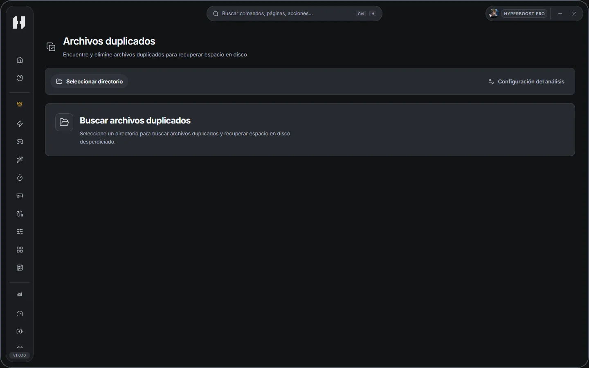

[Ver la guía y las preguntas](https://www.hyperboostapps.com/ferramentas/archivos-duplicados?lang=es)

<strong>Archivos grandes</strong> · Gratis

Encuentre los archivos que ocupan más espacio sin abrir todas las carpetas. Vea qué organizar antes de instalar otro juego o aplicación.

**Cuándo usarla:** Cuando necesitas espacio para un juego, una aplicación o una descarga y quieres localizar los archivos más grandes.

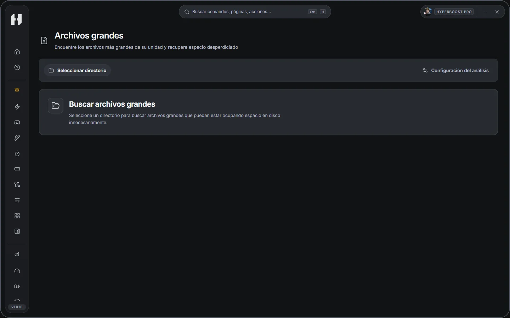

[Ver la guía y las preguntas](https://www.hyperboostapps.com/ferramentas/archivos-grandes?lang=es)

<strong>Carpetas vacías</strong> · Gratis

Organice las carpetas que quedan vacías después de mover o eliminar archivos. Encuentra sus ubicaciones y elige cuál ya no necesitas.

**Cuándo usarla:** Después de reorganizar sus archivos, cuando desee verificar qué carpetas quedaron vacías.

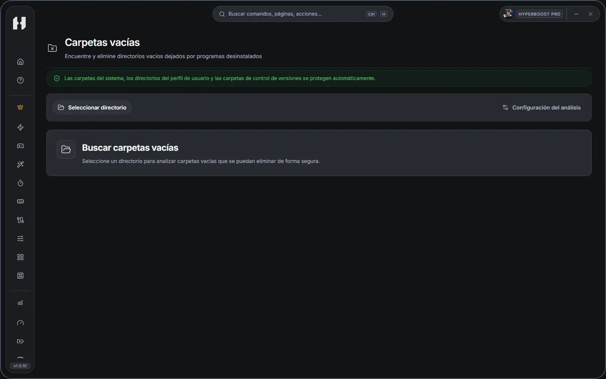

[Ver la guía y las preguntas](https://www.hyperboostapps.com/ferramentas/carpetas-vacias?lang=es)

<strong>Mantenimiento de unidades</strong> · Gratis

Mantenga sus unidades con opciones disponibles en Windows. Elija una unidad y siga una acción adecuada a su tipo.

**Cuándo usarla:** Cuando desee verificar el mantenimiento disponible para un SSD u otra unidad en su computadora.

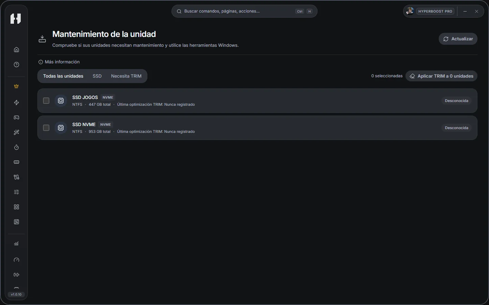

[Ver la guía y las preguntas](https://www.hyperboostapps.com/ferramentas/mantenimiento-de-unidades?lang=es)

<strong>Reparar Windows y disco</strong> · Gratis

Investigue Windows y conduzca problemas sin escribir comandos. Accede a las comprobaciones y reparaciones disponibles y sigue el resultado.

**Cuándo usarla:** Cuando Windows muestra errores y necesita una verificación guiada antes de considerar cambios mayores.

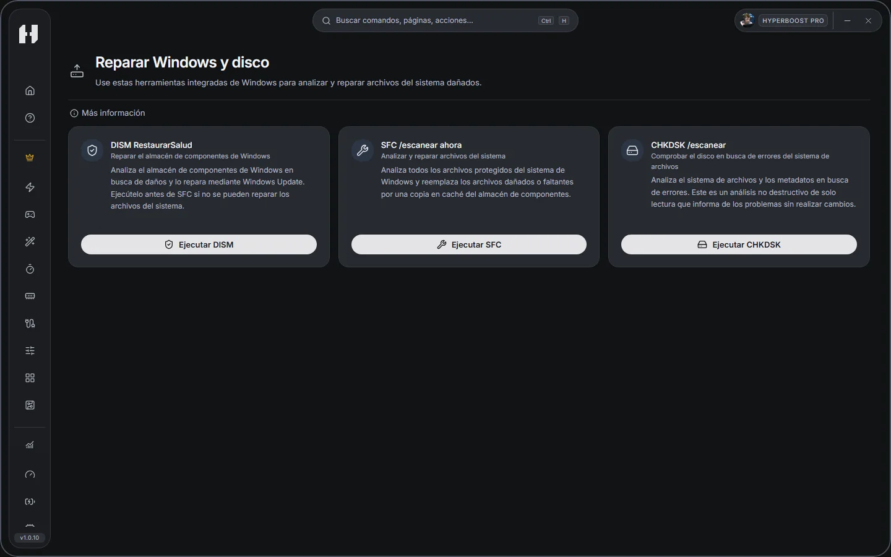

[Ver la guía y las preguntas](https://www.hyperboostapps.com/ferramentas/reparar-windows-y-disco?lang=es)

<strong>Eliminar archivos</strong> · Gratis

Elimine los archivos seleccionados con una revisión antes de comenzar. Úselo sólo cuando esté seguro: esta herramienta no ofrece restauración.

**Cuándo usarla:** Cuando esté seguro de que ya no necesita los archivos y desea eliminarlos sin la opción de restauración HyperBoost.

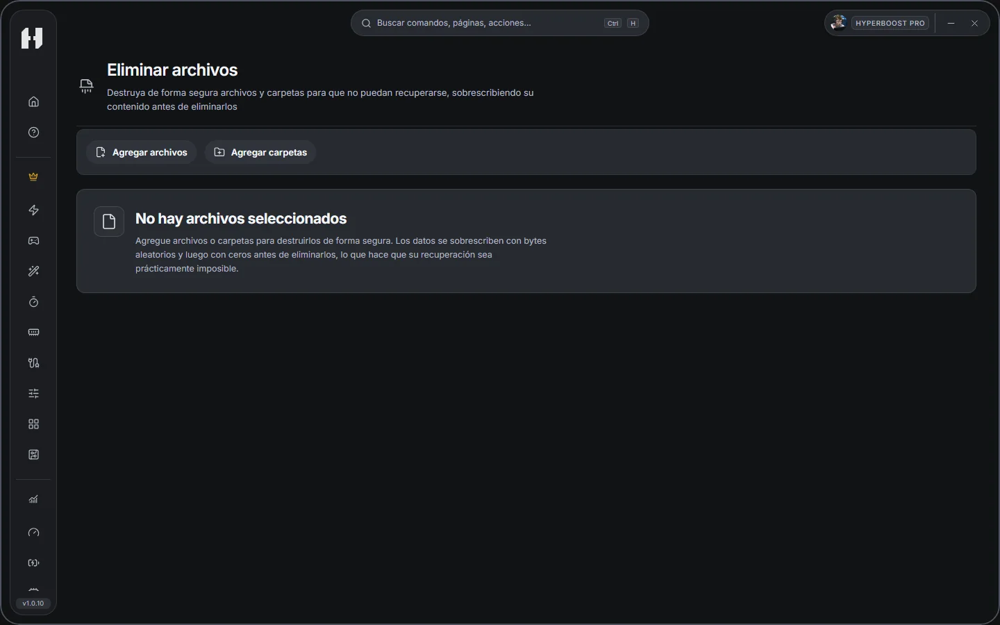

[Ver la guía y las preguntas](https://www.hyperboostapps.com/ferramentas/eliminar-archivos?lang=es)

## Software

<strong>Actualizar controladores</strong> · Gratis

Busque actualizaciones para los dispositivos de su PC sin verificar cada una por separado. Revise las opciones encontradas y elija cuál instalar.

**Cuándo usarla:** Al preparar una PC recién configurada o buscar actualizaciones para un dispositivo.

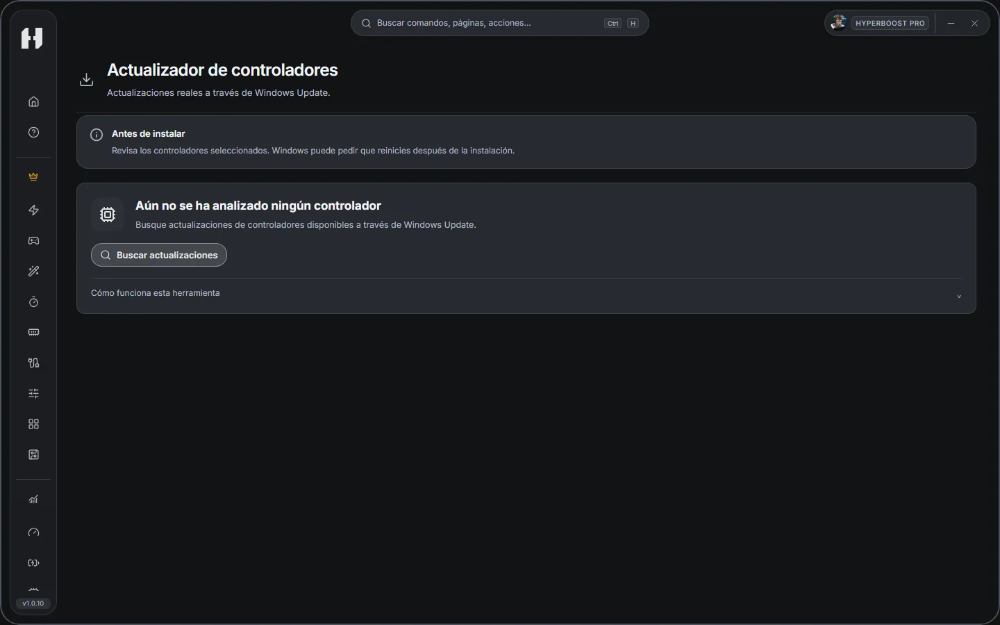

[Ver la guía y las preguntas](https://www.hyperboostapps.com/ferramentas/actualizar-controladores?lang=es)

<strong>Administrar controladores</strong> · Gratis

Organice los controladores que ya están en su computadora. Revise los paquetes detectados e identifique los más antiguos que se pueden eliminar.

**Cuándo usarla:** Después de cambiar el hardware o cuando desee organizar los paquetes de controladores que quedan en su PC.

[Ver la guía y las preguntas](https://www.hyperboostapps.com/ferramentas/administrar-controladores?lang=es)

<strong>Desinstalar apps</strong> · Gratis

Encuentra aplicaciones que ya no usas y comienza a eliminarlas de HyperBoost. Organice su software sin tener que localizar cada desinstalador usted mismo.

**Cuándo usarla:** Cuando desee eliminar software no utilizado u organizar aplicaciones instaladas.

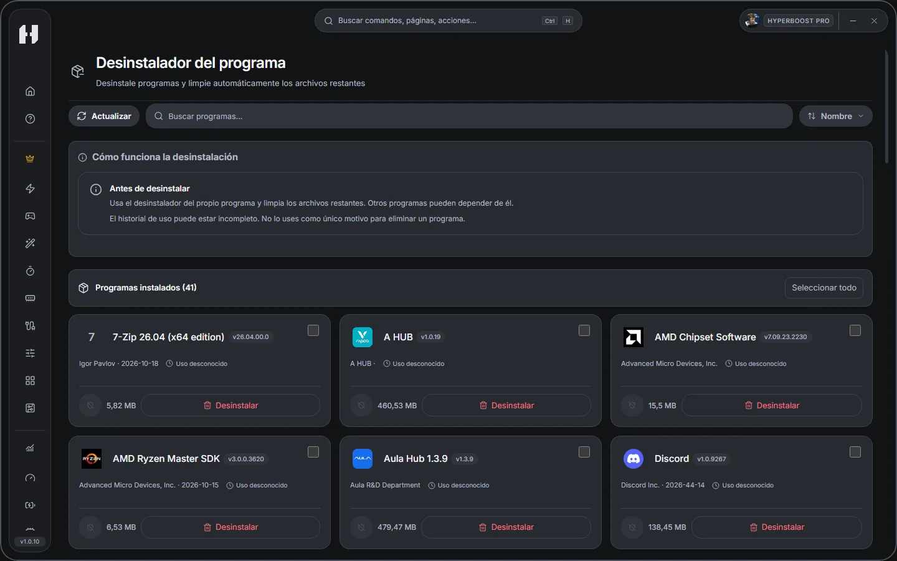

[Ver la guía y las preguntas](https://www.hyperboostapps.com/ferramentas/desinstalar-apps?lang=es)

<strong>Instalar apps</strong> · Gratis

Busca e instala las aplicaciones disponibles directamente desde HyperBoost, sin buscar descargas en el navegador. Ideal para preparar un PC después de formatear o instalar tus programas de uso diario.

**Cuándo usarla:** Después de formatear el PC, cambiar de ordenador o cuando quieras instalar varios programas sin visitar cada sitio web.

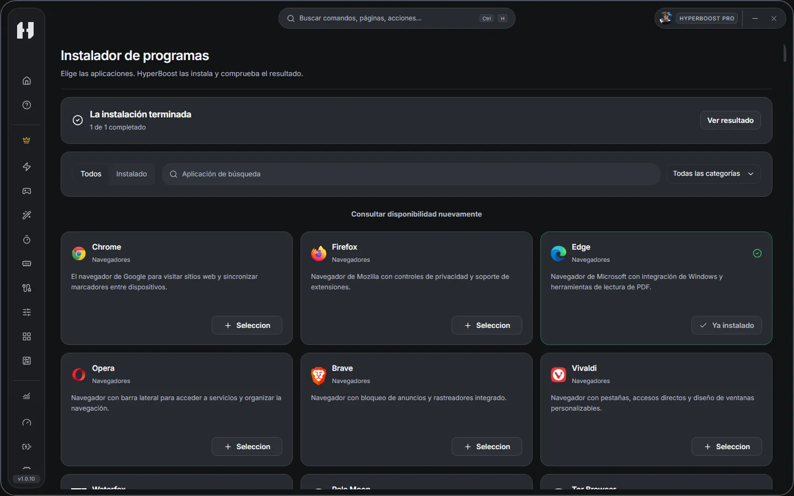

[Ver la guía y las preguntas](https://www.hyperboostapps.com/ferramentas/instalar-apps?lang=es)

<strong>Eliminar apps preinstaladas</strong> · Gratis

Elija qué aplicaciones preinstaladas desea conservar en su PC. Encuentre aquellos que no usa y elimine los artículos elegibles en un solo lugar.

**Cuándo usarla:** Al configurar una PC nueva o recién formateada con aplicaciones preinstaladas que no usas.

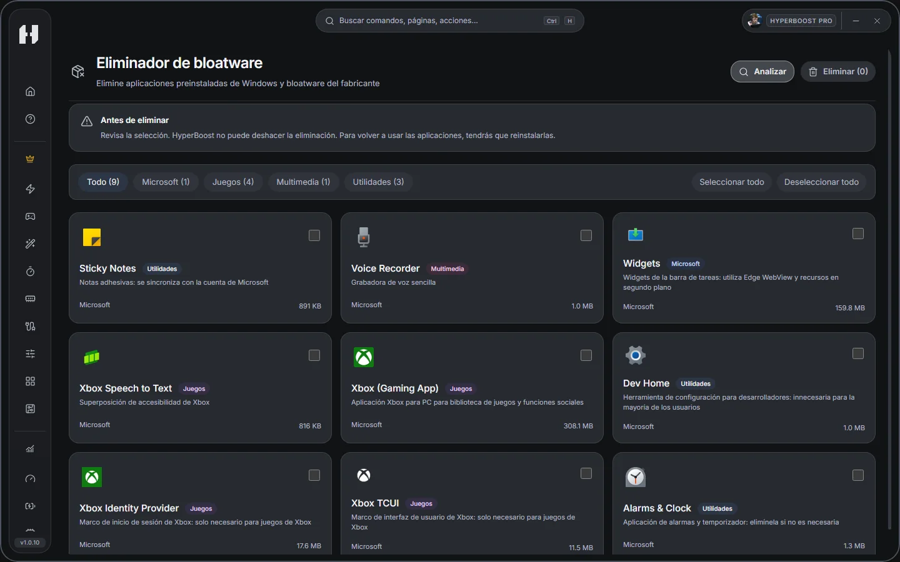

[Ver la guía y las preguntas](https://www.hyperboostapps.com/ferramentas/eliminar-apps-preinstaladas?lang=es)

<strong>Menú contextual</strong> · Gratis

Mantenga organizado el menú contextual. Elija qué entradas conservar sin desinstalar las aplicaciones relacionadas.

**Cuándo usarla:** Cuando el menú contextual está lleno de opciones que no utilizas.

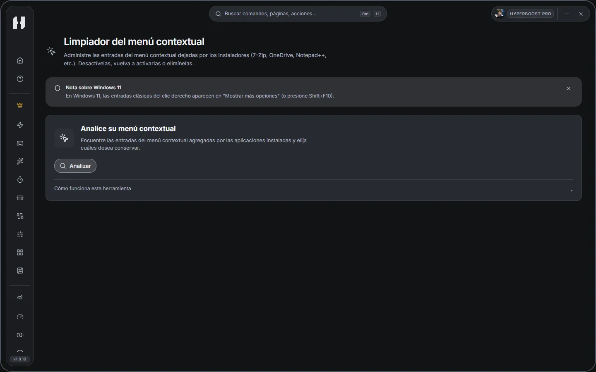

[Ver la guía y las preguntas](https://www.hyperboostapps.com/ferramentas/menu-contextual?lang=es)

<strong>Actualizar apps</strong> · Gratis

Encuentre actualizaciones de aplicaciones en un solo lugar. Elija qué programas reconocidos actualizar sin verificarlos uno por uno.

**Cuándo usarla:** Cuando desea actualizar programas reconocidos por HyperBoost sin abrir cada aplicación para verificar.

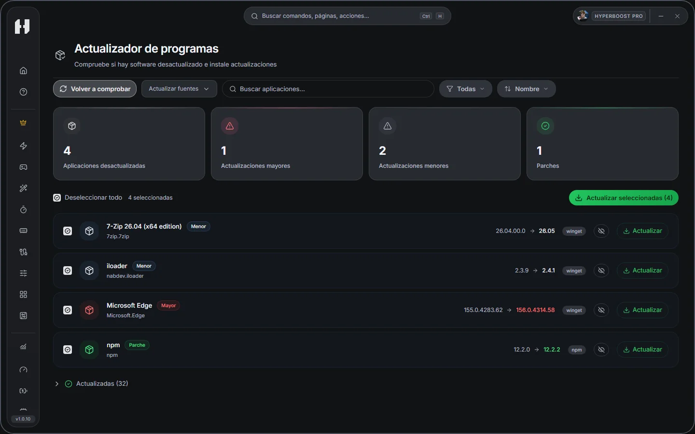

[Ver la guía y las preguntas](https://www.hyperboostapps.com/ferramentas/actualizar-apps?lang=es)

## Actividad y recuperación

<strong>Recuperación</strong> · Gratis

¿Cambiaste una configuración y quieres volver? Encuentre cambios con copias de seguridad y restaure el estado guardado por HyperBoost cuando esa opción esté disponible.

**Cuándo usarla:** Cuando desee deshacer un cambio respaldado o verificar una recuperación pendiente.

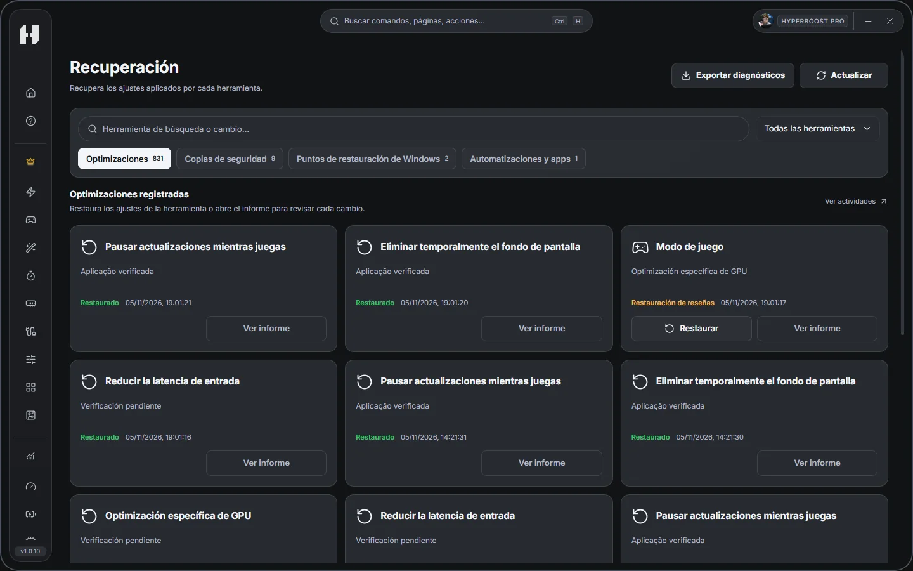

[Ver la guía y las preguntas](https://www.hyperboostapps.com/ferramentas/recuperacion?lang=es)

<strong>Actividad</strong> · Gratis

Mira lo que HyperBoost hizo en tu PC. Encuentre tareas completadas y verifique su tiempo, resultados y detalles disponibles.

**Cuándo usarla:** Cuando desee confirmar una limpieza, revisar una instalación o comprender el resultado de una tarea.

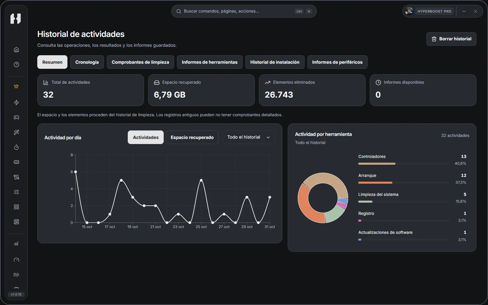

[Ver la guía y las preguntas](https://www.hyperboostapps.com/ferramentas/actividad?lang=es)

## Explora la aplicación

<strong>Inicio</strong> · Gratis

Vea su PC de un vistazo: siga el uso de recursos y encuentre el siguiente paso para organizar el sistema.

**Cuándo usarla:** Cuando abres HyperBoost y quieres saber por dónde empezar sin comprobar todas las herramientas.

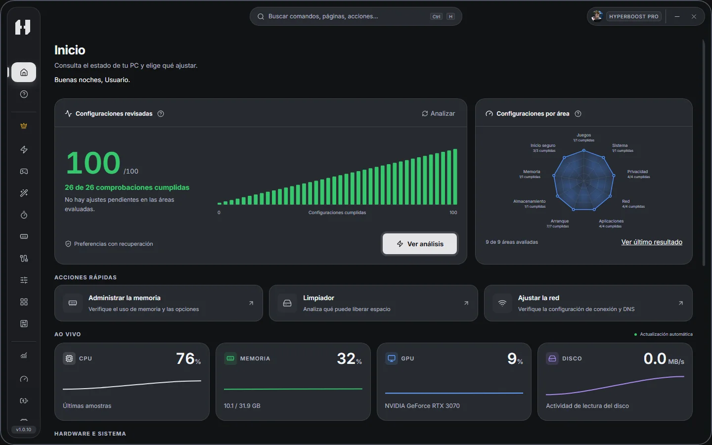

[Ver la guía y las preguntas](https://www.hyperboostapps.com/ferramentas?lang=es&ferramenta=home)

<strong>Configuración</strong> · Gratis

Haz tuyo HyperBoost. Elija su tema, idioma, tamaño de ventana y preferencias para adaptarse a la forma en que utiliza la aplicación.

**Cuándo usarla:** Cuando desea ajustar la apariencia y el comportamiento del propio HyperBoost.

[Ver la guía y las preguntas](https://www.hyperboostapps.com/ferramentas?lang=es&ferramenta=settings)

