# HyperBoost tools

[Português](ferramentas.md) · [English](tools.en.md) · [Español](herramientas.es.md)

Real HyperBoost 1.0.10 captures. Availability depends on your hardware, drivers and Windows. Account identifiers are hidden; the account photo is included with permission.

[Explore all tools](https://www.hyperboostapps.com/ferramentas?lang=en)

## Pro

<strong>PC Boost</strong> · Pro

Prepare your PC for your goal without hunting through settings menus. PC Boost brings recommendations together so you can choose what to apply.

**When to use:** Before preparing your computer for a game or reviewing settings that suit your routine.

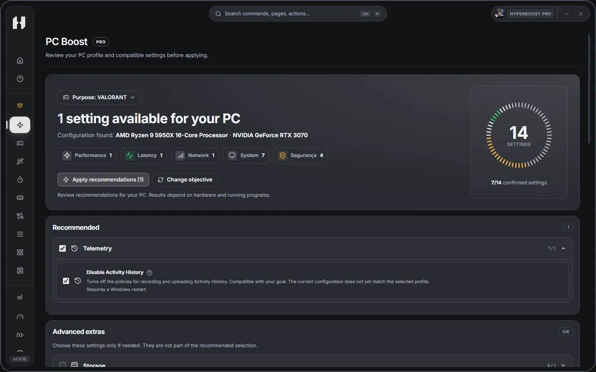

[See the guide and questions](https://www.hyperboostapps.com/ferramentas/pc-boost?lang=en)

<strong>Game Mode</strong> · Pro

Choose how to prepare your PC for gaming and follow your session. Keep profiles, session settings and an optional on-screen monitor together.

**When to use:** When you want to use a gaming profile and follow how your PC behaves during a session.

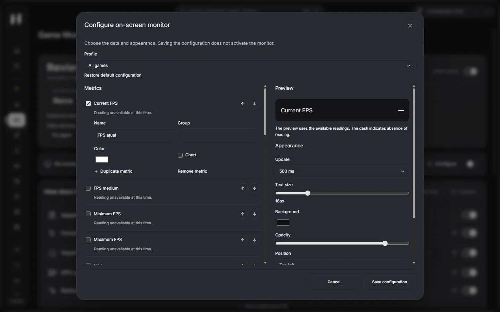

On-screen monitor settings.

[See the guide and questions](https://www.hyperboostapps.com/ferramentas/game-mode?lang=en)

<strong>Apps</strong> · Pro

Adjust apps such as Discord and browsers in one place. Find available options without hunting through different menus.

**When to use:** When you want to review how apps behave alongside your games or in everyday use.

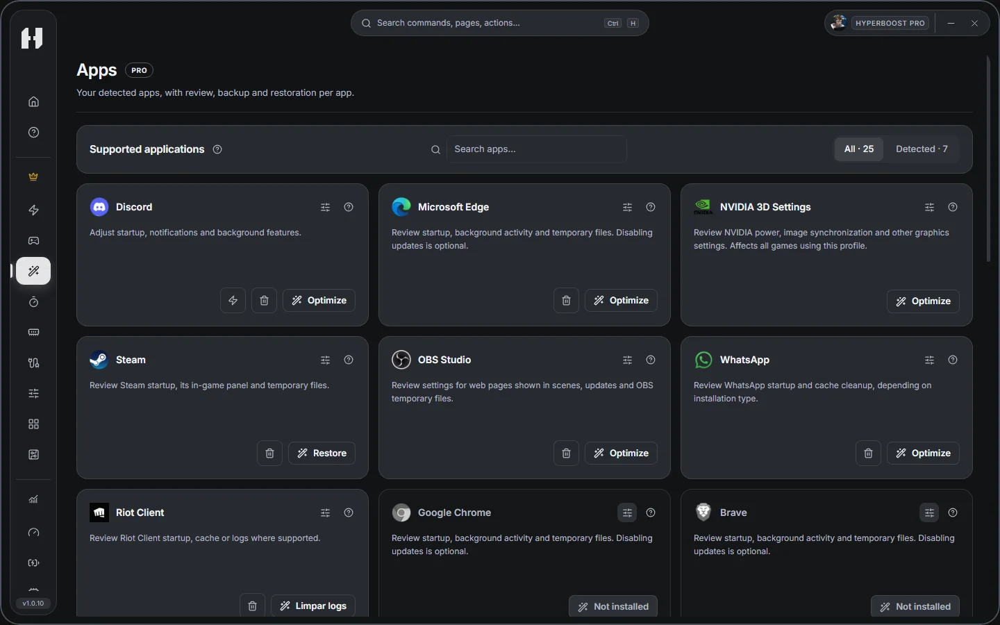

[See the guide and questions](https://www.hyperboostapps.com/ferramentas/apps?lang=en)

<strong>Latency</strong> · Pro

Bring together the mouse, graphics and connection settings you want to review for gaming. Understand each option and choose what suits your PC.

**When to use:** When you want to review settings related to input response without getting lost in Windows settings.

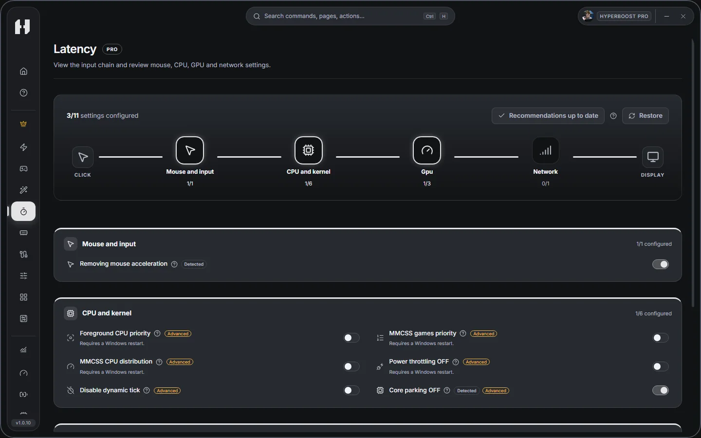

[See the guide and questions](https://www.hyperboostapps.com/ferramentas/latency?lang=en)

<strong>Memory</strong> · Pro

See how much memory your apps use and choose when cleanup runs. Manage RAM without repeating the same task manually.

**When to use:** When many apps are open or you want to set up a memory-cleanup routine.

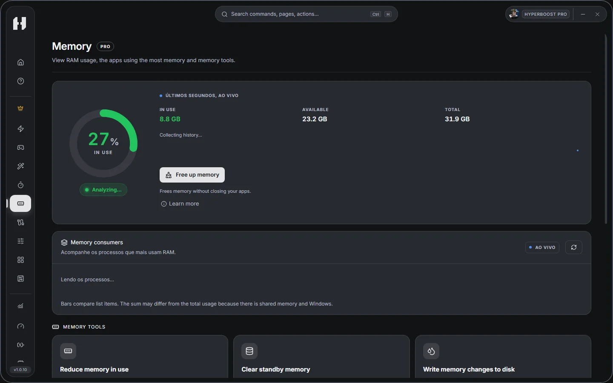

[See the guide and questions](https://www.hyperboostapps.com/ferramentas/memory?lang=en)

<strong>Network settings</strong> · Pro

Compare DNS options on your connection and keep network settings in one place. Choose using results from your own PC.

**When to use:** When you want to compare available connection options and choose which to use on your computer.

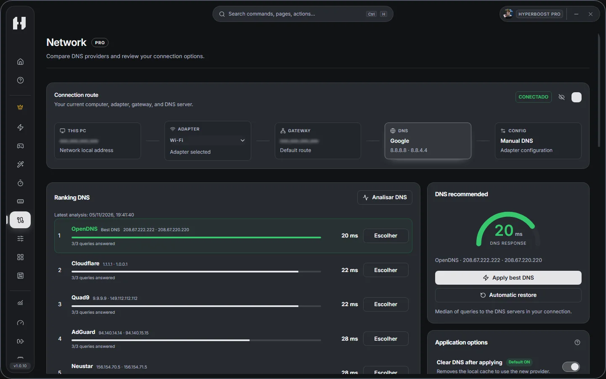

[See the guide and questions](https://www.hyperboostapps.com/ferramentas/network-settings?lang=en)

<strong>Tweaks</strong> · Pro

Make Windows fit the way you use your PC. Find settings grouped by category, with explanations to help you decide what to change.

**When to use:** When you want to personalize Windows beyond common settings and understand each choice.

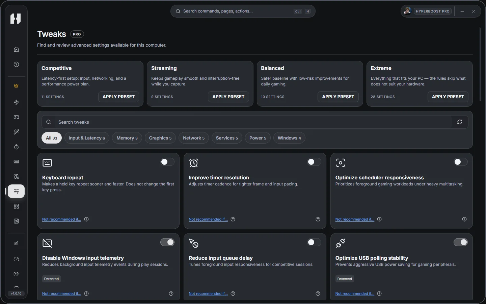

[See the guide and questions](https://www.hyperboostapps.com/ferramentas/tweaks?lang=en)

<strong>Windows settings</strong> · Pro

Organize Windows features and preferences without visiting multiple panels. Choose what you want to keep in your routine.

**When to use:** When setting up a new PC or adapting Windows for work, study and gaming.

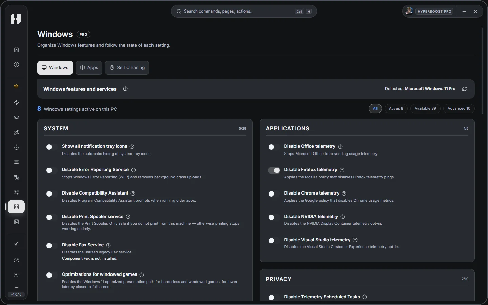

[See the guide and questions](https://www.hyperboostapps.com/ferramentas/windows-settings?lang=en)

<strong>Hardware and BIOS</strong> · Pro

Get to know your hardware and see the findings HyperBoost can confirm. Review them without entering the BIOS or changing its settings.

**When to use:** Before asking for support, planning a hardware upgrade or checking your computer configuration.

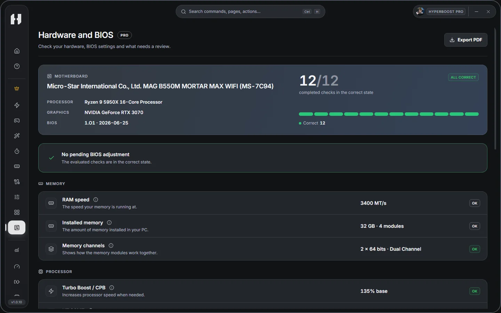

[See the guide and questions](https://www.hyperboostapps.com/ferramentas/hardware-and-bios?lang=en)

## Performance

<strong>Optimization</strong> · Free

Choose what you want to organize on your PC and go straight to the right tool. Find shortcuts for power, startup, privacy and other tasks.

**When to use:** When you know what you want to do on your PC but are not sure which tool to open.

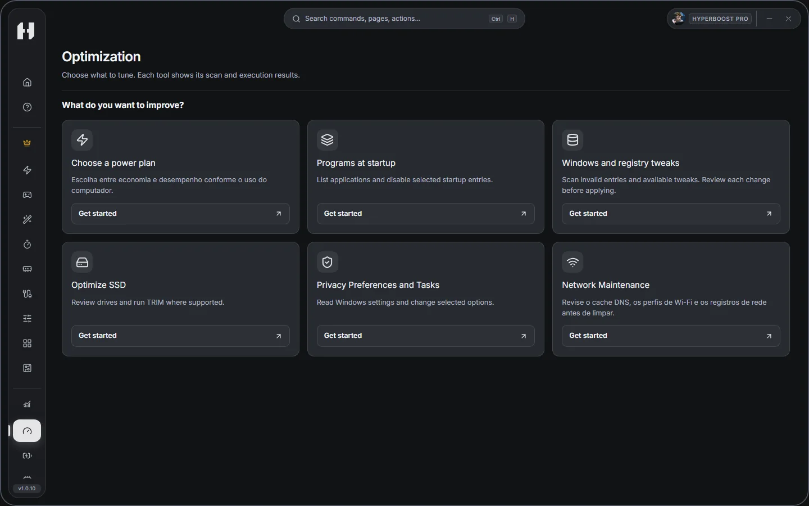

[See the guide and questions](https://www.hyperboostapps.com/ferramentas/optimization?lang=en)

<strong>Power plans</strong> · Free

Choose how your PC uses power for work or gaming. Switch between available plans and return to the previous one when your needs change.

**When to use:** When switching between gaming, work and battery use, depending on the plans available on your PC.

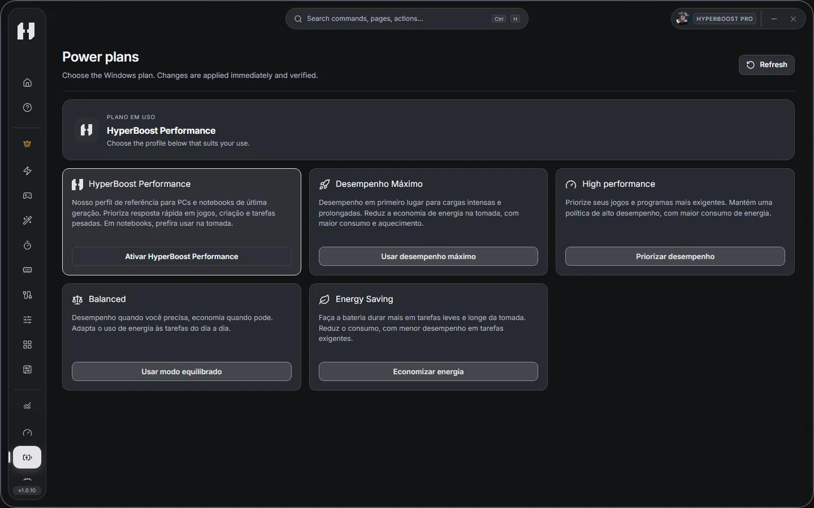

[See the guide and questions](https://www.hyperboostapps.com/ferramentas/power-plans?lang=en)

<strong>My computer</strong> · Free

Find out what is inside your PC without opening the case. Check the processor, graphics card, memory and drives to plan your next steps.

**When to use:** Before buying hardware, installing a game or sharing your configuration with support.

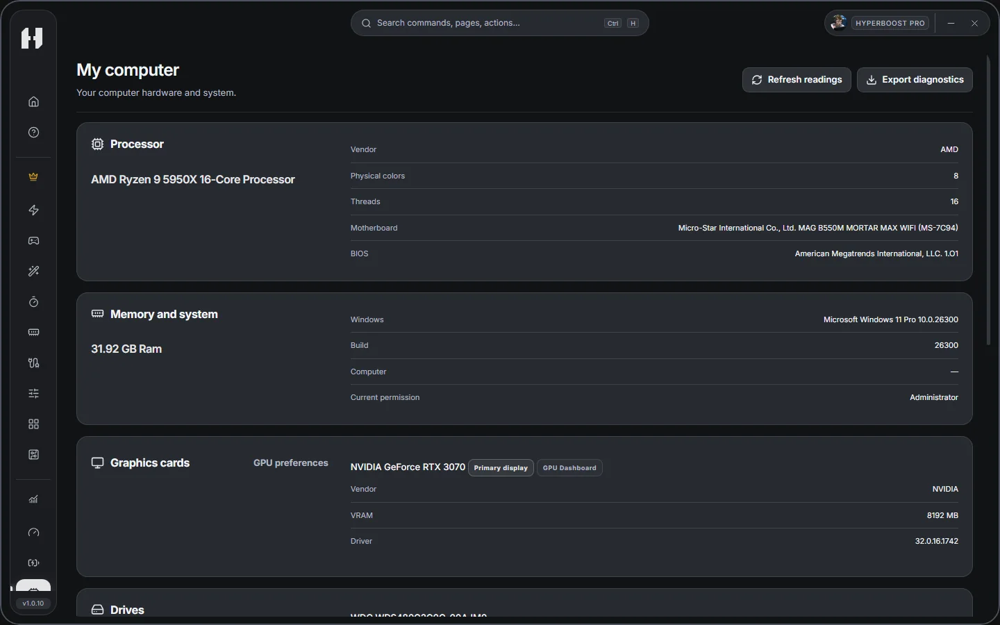

[See the guide and questions](https://www.hyperboostapps.com/ferramentas/my-computer?lang=en)

<strong>Monitoring</strong> · Free

See what is demanding resources while you use your PC. Follow live charts and find the apps using the most resources.

**When to use:** When your PC seems busy, an app feels slow or you want to follow resource use during a task.

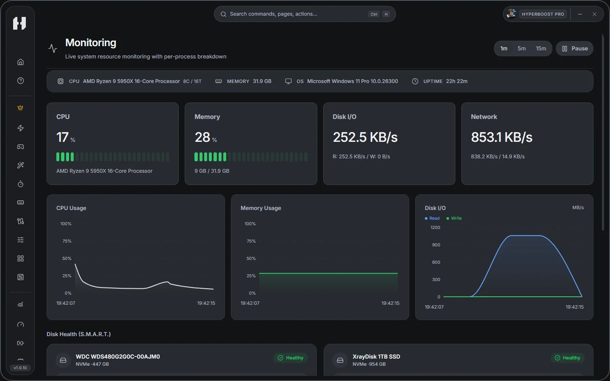

[See the guide and questions](https://www.hyperboostapps.com/ferramentas/monitoring?lang=en)

<strong>Peripheral tests</strong> · Free

Test your accessories before replacing hardware or starting a call. Check your keyboard, mouse, controller, audio, camera and screen in one place.

**When to use:** When connecting a new accessory, investigating a fault or preparing for a call or game.

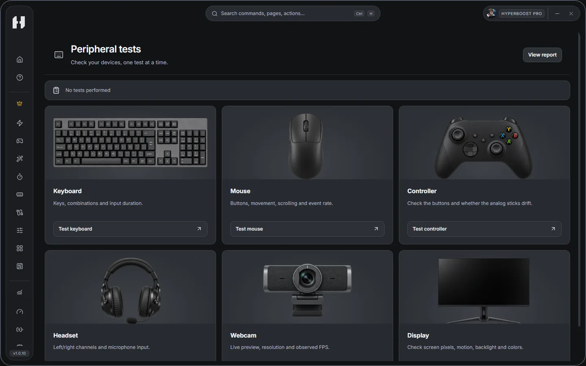

[See the guide and questions](https://www.hyperboostapps.com/ferramentas/peripheral-tests?lang=en)

<strong>Internet test</strong> · Free

Check your connection without leaving HyperBoost. Use measurements to investigate slowdowns and compare your internet at different times.

**When to use:** When browsing, a call or a game feels slow and you want to check your connection.

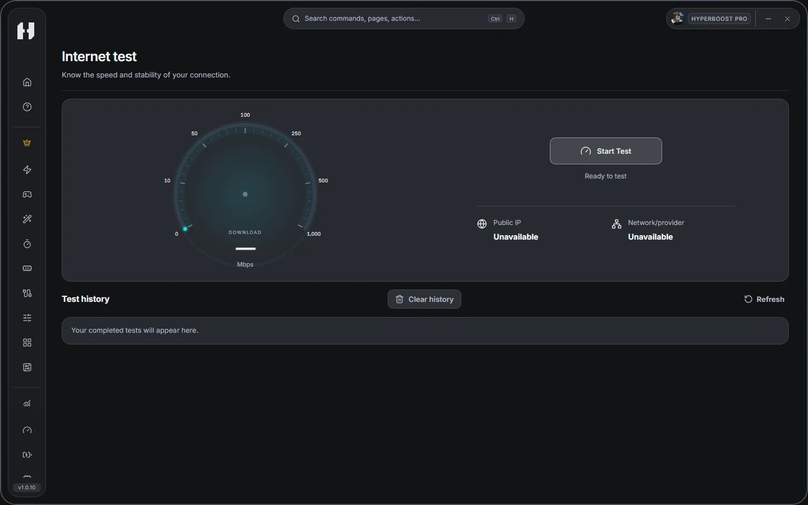

[See the guide and questions](https://www.hyperboostapps.com/ferramentas/internet-test?lang=en)

<strong>Network maintenance</strong> · Free

Find tools to maintain your connection when problems arise. Keep network-data cleanup and saved-network management together.

**When to use:** When investigating connection problems or organizing networks you no longer use.

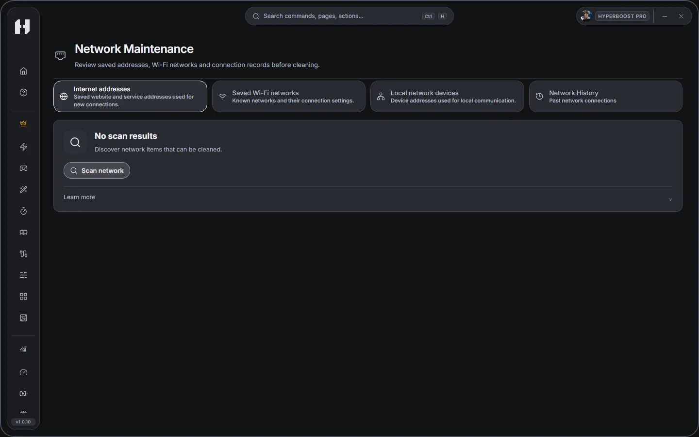

[See the guide and questions](https://www.hyperboostapps.com/ferramentas/network-maintenance?lang=en)

<strong>Keyboard test</strong> · Free

A key not responding as expected? See which keys your PC recognizes before deciding to replace the keyboard.

**When to use:** When testing a new keyboard or investigating a faulty key.

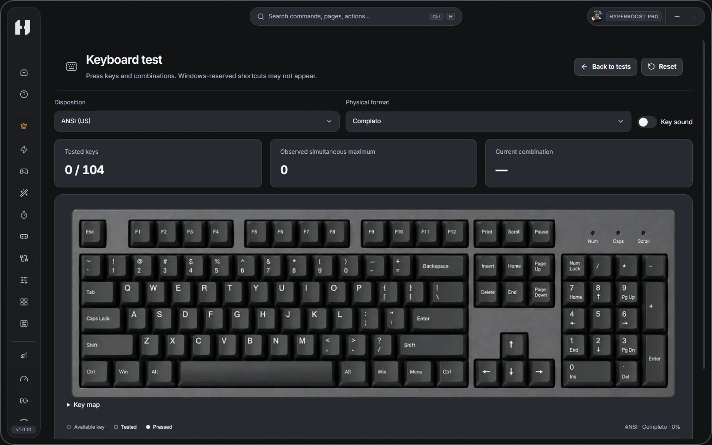

[See the guide and questions](https://www.hyperboostapps.com/ferramentas?lang=en&ferramenta=keyboard)

<strong>Mouse test</strong> · Free

Check your mouse clicks and movement with a guided test. Investigate unusual behavior before replacing the accessory.

**When to use:** When a mouse button or movement seems different from what you expect.

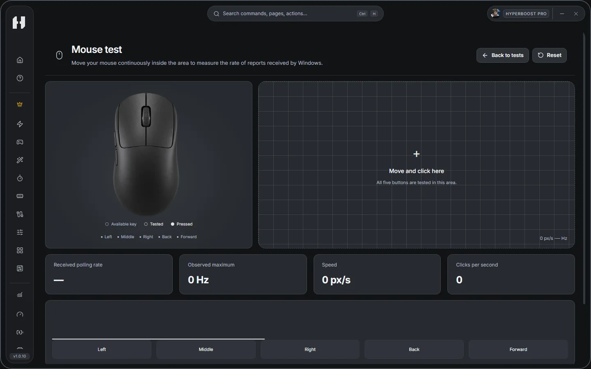

[See the guide and questions](https://www.hyperboostapps.com/ferramentas?lang=en&ferramenta=mouse)

<strong>Controller test</strong> · Free

Get your controller ready to play. Check whether your PC recognizes commands from the connected device.

**When to use:** When connecting a controller or investigating a command that does not respond as expected.

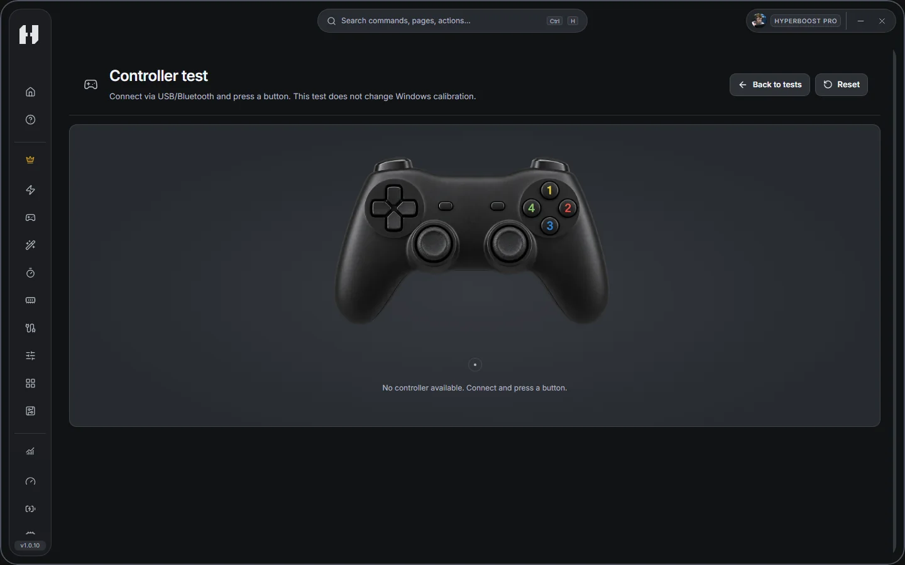

[See the guide and questions](https://www.hyperboostapps.com/ferramentas?lang=en&ferramenta=controller)

<strong>Audio test</strong> · Free

Test audio and microphone before a call or game. Check available devices and run sound tests in HyperBoost.

**When to use:** Before a call, stream or game with voice chat.

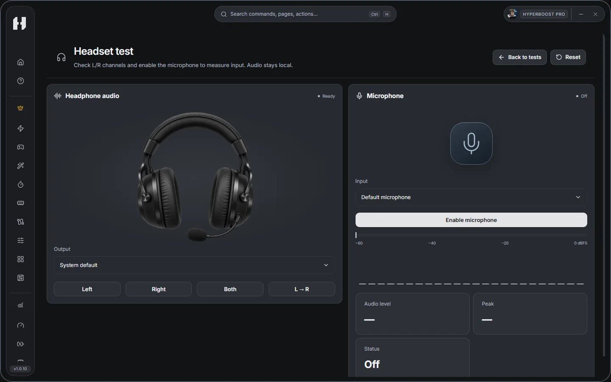

[See the guide and questions](https://www.hyperboostapps.com/ferramentas?lang=en&ferramenta=headset)

<strong>Camera test</strong> · Free

Check your camera image before a meeting or stream. The preview starts only when you begin and allow access.

**When to use:** Before a meeting or when checking a newly connected camera.

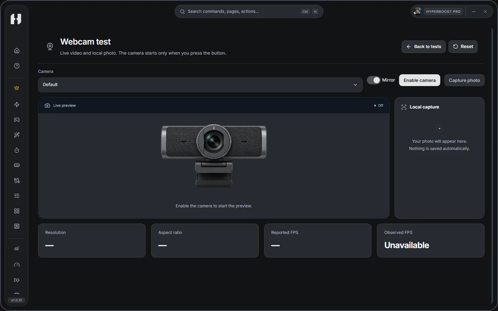

[See the guide and questions](https://www.hyperboostapps.com/ferramentas?lang=en&ferramenta=webcam)

<strong>Display test</strong> · Free

Check your screen with visual test patterns. Inspect colors and look for visible spots or differences on the display.

**When to use:** When testing a new monitor or noticing something unusual in its colors or image.

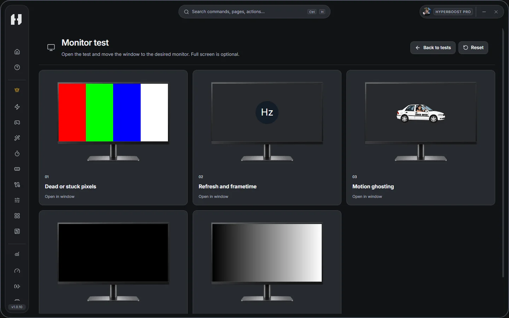

[See the guide and questions](https://www.hyperboostapps.com/ferramentas?lang=en&ferramenta=display)

<strong>Peripheral results</strong> · Free

See the results of your completed tests in one place. Review which accessories you tested and what still needs checking.

**When to use:** After testing your accessories when you want to review the results together.

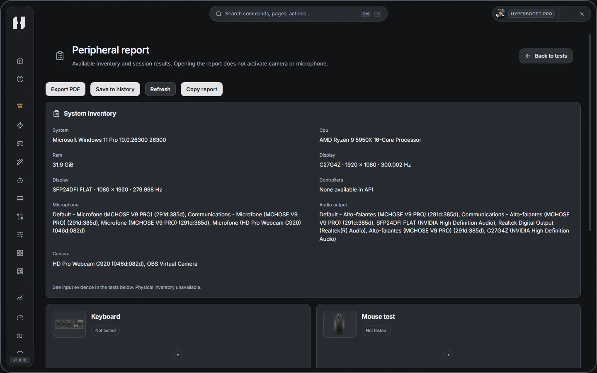

[See the guide and questions](https://www.hyperboostapps.com/ferramentas?lang=en&ferramenta=peripheral-report)

## Maintenance

<strong>Cleanup</strong> · Free

Make room for what matters. Find unnecessary files and choose what to remove before starting cleanup.

**When to use:** When your drive is filling up or you want to organize files that build up with daily use.

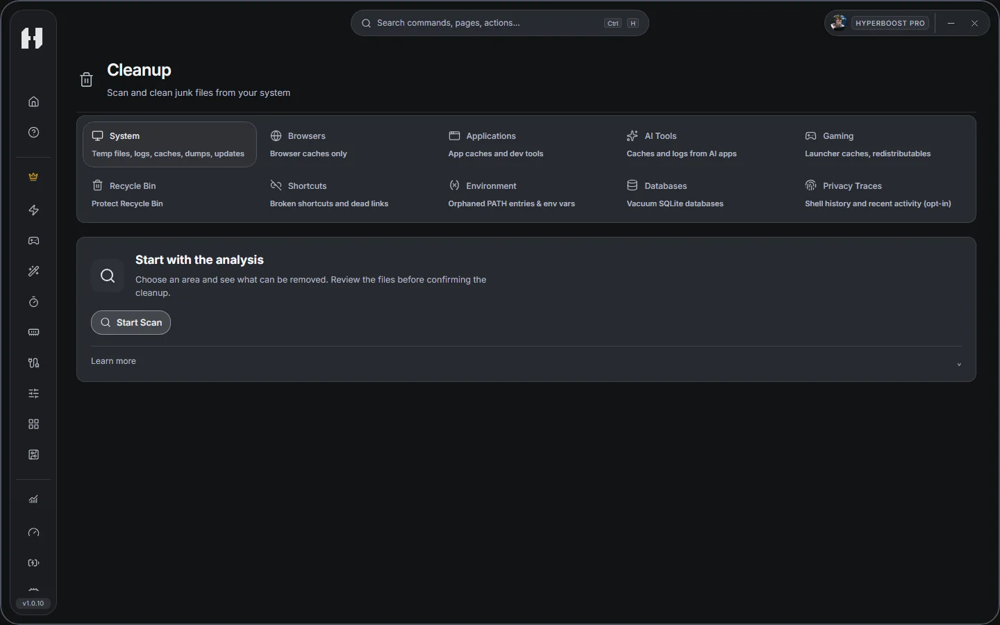

[See the guide and questions](https://www.hyperboostapps.com/ferramentas/cleanup?lang=en)

<strong>Startup</strong> · Free

Choose which apps need to open with Windows. Keep only what makes sense for your daily routine in startup.

**When to use:** When too many apps open as you start your PC or you want to review automatic startup.

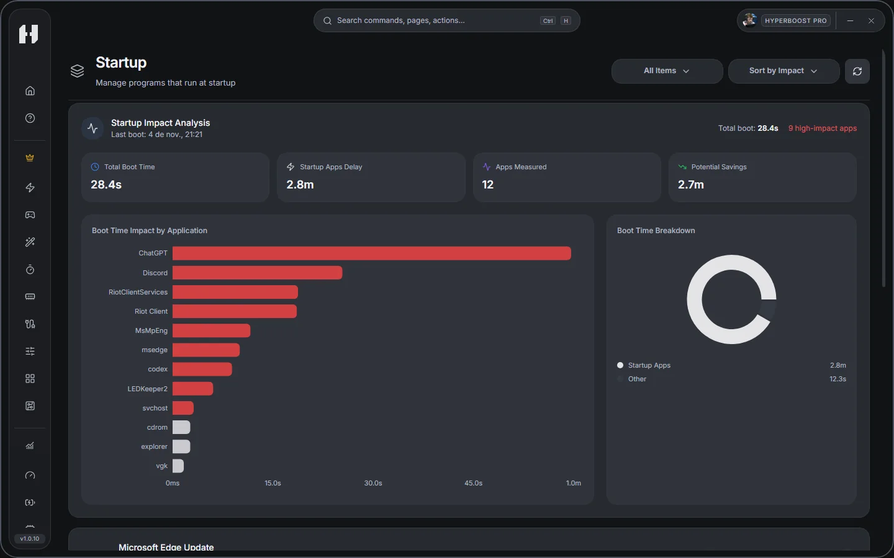

[See the guide and questions](https://www.hyperboostapps.com/ferramentas/startup?lang=en)

<strong>Disk scanner</strong> · Free

Find out where your drive space went. See which files and folders take the most space before deciding what to organize.

**When to use:** When your drive is full and you do not yet know which folders or files are taking space.

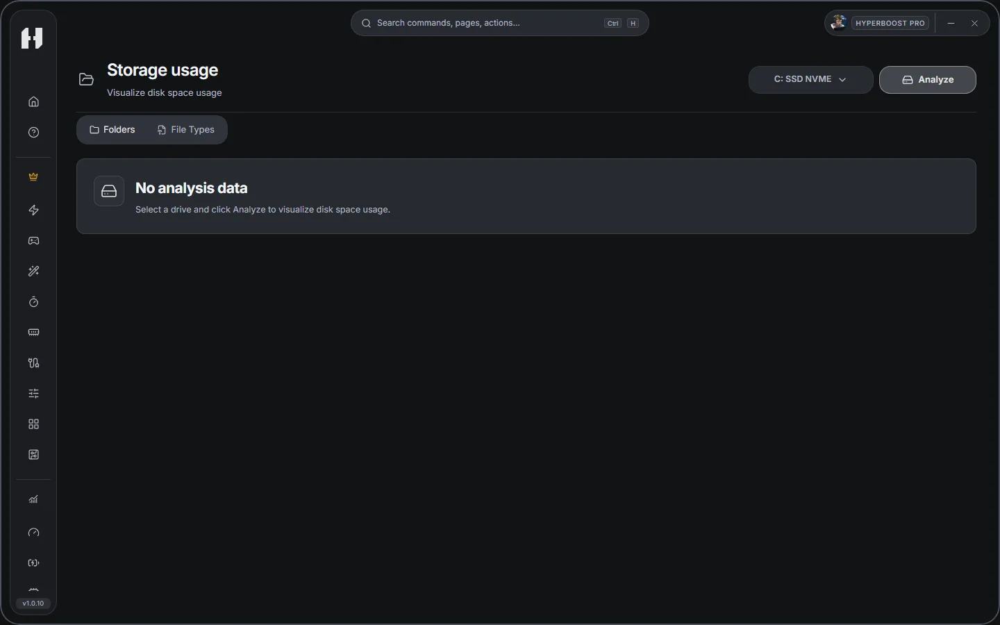

[See the guide and questions](https://www.hyperboostapps.com/ferramentas/disk-scanner?lang=en)

<strong>Storage</strong> · Free

Find the right way to organize storage. Reach space-analysis, duplicate-file and maintenance tools without searching through the whole app.

**When to use:** When you need to free or organize space and want to choose the right tool to start.

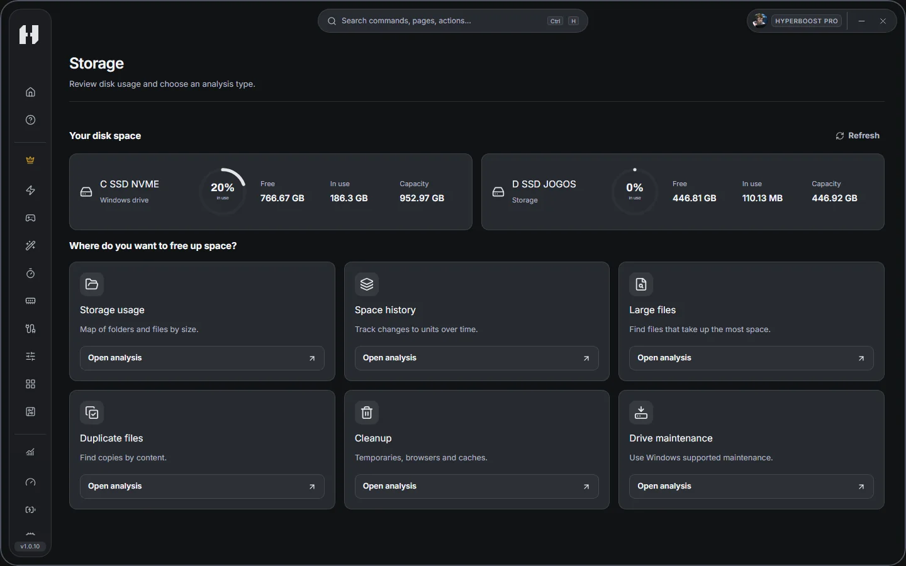

[See the guide and questions](https://www.hyperboostapps.com/ferramentas/storage?lang=en)

<strong>Storage history</strong> · Free

Understand what changed in your folders between scans. Compare records to investigate why used space increased.

**When to use:** When a folder is growing and you want to compare its contents at different times.

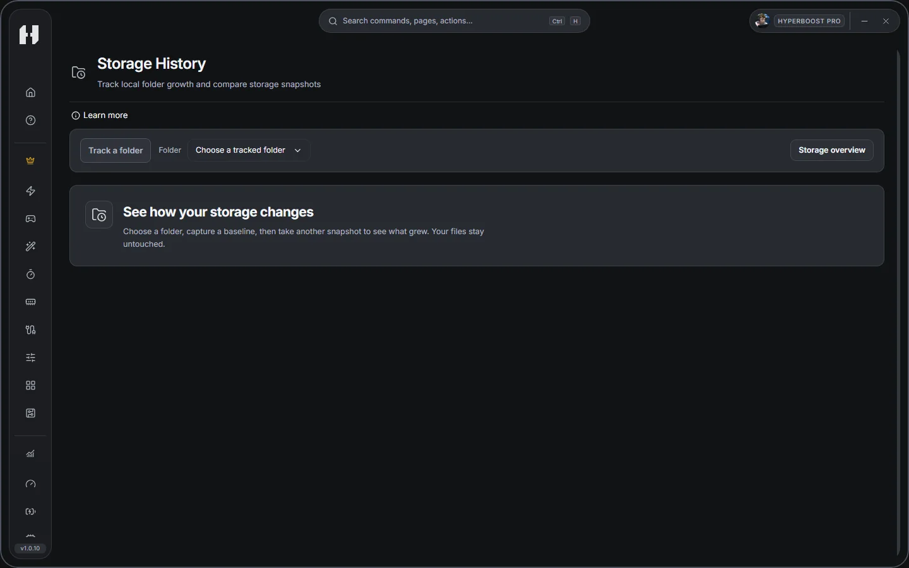

[See the guide and questions](https://www.hyperboostapps.com/ferramentas/storage-history?lang=en)

<strong>Tools</strong> · Free

Keep everyday utilities close at hand. Find shortcuts for maintaining Windows, checking your PC and working with files.

**When to use:** When you need a Windows tool or utility without searching in different places.

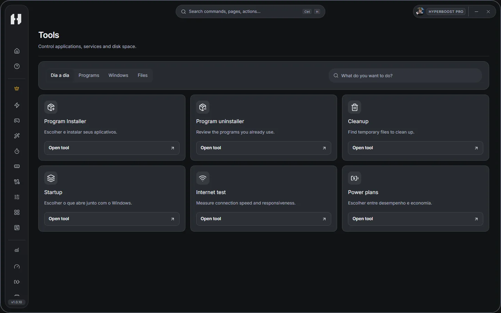

[See the guide and questions](https://www.hyperboostapps.com/ferramentas/tools?lang=en)

<strong>Schedules</strong> · Free

Let available tasks follow your routine. Choose when they run, set their frequency and follow what was completed.

**When to use:** When you want to repeat an available task without remembering to start it manually each time.

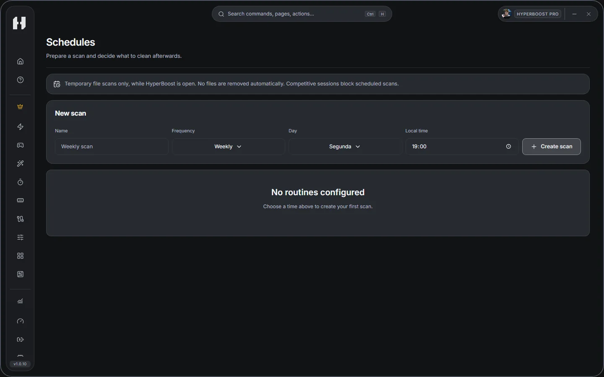

[See the guide and questions](https://www.hyperboostapps.com/ferramentas/schedules?lang=en)

<strong>Registry and settings</strong> · Free

Keep analysis and review of Windows entries in one place. Inspect findings and choose what to change with a backup.

**When to use:** When there is a reason to investigate Windows entries and you want to review findings before making changes.

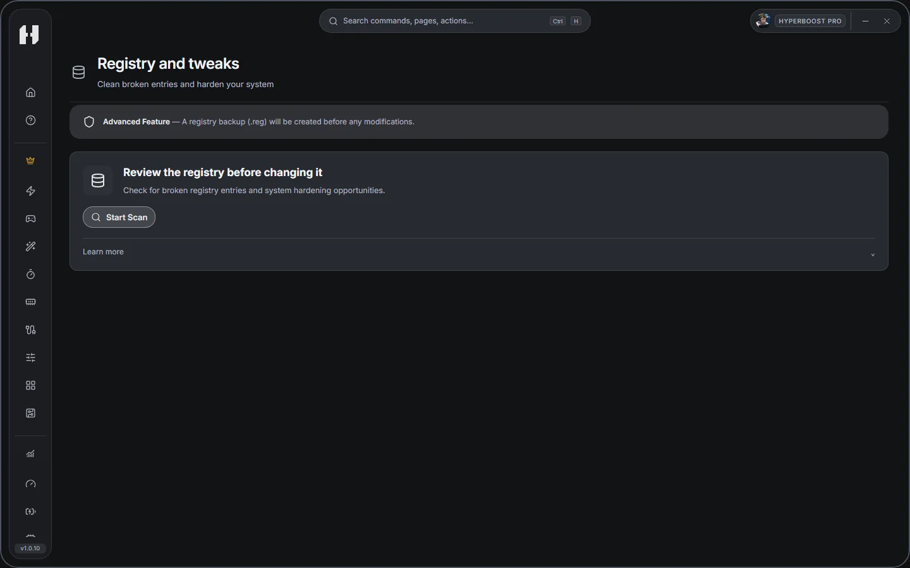

[See the guide and questions](https://www.hyperboostapps.com/ferramentas/registry-and-settings?lang=en)

<strong>Privacy</strong> · Free

Choose how you use Windows privacy features. Keep advertising, search and sync preferences together without hunting through panels.

**When to use:** When personalizing Windows or reviewing the advertising, search and sync features you want to use.

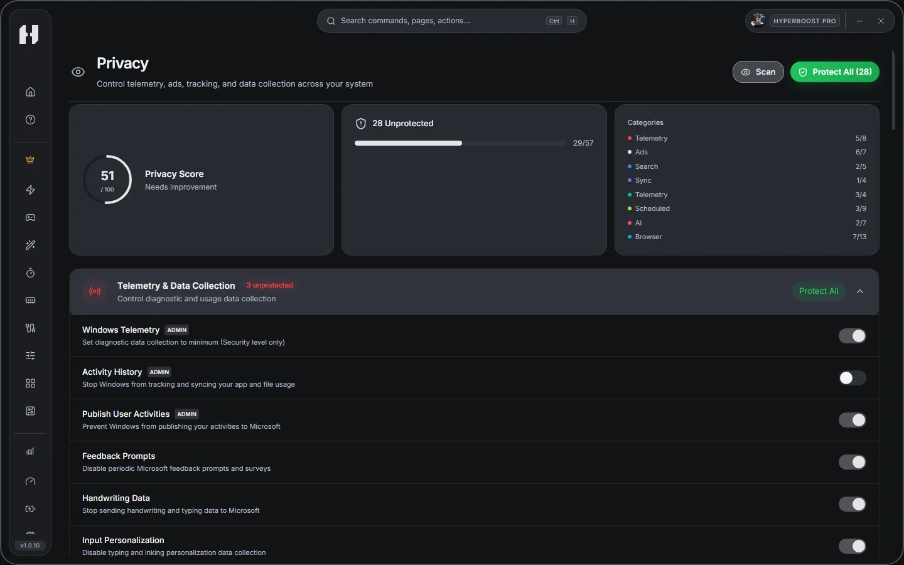

[See the guide and questions](https://www.hyperboostapps.com/ferramentas/privacy?lang=en)

<strong>Firewall</strong> · Free

Understand Windows connection permissions for your apps. Find rules worth reviewing and decide what to keep.

**When to use:** When reviewing app network permissions or investigating a rule you do not recognize.

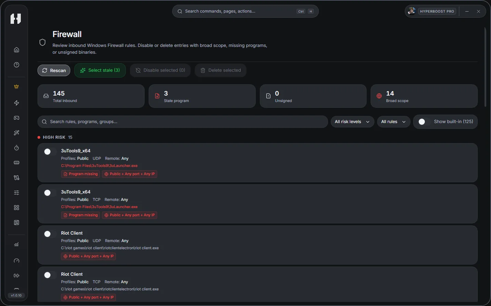

[See the guide and questions](https://www.hyperboostapps.com/ferramentas/firewall?lang=en)

<strong>File inspection</strong> · Free

Investigate suspicious files with the checks available in HyperBoost. Review the findings to decide your next step while keeping your antivirus active.

**When to use:** When a file seems suspicious and you want more information before deciding what to do.

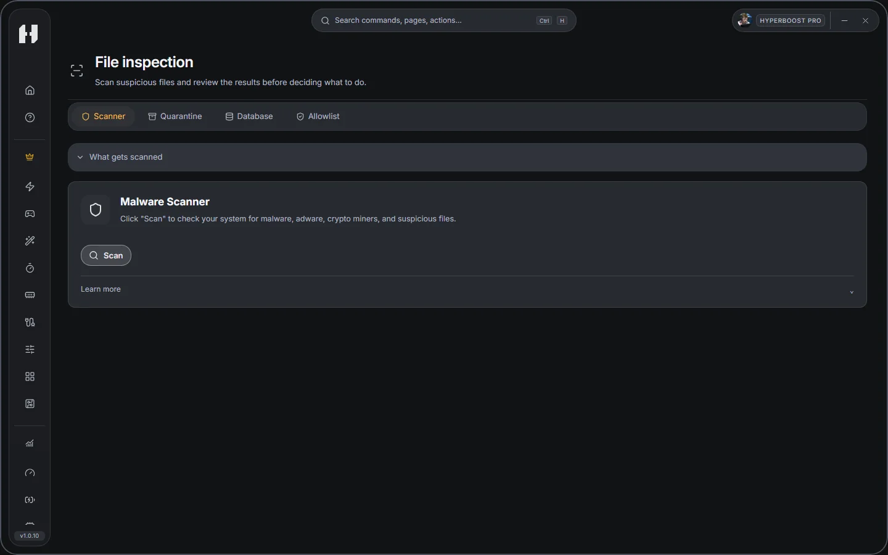

[See the guide and questions](https://www.hyperboostapps.com/ferramentas/file-inspection?lang=en)

<strong>Services</strong> · Free

Find and manage services running in Windows. See what is active before adjusting how each service starts.

**When to use:** When you need to find a specific service or check its state while following support guidance.

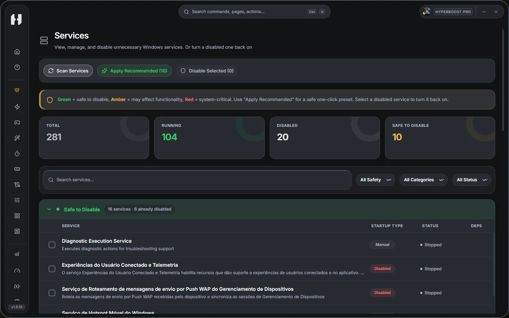

[See the guide and questions](https://www.hyperboostapps.com/ferramentas/services?lang=en)

<strong>Duplicate files</strong> · Free

Find repeated copies taking up space. Compare files and choose which to keep before removing those you do not need.

**When to use:** After copying photos, documents or backups when you suspect your folders contain duplicate files.

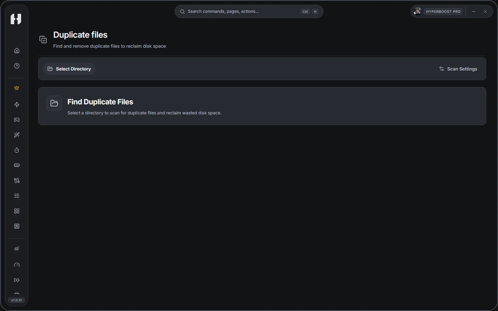

[See the guide and questions](https://www.hyperboostapps.com/ferramentas/duplicate-files?lang=en)

<strong>Large files</strong> · Free

Find the files taking the most space without opening every folder. See what to organize before installing another game or app.

**When to use:** When you need room for a game, app or download and want to locate the largest files.

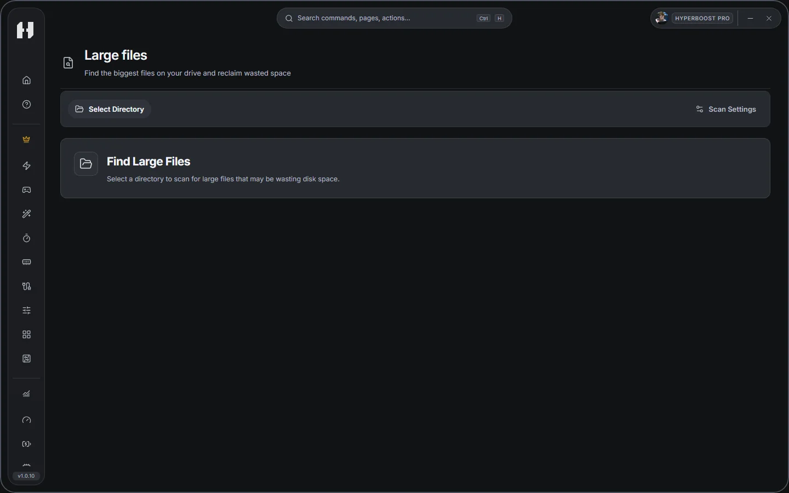

[See the guide and questions](https://www.hyperboostapps.com/ferramentas/large-files?lang=en)

<strong>Empty folders</strong> · Free

Organize folders left empty after moving or removing files. Find their locations and choose which you no longer need.

**When to use:** After reorganizing your files when you want to check which folders were left empty.

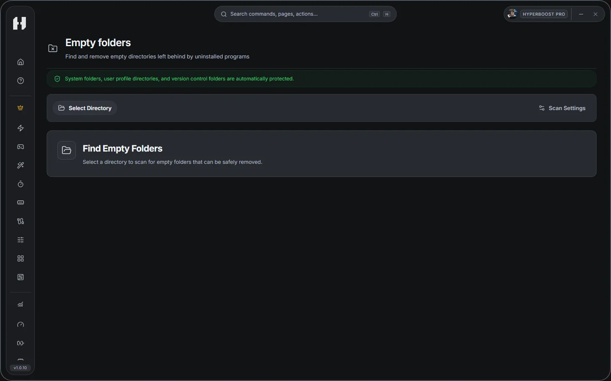

[See the guide and questions](https://www.hyperboostapps.com/ferramentas/empty-folders?lang=en)

<strong>Drive maintenance</strong> · Free

Maintain your drives with options available in Windows. Choose a drive and follow an action suited to its type.

**When to use:** When you want to check maintenance available for an SSD or another drive on your computer.

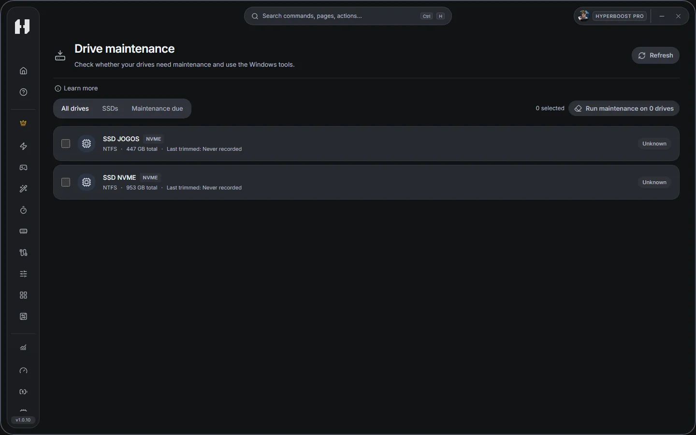

[See the guide and questions](https://www.hyperboostapps.com/ferramentas/drive-maintenance?lang=en)

<strong>Repair Windows and disk</strong> · Free

Investigate Windows and drive problems without typing commands. Access available checks and repairs and follow the result.

**When to use:** When Windows shows errors and you need a guided check before considering bigger changes.

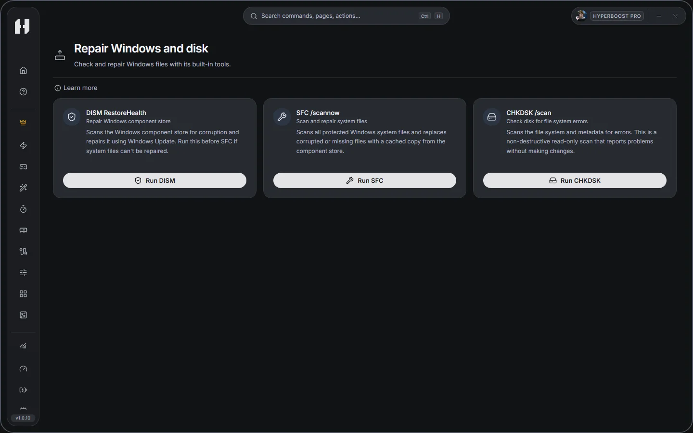

[See the guide and questions](https://www.hyperboostapps.com/ferramentas/repair-windows-and-disk?lang=en)

<strong>Delete files</strong> · Free

Delete selected files with a review before starting. Use it only when you are sure: this tool does not offer restoration.

**When to use:** When you are certain you no longer need the files and want deletion with no HyperBoost restore option.

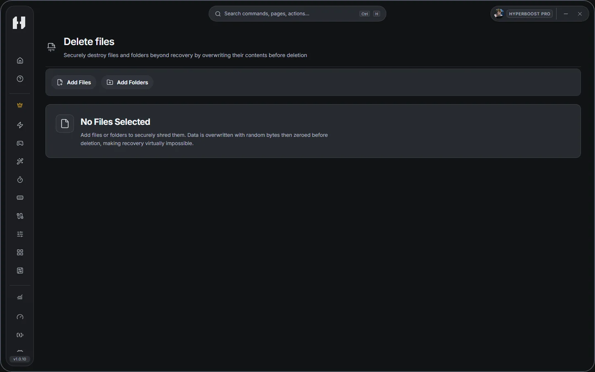

[See the guide and questions](https://www.hyperboostapps.com/ferramentas/delete-files?lang=en)

## Software

<strong>Driver updates</strong> · Free

Look for updates for your PC devices without checking each one separately. Review the options found and choose which to install.

**When to use:** When preparing a newly configured PC or checking for updates for a device.

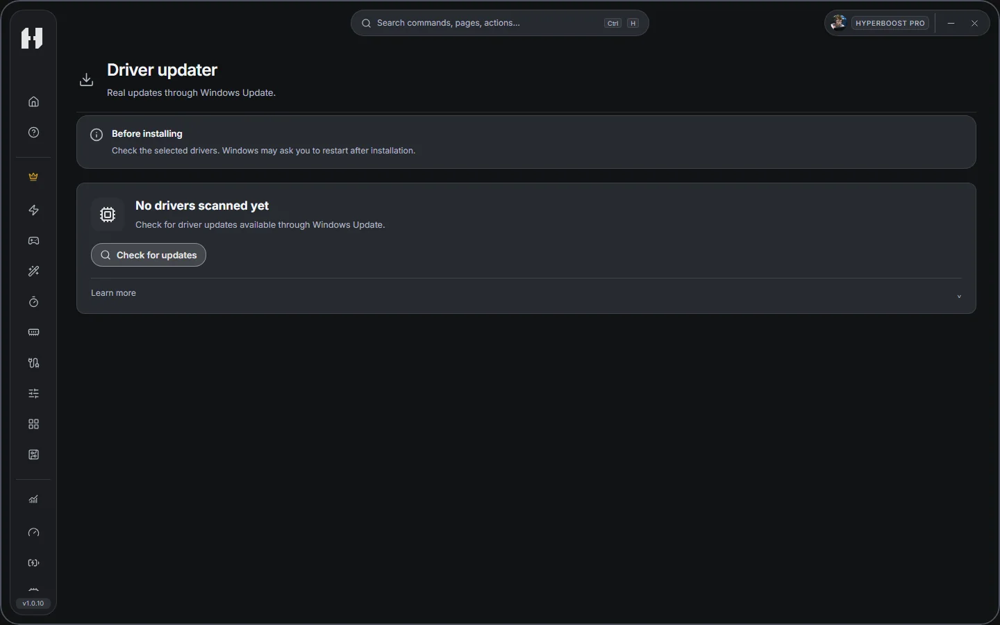

[See the guide and questions](https://www.hyperboostapps.com/ferramentas/driver-updates?lang=en)

<strong>Driver manager</strong> · Free

Organize drivers already on your computer. Review detected packages and identify older ones that can be removed.

**When to use:** After changing hardware or when you want to organize driver packages left on your PC.

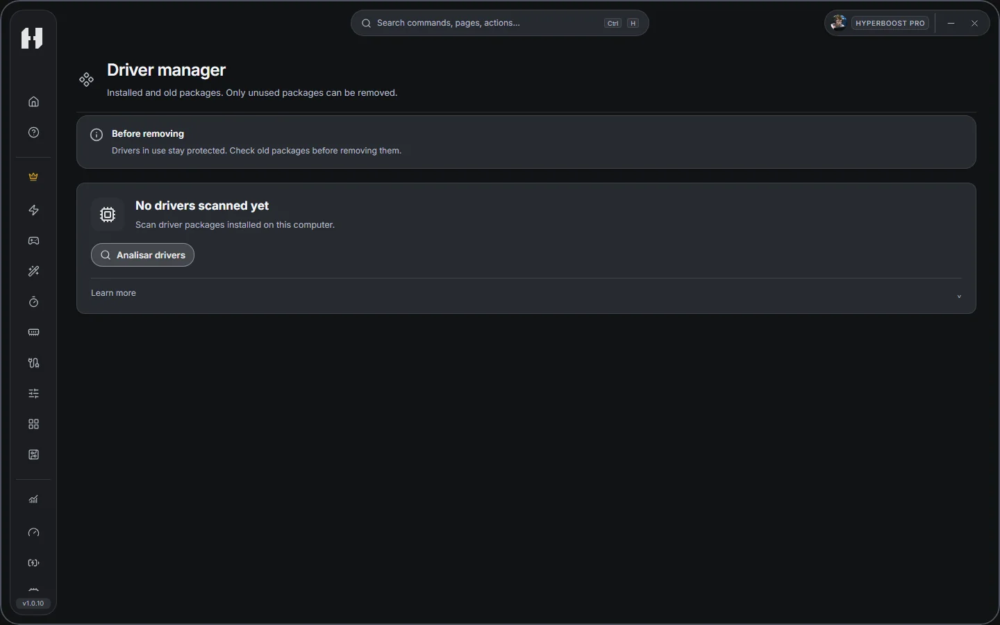

[See the guide and questions](https://www.hyperboostapps.com/ferramentas/driver-manager?lang=en)

<strong>Uninstall apps</strong> · Free

Find apps you no longer use and start removing them from HyperBoost. Organize your software without locating each uninstaller yourself.

**When to use:** When you want to remove unused software or organize installed apps.

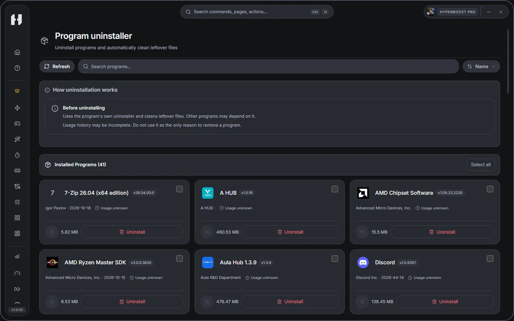

[See the guide and questions](https://www.hyperboostapps.com/ferramentas/uninstall-apps?lang=en)

<strong>Install apps</strong> · Free

Find and install available apps directly from HyperBoost, without searching for downloads in a browser. Ideal for setting up a freshly formatted PC or adding everyday software.

**When to use:** After formatting your PC, switching computers or whenever you want to install several apps without visiting each website.

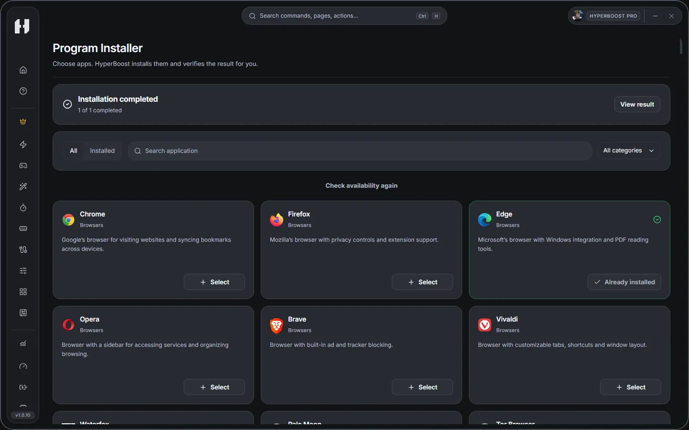

[See the guide and questions](https://www.hyperboostapps.com/ferramentas/install-apps?lang=en)

<strong>Remove preinstalled apps</strong> · Free

Choose which preinstalled apps to keep on your PC. Find those you do not use and remove eligible items in one place.

**When to use:** When setting up a new or freshly formatted PC with preinstalled apps you do not use.

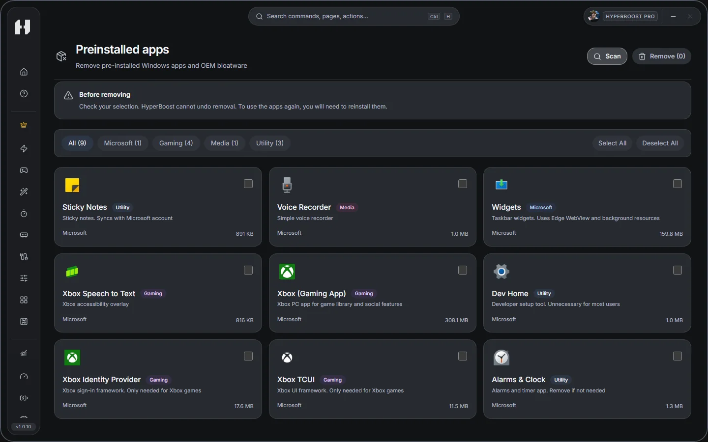

[See the guide and questions](https://www.hyperboostapps.com/ferramentas/remove-preinstalled-apps?lang=en)

<strong>Context menu</strong> · Free

Keep the right-click menu organized. Choose which entries to keep without uninstalling the related apps.

**When to use:** When the right-click menu is crowded with options you do not use.

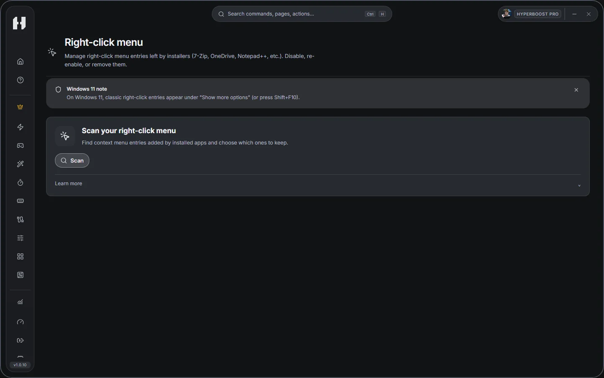

[See the guide and questions](https://www.hyperboostapps.com/ferramentas/context-menu?lang=en)

<strong>App updates</strong> · Free

Find app updates in one place. Choose which recognized programs to update without checking them one by one.

**When to use:** When you want to update programs recognized by HyperBoost without opening each app to check.

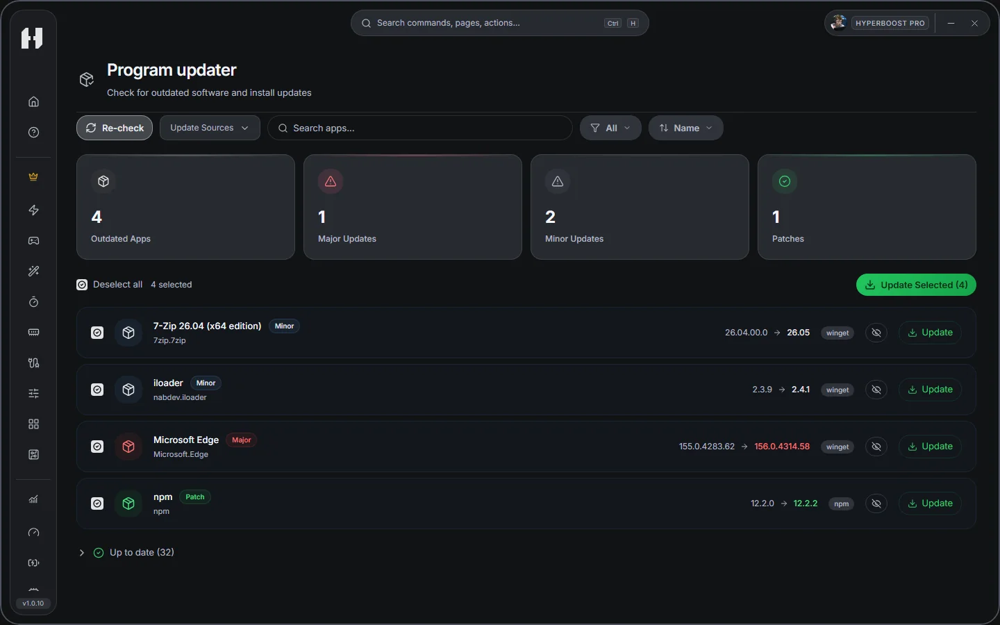

[See the guide and questions](https://www.hyperboostapps.com/ferramentas/app-updates?lang=en)

## Activity and recovery

<strong>Recovery</strong> · Free

Changed a setting and want to go back? Find changes with backups and restore the state saved by HyperBoost when that option is available.

**When to use:** When you want to undo a backed-up change or check a pending recovery.

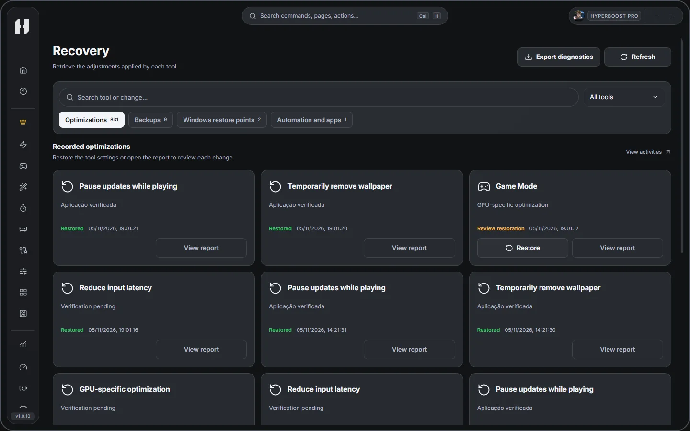

[See the guide and questions](https://www.hyperboostapps.com/ferramentas/recovery?lang=en)

<strong>Activity</strong> · Free

See what HyperBoost did on your PC. Find completed tasks and check their timing, results and available details.

**When to use:** When you want to confirm a cleanup, review an installation or understand a task result.

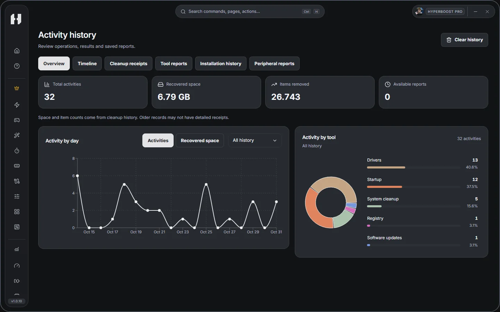

[See the guide and questions](https://www.hyperboostapps.com/ferramentas/activity?lang=en)

## Explore the app

<strong>Home</strong> · Free

See your PC at a glance: follow resource use and find your next step to organize the system.

**When to use:** When you open HyperBoost and want to know where to start without checking every tool.

[See the guide and questions](https://www.hyperboostapps.com/ferramentas?lang=en&ferramenta=home)

<strong>Settings</strong> · Free

Make HyperBoost your own. Choose its theme, language, window size and preferences to suit the way you use the app.

**When to use:** When you want to adjust the appearance and behavior of HyperBoost itself.

[See the guide and questions](https://www.hyperboostapps.com/ferramentas?lang=en&ferramenta=settings)

